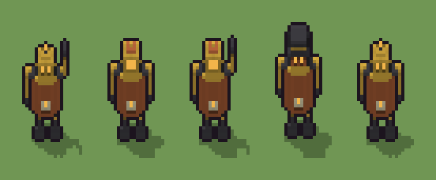

# Automa a molla (`steampunk-automa-a-molla.xml`)

Classe `persona`, scatola 20 × 15 × 30 voxel, ambientazione `steampunk (orichalcum)`.

Un automa dal corpo a botte di rame cerchiato d'ottone, con la chiave della carica sulla schiena e gli occhi ambrati. Il seme sceglie l'altezza del corpo, la posa delle braccia e la testa (cupola, cilindro o lanterna).

## Esito

- validatore (`modelErrors`, `checkProgram`, `analyse` a ogni seme): nessun errore, nessun frammento staccato
- varianza su 5 semi (voxel pieni in un seme e vuoti nell'altro, sui pieni in almeno uno; il colore non conta): **media 0.178**, minima 0.037, massima 0.294 (soglia 0.15) → passa
- voxel per seme: 846, 923, 924, 1070, 847; tempo per seme: 14, 15, 14, 15, 14 ms
- avvisi: tocca i bordi laterali della griglia: forse è tagliato; colori mai usati: Q; tocca il soffitto della griglia: forse è tagliato in alto

| coppia | 1-2 | 1-3 | 1-4 | 1-5 | 2-3 | 2-4 | 2-5 | 3-4 | 3-5 | 4-5 |
|---|---|---|---|---|---|---|---|---|---|---|
| distanza | 0.184 | 0.160 | 0.294 | 0.212 | 0.037 | 0.198 | 0.086 | 0.218 | 0.122 | 0.270 |



## Traccia di tre semi a confronto

La traccia di `src/mj/trace.ts` (forma `nodi`): per ogni nodo quante volte gira, quante celle scrive e la scatola di ciò che scrive. Le
righe che cambiano fra i semi sono le scelte del programma.

### Seme 1

```text
Traccia, seme 1: griglia 20×15×30, 36 nodi, 88 passi, finito in 16 ms.
x sinistra→destra, y fondo→davanti, z basso→alto; «.» è la cella vuota; #n è il nodo nell'ordine dell'XML; ×n quante volte ha agito.
Lettere: C=rame, O=ottone, E=ghisa, A=vetro ambrato acceso, G=quadrante, D=legno scuro, Q=rame dell'asse, h=altezze possibili (marcatore), k=la quota scelta (marcatore), s=le spalle (marcatore), w=la pancia possibile (marcatore), m=il dado della pancia (marcatore), X=pancia sì (marcatore).
Alla fine: C 554, O 187, E 75, D 21, G 5, A 4.
#2-15 box×10, cylinder×2: 1465 celle x0-15 y0-11 z0-25, passi 1-12
#16-19 one×1, all×3: 305 celle x0-19 y0-14 z16-21, passi 13-52
 #20 all [.COQwmk] k → k k: ×10, 3000 celle x0-19 y0-14 z20-29, passi 53-62, .→k 2554, C→k 300, w→k 140, Q→k 6
 #21 all k → .: ×1, 3300 celle x0-19 y0-14 z19-29, passi 63, k→. 3300
#22-24 one×1, all×2: 100 celle x8-12 y3 z9-18, passi 64-77
 #25 all [wY] → .: ×1, 230 celle x5-15 y4-11 z9-18, passi 78, w→. 230
#26-35 all×3, box×5, one×2: 283 celle x4-16 y0-11 z8-26, passi 79-88
Senza effetto (non hanno mai cambiato una cella):
#12 cylinder at 10 7 10 size 10 8 1 O su .
#13 cylinder at 10 7 14 size 10 8 1 O su .
#36 all s → E: in quel momento nella griglia non c'erano celle "s"
```

### Seme 2

```text
Traccia, seme 2: griglia 20×15×30, 36 nodi, 89 passi, finito in 15 ms.
x sinistra→destra, y fondo→davanti, z basso→alto; «.» è la cella vuota; #n è il nodo nell'ordine dell'XML; ×n quante volte ha agito.
Lettere: C=rame, O=ottone, E=ghisa, A=vetro ambrato acceso, G=quadrante, D=legno scuro, Q=rame dell'asse, h=altezze possibili (marcatore), k=la quota scelta (marcatore), s=le spalle (marcatore), w=la pancia possibile (marcatore), m=il dado della pancia (marcatore), X=pancia sì (marcatore).
Alla fine: C 619, O 143, E 71, A 64, D 21, G 5.
#2-15 box×10, cylinder×2: 1465 celle x0-15 y0-11 z0-25, passi 1-12
#16-19 one×1, all×3: 305 celle x0-19 y0-14 z16-21, passi 13-53
 #20 all [.COQwmk] k → k k: ×9, 2700 celle x0-19 y0-14 z21-29, passi 54-62, .→k 2333, C→k 250, w→k 112, Q→k 5
 #21 all k → .: ×1, 3000 celle x0-19 y0-14 z20-29, passi 63, k→. 3000
#22-24 one×1, all×2: 110 celle x8-12 y3 z9-19, passi 64-78
 #25 all [wY] → .: ×1, 253 celle x5-15 y4-11 z9-19, passi 79, w→. 253
#26-35 all×3, box×5, one×2: 305 celle x4-16 y0-11 z8-27, passi 80-89
Senza effetto (non hanno mai cambiato una cella):
#12 cylinder at 10 7 10 size 10 8 1 O su .
#13 cylinder at 10 7 14 size 10 8 1 O su .
#36 all s → E: in quel momento nella griglia non c'erano celle "s"
```

### Seme 3

```text
Traccia, seme 3: griglia 20×15×30, 36 nodi, 89 passi, finito in 16 ms.
x sinistra→destra, y fondo→davanti, z basso→alto; «.» è la cella vuota; #n è il nodo nell'ordine dell'XML; ×n quante volte ha agito.
Lettere: C=rame, O=ottone, E=ghisa, A=vetro ambrato acceso, G=quadrante, D=legno scuro, Q=rame dell'asse, h=altezze possibili (marcatore), k=la quota scelta (marcatore), s=le spalle (marcatore), w=la pancia possibile (marcatore), m=il dado della pancia (marcatore), X=pancia sì (marcatore).
Alla fine: C 619, O 141, E 74, A 64, D 21, G 5.
#2-15 box×10, cylinder×2: 1465 celle x0-15 y0-11 z0-25, passi 1-12
#16-19 one×1, all×3: 305 celle x0-19 y0-14 z16-21, passi 13-53
 #20 all [.COQwmk] k → k k: ×9, 2700 celle x0-19 y0-14 z21-29, passi 54-62, .→k 2333, C→k 250, w→k 112, Q→k 5
 #21 all k → .: ×1, 3000 celle x0-19 y0-14 z20-29, passi 63, k→. 3000
#22-24 one×1, all×2: 110 celle x8-12 y3 z9-19, passi 64-78
 #25 all [wY] → .: ×1, 253 celle x5-15 y4-11 z9-19, passi 79, w→. 253
#26-35 all×3, box×5, one×2: 306 celle x4-16 y0-11 z8-27, passi 80-89
Senza effetto (non hanno mai cambiato una cella):
#12 cylinder at 10 7 10 size 10 8 1 O su .
#13 cylinder at 10 7 14 size 10 8 1 O su .
#36 all s → E: in quel momento nella griglia non c'erano celle "s"
```
