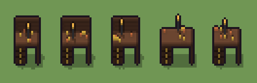

# Banco da orologiaio (`steampunk-banco-da-orologiaio.xml`)

Classe `mobile`, scatola 20 × 20 × 20 voxel, ambientazione `steampunk (orichalcum)`.

Un piano di legno scuro su una cassettiera dai pomelli d'ottone, con una lampada a braccio ambrata e ingranaggi sparsi. Il seme sceglie la lunghezza del banco, se c'è l'alzata di casellari, dove sta la lampada e dove cadono i pezzi.

## Esito

- validatore (`modelErrors`, `checkProgram`, `analyse` a ogni seme): nessun errore, nessun frammento staccato
- varianza su 5 semi (voxel pieni in un seme e vuoti nell'altro, sui pieni in almeno uno; il colore non conta): **media 0.269**, minima 0.118, massima 0.333 (soglia 0.15) → passa
- voxel per seme: 612, 649, 631, 618, 577; tempo per seme: 5, 5, 6, 4, 5 ms

| coppia | 1-2 | 1-3 | 1-4 | 1-5 | 2-3 | 2-4 | 2-5 | 3-4 | 3-5 | 4-5 |
|---|---|---|---|---|---|---|---|---|---|---|
| distanza | 0.261 | 0.242 | 0.333 | 0.299 | 0.234 | 0.304 | 0.302 | 0.319 | 0.118 | 0.281 |



## Traccia di tre semi a confronto

La traccia di `src/mj/trace.ts` (forma `nodi`): per ogni nodo quante volte gira, quante celle scrive e la scatola di ciò che scrive. Le
righe che cambiano fra i semi sono le scelte del programma.

### Seme 1

```text
Traccia, seme 1: griglia 20×20×20, 32 nodi, 99 passi, finito in 5 ms.
x sinistra→destra, y fondo→davanti, z basso→alto; «.» è la cella vuota; #n è il nodo nell'ordine dell'XML; ×n quante volte ha agito.
Lettere: D=legno scuro, W=piano di legno, N=fuga dei cassetti, O=ottone, C=rame, E=ghisa, A=vetro ambrato acceso, h=lunghezze possibili (marcatore), k=dove finisce il banco (marcatore), u=l'alzata possibile (marcatore), X=l'alzata scelta (marcatore), m=il dado dell'alzata (marcatore), l=il fianco (marcatore), r=la lampada che cresce (marcatore), t=il posto della lampada (marcatore).
Alla fine: D 432, W 154, N 10, O 8, E 5, C 2, A 1.
#2-13 box×12: 710 celle x2-18 y0-14 z0-16, passi 1-12
#14-15 one×1, all×1: 11 celle x8-18 y0 z0, passi 13-14
 #16 all k/[.DWNOum] → k/k (+3): ×38, 399 celle x14 y0-19 z0-19, passi 15-52, .→k 381, W→k 14, u→k 4
   r1 k/[.DWNOum] → k/k ×199; r2 [.DWNOum]/k → k/k ×0; r3 [.DWNOum] k → k k ×200; r4 k [.DWNOum] → k k ×0
 #17 all k[.DWNOum] → kk: ×5, 2000 celle x15-19 y0-19 z0-19, passi 53-57, .→k 1926, W→k 56, u→k 18
 #18 all k → .: ×1, 2400 celle x14-19 y0-19 z0-19, passi 58, k→. 2400
#19-32 one×3, all×8, prl×2: 280 celle x2-13 y7-13 z0-17, passi 59-99
Senza effetto (non hanno mai cambiato una cella):
#21 all [um] → .: in quel momento nella griglia non c'erano celle "um"
```

### Seme 2

```text
Traccia, seme 2: griglia 20×20×20, 32 nodi, 99 passi, finito in 7 ms.
x sinistra→destra, y fondo→davanti, z basso→alto; «.» è la cella vuota; #n è il nodo nell'ordine dell'XML; ×n quante volte ha agito.
Lettere: D=legno scuro, W=piano di legno, N=fuga dei cassetti, O=ottone, C=rame, E=ghisa, A=vetro ambrato acceso, h=lunghezze possibili (marcatore), k=dove finisce il banco (marcatore), u=l'alzata possibile (marcatore), X=l'alzata scelta (marcatore), m=il dado dell'alzata (marcatore), l=il fianco (marcatore), r=la lampada che cresce (marcatore), t=il posto della lampada (marcatore).
Alla fine: D 440, W 182, N 10, O 8, E 5, C 3, A 1.
#2-13 box×12: 710 celle x2-18 y0-14 z0-16, passi 1-12
#14-15 one×1, all×1: 11 celle x8-18 y0 z0, passi 13-14
 #16 all k/[.DWNOum] → k/k (+3): ×38, 399 celle x16 y0-19 z0-19, passi 15-52, .→k 381, W→k 14, u→k 4
   r1 k/[.DWNOum] → k/k ×200; r2 [.DWNOum]/k → k/k ×0; r3 [.DWNOum] k → k k ×199; r4 k [.DWNOum] → k k ×0
 #17 all k[.DWNOum] → kk: ×3, 1200 celle x17-19 y0-19 z0-19, passi 53-55, .→k 1162, W→k 28, u→k 10
 #18 all k → .: ×1, 1600 celle x16-19 y0-19 z0-19, passi 56, k→. 1600
#19-32 one×3, all×8, prl×2: 299 celle x2-15 y7-13 z0-17, passi 57-99
Senza effetto (non hanno mai cambiato una cella):
#21 all [um] → .: in quel momento nella griglia non c'erano celle "um"
```

### Seme 3

```text
Traccia, seme 3: griglia 20×20×20, 32 nodi, 100 passi, finito in 5 ms.
x sinistra→destra, y fondo→davanti, z basso→alto; «.» è la cella vuota; #n è il nodo nell'ordine dell'XML; ×n quante volte ha agito.
Lettere: D=legno scuro, W=piano di legno, N=fuga dei cassetti, O=ottone, C=rame, E=ghisa, A=vetro ambrato acceso, h=lunghezze possibili (marcatore), k=dove finisce il banco (marcatore), u=l'alzata possibile (marcatore), X=l'alzata scelta (marcatore), m=il dado dell'alzata (marcatore), l=il fianco (marcatore), r=la lampada che cresce (marcatore), t=il posto della lampada (marcatore).
Alla fine: D 436, W 168, N 10, O 9, E 5, C 2, A 1.
#2-13 box×12: 710 celle x2-18 y0-14 z0-16, passi 1-12
#14-15 one×1, all×1: 11 celle x8-18 y0 z0, passi 13-14
 #16 all k/[.DWNOum] → k/k (+3): ×38, 399 celle x15 y0-19 z0-19, passi 15-52, .→k 381, W→k 14, u→k 4
   r1 k/[.DWNOum] → k/k ×196; r2 [.DWNOum]/k → k/k ×0; r3 [.DWNOum] k → k k ×203; r4 k [.DWNOum] → k k ×0
 #17 all k[.DWNOum] → kk: ×4, 1600 celle x16-19 y0-19 z0-19, passi 53-56, .→k 1544, W→k 42, u→k 14
 #18 all k → .: ×1, 2000 celle x15-19 y0-19 z0-19, passi 57, k→. 2000
#19-32 one×3, all×8, prl×2: 295 celle x2-14 y7-13 z0-17, passi 58-100
Senza effetto (non hanno mai cambiato una cella):
#21 all [um] → .: in quel momento nella griglia non c'erano celle "um"
```
