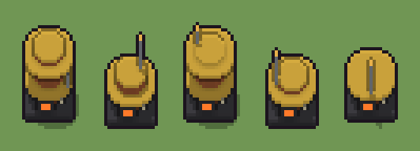

# Caldaia a pressione (`steampunk-caldaia-a-pressione.xml`)

Classe `mobile`, scatola 20 × 20 × 20 voxel, ambientazione `steampunk (orichalcum)`.

Un corpo di rame cerchiato d'ottone su uno zoccolo di ghisa, con il focolare acceso. Il seme sceglie l'altezza del corpo, dove sale il camino e da che lato esce il tubo del vapore.

## Esito

- validatore (`modelErrors`, `checkProgram`, `analyse` a ogni seme): nessun errore, nessun frammento staccato
- varianza su 5 semi (voxel pieni in un seme e vuoti nell'altro, sui pieni in almeno uno; il colore non conta): **media 0.265**, minima 0.052, massima 0.440 (soglia 0.15) → passa
- voxel per seme: 1749, 1215, 1679, 1146, 1008; tempo per seme: 7, 8, 8, 8, 9 ms
- avvisi: tocca il soffitto della griglia: forse è tagliato in alto

| coppia | 1-2 | 1-3 | 1-4 | 1-5 | 2-3 | 2-4 | 2-5 | 3-4 | 3-5 | 4-5 |
|---|---|---|---|---|---|---|---|---|---|---|
| distanza | 0.314 | 0.052 | 0.362 | 0.440 | 0.290 | 0.087 | 0.199 | 0.335 | 0.417 | 0.151 |



## Traccia di tre semi a confronto

La traccia di `src/mj/trace.ts` (forma `nodi`): per ogni nodo quante volte gira, quante celle scrive e la scatola di ciò che scrive. Le
righe che cambiano fra i semi sono le scelte del programma.

### Seme 1

```text
Traccia, seme 1: griglia 20×20×20, 34 nodi, 84 passi, finito in 20 ms.
x sinistra→destra, y fondo→davanti, z basso→alto; «.» è la cella vuota; #n è il nodo nell'ordine dell'XML; ×n quante volte ha agito.
Lettere: G=ghisa, C=rame, O=ottone, A=vetro ambrato, F=fuoco del focolare, M=quadrante del manometro, P=legno scuro, E=tubo di ferro, h=altezze possibili (marcatore), k=la quota scelta (marcatore), V=dove può uscire il tubo (marcatore), r=punta che cresce (marcatore), t=il tubo scelto (marcatore), w=la pancia possibile (marcatore), m=il dado della pancia (marcatore), Y=pancia no (marcatore).
Alla fine: C 897, G 508, O 317, E 13, M 6, F 6, P 1, A 1.
#2-5 box×2, cylinder×2: 3061 celle x3-17 y3-17 z0-19, passi 1-4
#6-9 one×1, all×1: 1369 celle x4-16 y4-16 z2-19, passi 5-6
#10-16 cylinder×2, box×1, one×1, all×3: 673 celle x0-19 y0-19 z6-19, passi 7-54
 #17 all [.COk] k → k k: ×3, 1200 celle x0-19 y0-19 z17-19, passi 55-57, .→k 993, C→k 207
 #18 all k → .: ×1, 1600 celle x0-19 y0-19 z16-19, passi 58, k→. 1600
#19-34 all×6, box×4, prl×1, one×5: 762 celle x1-19 y1-19 z2-16, passi 59-84
Senza effetto (non hanno mai cambiato una cella):
#7 all Xw → XX: in quel momento nella griglia non c'erano celle "X"
#8 all X → C: in quel momento nella griglia non c'erano celle "X"
```

### Seme 2

```text
Traccia, seme 2: griglia 20×20×20, 34 nodi, 94 passi, finito in 19 ms.
x sinistra→destra, y fondo→davanti, z basso→alto; «.» è la cella vuota; #n è il nodo nell'ordine dell'XML; ×n quante volte ha agito.
Lettere: G=ghisa, C=rame, O=ottone, A=vetro ambrato, F=fuoco del focolare, M=quadrante del manometro, P=legno scuro, E=tubo di ferro, h=altezze possibili (marcatore), k=la quota scelta (marcatore), V=dove può uscire il tubo (marcatore), r=punta che cresce (marcatore), t=il tubo scelto (marcatore), w=la pancia possibile (marcatore), m=il dado della pancia (marcatore), Y=pancia no (marcatore).
Alla fine: G 508, C 483, O 193, E 17, M 6, F 6, P 1, A 1.
#2-5 box×2, cylinder×2: 3061 celle x3-17 y3-17 z0-19, passi 1-4
#6-9 one×1, all×1: 1369 celle x4-16 y4-16 z2-19, passi 5-6
#10-16 cylinder×2, box×1, one×1, all×3: 673 celle x0-19 y0-19 z6-19, passi 7-54
 #17 all [.COk] k → k k: ×9, 3600 celle x0-19 y0-19 z11-19, passi 55-63, .→k 2855, C→k 621, O→k 124
 #18 all k → .: ×1, 4000 celle x0-19 y0-19 z10-19, passi 64, k→. 4000
#19-34 all×6, box×4, prl×1, one×5: 762 celle x1-19 y1-19 z2-19, passi 65-94
Senza effetto (non hanno mai cambiato una cella):
#7 all Xw → XX: in quel momento nella griglia non c'erano celle "X"
#8 all X → C: in quel momento nella griglia non c'erano celle "X"
```

### Seme 3

```text
Traccia, seme 3: griglia 20×20×20, 34 nodi, 84 passi, finito in 8 ms.
x sinistra→destra, y fondo→davanti, z basso→alto; «.» è la cella vuota; #n è il nodo nell'ordine dell'XML; ×n quante volte ha agito.
Lettere: G=ghisa, C=rame, O=ottone, A=vetro ambrato, F=fuoco del focolare, M=quadrante del manometro, P=legno scuro, E=tubo di ferro, h=altezze possibili (marcatore), k=la quota scelta (marcatore), V=dove può uscire il tubo (marcatore), r=punta che cresce (marcatore), t=il tubo scelto (marcatore), w=la pancia possibile (marcatore), m=il dado della pancia (marcatore), Y=pancia no (marcatore).
Alla fine: C 828, G 508, O 317, E 12, M 6, F 6, P 1, A 1.
#2-5 box×2, cylinder×2: 3061 celle x3-17 y3-17 z0-19, passi 1-4
#6-9 one×1, all×1: 1369 celle x4-16 y4-16 z2-19, passi 5-6
#10-16 cylinder×2, box×1, one×1, all×3: 673 celle x0-19 y0-19 z6-19, passi 7-54
 #17 all [.COk] k → k k: ×4, 1600 celle x0-19 y0-19 z16-19, passi 55-58, .→k 1324, C→k 276
 #18 all k → .: ×1, 2000 celle x0-19 y0-19 z15-19, passi 59, k→. 2000
#19-34 all×6, box×4, prl×1, one×5: 776 celle x1-19 y1-19 z2-19, passi 60-84
Senza effetto (non hanno mai cambiato una cella):
#7 all Xw → XX: in quel momento nella griglia non c'erano celle "X"
#8 all X → C: in quel momento nella griglia non c'erano celle "X"
```
