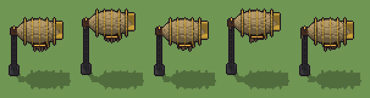

# Dirigibile da attracco (`steampunk-dirigibile-da-attracco.xml`)

Classe `edificio`, scatola 50 × 50 × 50 voxel, ambientazione `steampunk (orichalcum)`.

Un dirigibile di tela cerata con centine d'ottone e gondola di legno scuro, legato per il muso a una torre d'attracco di ghisa. Il seme sceglie l'altezza dell'ormeggio, dove sta la torre e dove la tela è rattoppata.

## Esito

- validatore (`modelErrors`, `checkProgram`, `analyse` a ogni seme): nessun errore, nessun frammento staccato
- varianza su 5 semi (voxel pieni in un seme e vuoti nell'altro, sui pieni in almeno uno; il colore non conta): **media 0.605**, minima 0.011, massima 1.000 (soglia 0.15) → passa
- voxel per seme: 4076, 4101, 4076, 4096, 4074; tempo per seme: 29, 28, 30, 29, 34 ms

| coppia | 1-2 | 1-3 | 1-4 | 1-5 | 2-3 | 2-4 | 2-5 | 3-4 | 3-5 | 4-5 |
|---|---|---|---|---|---|---|---|---|---|---|
| distanza | 1.000 | 0.013 | 1.000 | 0.013 | 1.000 | 0.011 | 1.000 | 1.000 | 0.014 | 1.000 |



## Traccia di tre semi a confronto

La traccia di `src/mj/trace.ts` (forma `nodi`): per ogni nodo quante volte gira, quante celle scrive e la scatola di ciò che scrive. Le
righe che cambiano fra i semi sono le scelte del programma.

### Seme 1

```text
Traccia, seme 1: griglia 50×50×50, 96 nodi, 234 passi, finito in 32 ms.
x sinistra→destra, y fondo→davanti, z basso→alto; «.» è la cella vuota; #n è il nodo nell'ordine dell'XML; ×n quante volte ha agito.
Lettere: T=tela cerata, O=ottone, D=legno scuro, E=ghisa, A=vetro ambrato acceso, R=toppa di cuoio, p=dado dietro (marcatore), q=dado al centro (marcatore), u=dado davanti (marcatore), S=la scelta (marcatore), K=ciò che sparisce (marcatore).
Alla fine: T 3112, O 471, D 227, E 206, R 41, A 19.
#2-88 box×66, ellipsoid×18: 12258 celle x4-46 y2-48 z0-45, passi 1-84
 #89 prl . T → . R passi=1: ×1, 37 celle x13-44 y7-47 z26-44, passi 85, T→R 37
 #90 prl D . → D R passi=1: ×1, 52 celle x5-33 y7-43 z15-37, passi 86, .→R 52
 #91 one R . → R R passi=40: ×40, 40 celle x7-38 y7-43 z12-37, passi 87-126, .→R 40
#92-93 one×1, all×1: 3 celle x4 y9-41 z0, passi 127-128
 #94 all K[TRODEA] → KK: ×104, 8146 celle x4-46 y2-48 z0-45, passi 129-232, T→K 6214, O→K 942, D→K 454, E→K 410, +2
 #95 all K → .: ×1, 8148 celle x4-46 y2-48 z0-45, passi 233, K→. 8148
 #96 all S → E: ×1, 1 celle x4 y25 z0, passi 234, S→E 1
Senza effetto (non hanno mai cambiato una cella):
#21 ellipsoid at 11 9 24 size 3 5 5 O su .
#50 ellipsoid at 11 25 30 size 3 5 5 O su .
#80 ellipsoid at 11 41 36 size 3 5 5 O su .
```

### Seme 2

```text
Traccia, seme 2: griglia 50×50×50, 96 nodi, 228 passi, finito in 32 ms.
x sinistra→destra, y fondo→davanti, z basso→alto; «.» è la cella vuota; #n è il nodo nell'ordine dell'XML; ×n quante volte ha agito.
Lettere: T=tela cerata, O=ottone, D=legno scuro, E=ghisa, A=vetro ambrato acceso, R=toppa di cuoio, p=dado dietro (marcatore), q=dado al centro (marcatore), u=dado davanti (marcatore), S=la scelta (marcatore), K=ciò che sparisce (marcatore).
Alla fine: T 3112, O 471, E 235, D 227, R 37, A 19.
#2-88 box×66, ellipsoid×18: 12258 celle x4-46 y2-48 z0-45, passi 1-84
 #89 prl . T → . R passi=1: ×1, 40 celle x12-38 y4-44 z27-44, passi 85, T→R 40
 #90 prl D . → D R passi=1: ×1, 59 celle x5-33 y7-43 z15-37, passi 86, .→R 59
 #91 one R . → R R passi=40: ×40, 40 celle x5-33 y7-43 z13-36, passi 87-126, .→R 40
#92-93 one×1, all×1: 3 celle x4 y9-41 z0, passi 127-128
 #94 all K[TRODEA] → KK: ×98, 8128 celle x4-46 y2-32 z0-39, passi 129-226, T→K 6211, O→K 942, D→K 454, E→K 381, +2
 #95 all K → .: ×1, 8130 celle x4-46 y2-32 z0-39, passi 227, K→. 8130
 #96 all S → E: ×1, 1 celle x4 y41 z0, passi 228, S→E 1
Senza effetto (non hanno mai cambiato una cella):
#21 ellipsoid at 11 9 24 size 3 5 5 O su .
#50 ellipsoid at 11 25 30 size 3 5 5 O su .
#80 ellipsoid at 11 41 36 size 3 5 5 O su .
```

### Seme 3

```text
Traccia, seme 3: griglia 50×50×50, 96 nodi, 233 passi, finito in 32 ms.
x sinistra→destra, y fondo→davanti, z basso→alto; «.» è la cella vuota; #n è il nodo nell'ordine dell'XML; ×n quante volte ha agito.
Lettere: T=tela cerata, O=ottone, D=legno scuro, E=ghisa, A=vetro ambrato acceso, R=toppa di cuoio, p=dado dietro (marcatore), q=dado al centro (marcatore), u=dado davanti (marcatore), S=la scelta (marcatore), K=ciò che sparisce (marcatore).
Alla fine: T 3114, O 471, D 227, E 206, R 39, A 19.
#2-88 box×66, ellipsoid×18: 12258 celle x4-46 y2-48 z0-45, passi 1-84
 #89 prl . T → . R passi=1: ×1, 27 celle x11-38 y3-47 z26-43, passi 85, T→R 27
 #90 prl D . → D R passi=1: ×1, 56 celle x5-33 y7-43 z15-37, passi 86, .→R 56
 #91 one R . → R R passi=40: ×40, 40 celle x5-38 y7-43 z13-36, passi 87-126, .→R 40
#92-93 one×1, all×1: 3 celle x4 y9-41 z0, passi 127-128
 #94 all K[TRODEA] → KK: ×103, 8150 celle x4-46 y2-48 z0-45, passi 129-231, T→K 6222, O→K 942, D→K 454, E→K 410, +2
 #95 all K → .: ×1, 8152 celle x4-46 y2-48 z0-45, passi 232, K→. 8152
 #96 all S → E: ×1, 1 celle x4 y25 z0, passi 233, S→E 1
Senza effetto (non hanno mai cambiato una cella):
#21 ellipsoid at 11 9 24 size 3 5 5 O su .
#50 ellipsoid at 11 25 30 size 3 5 5 O su .
#80 ellipsoid at 11 41 36 size 3 5 5 O su .
```
