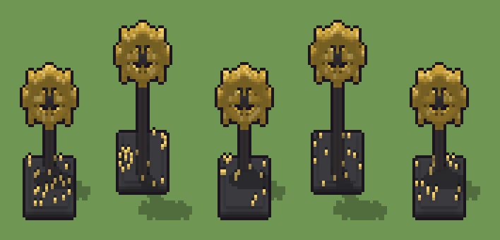

# Ingranaggio monumentale (`steampunk-ingranaggio-monumentale.xml`)

Classe `monumento`, scatola 20 × 20 × 60 voxel, ambientazione `steampunk (orichalcum)`.

Una grande ruota dentata d'ottone con raggi e mozzo di ghisa, ritta su un pilastro sopra uno zoccolo a gradini. Il seme sceglie l'altezza della ruota e se sta davanti, al centro o dietro sullo zoccolo.

## Esito

- validatore (`modelErrors`, `checkProgram`, `analyse` a ogni seme): nessun errore, nessun frammento staccato
- varianza su 5 semi (voxel pieni in un seme e vuoti nell'altro, sui pieni in almeno uno; il colore non conta): **media 0.400**, minima 0.019, massima 0.654 (soglia 0.15) → passa
- voxel per seme: 1610, 1772, 1602, 1762, 1606; tempo per seme: 6, 7, 6, 6, 6 ms
- avvisi: tocca i bordi laterali della griglia: forse è tagliato

| coppia | 1-2 | 1-3 | 1-4 | 1-5 | 2-3 | 2-4 | 2-5 | 3-4 | 3-5 | 4-5 |
|---|---|---|---|---|---|---|---|---|---|---|
| distanza | 0.654 | 0.021 | 0.653 | 0.021 | 0.654 | 0.019 | 0.654 | 0.652 | 0.021 | 0.653 |



## Traccia di tre semi a confronto

La traccia di `src/mj/trace.ts` (forma `nodi`): per ogni nodo quante volte gira, quante celle scrive e la scatola di ciò che scrive. Le
righe che cambiano fra i semi sono le scelte del programma.

### Seme 1

```text
Traccia, seme 1: griglia 20×20×60, 68 nodi, 105 passi, finito in 7 ms.
x sinistra→destra, y fondo→davanti, z basso→alto; «.» è la cella vuota; #n è il nodo nell'ordine dell'XML; ×n quante volte ha agito.
Lettere: G=ghisa dello zoccolo, O=ottone, D=ghisa, L=ottone lucido, a=ruota dietro (marcatore), b=pilastro dietro (marcatore), c=ruota al centro (marcatore), d=pilastro al centro (marcatore), e=ruota davanti (marcatore), f=pilastro davanti (marcatore), p=dado dietro (marcatore), q=dado al centro (marcatore), u=dado davanti (marcatore), S=la scelta (marcatore), X=ottone scelto (marcatore), Y=ghisa scelta (marcatore), r=ribattino possibile (marcatore).
Alla fine: G 867, O 525, D 162, L 56.
#2-60 box×41, ellipsoid×18: 5361 celle x1-19 y1-19 z0-54, passi 1-59
#61-63 prl×1, all×1, one×1: 47 celle x3-17 y1-18 z2-3, passi 60-62
 #64 all [SXY][ace] → *X (+1): ×39, 719 celle x1-19 y3-5 z3-36, passi 63-101, a→X 558, b→Y 161
   r1 [SXY][ace] → *X ×558; r2 [SXY][bdf] → *Y ×161
 #65 all [abcdefpqu] → .: ×1, 1683 celle x1-19 y9-17 z3-54, passi 102, c→. 558, e→. 558, f→. 323, d→. 242, +2
 #66 all X → O: ×1, 558 celle x1-19 y3-5 z17-36, passi 103, X→O 558
 #67 all [YS] → D: ×1, 162 celle x9-11 y3-5 z3-28, passi 104, Y→D 161, S→D 1
 #68 prl . O → . L passi=1: ×1, 33 celle x2-19 y3-5 z20-36, passi 105, O→L 33
```

### Seme 2

```text
Traccia, seme 2: griglia 20×20×60, 68 nodi, 123 passi, finito in 7 ms.
x sinistra→destra, y fondo→davanti, z basso→alto; «.» è la cella vuota; #n è il nodo nell'ordine dell'XML; ×n quante volte ha agito.
Lettere: G=ghisa dello zoccolo, O=ottone, D=ghisa, L=ottone lucido, a=ruota dietro (marcatore), b=pilastro dietro (marcatore), c=ruota al centro (marcatore), d=pilastro al centro (marcatore), e=ruota davanti (marcatore), f=pilastro davanti (marcatore), p=dado dietro (marcatore), q=dado al centro (marcatore), u=dado davanti (marcatore), S=la scelta (marcatore), X=ottone scelto (marcatore), Y=ghisa scelta (marcatore), r=ribattino possibile (marcatore).
Alla fine: G 867, O 521, D 324, L 60.
#2-60 box×41, ellipsoid×18: 5361 celle x1-19 y1-19 z0-54, passi 1-59
#61-63 prl×1, all×1, one×1: 47 celle x2-18 y2-19 z2-3, passi 60-62
 #64 all [SXY][ace] → *X (+1): ×57, 881 celle x1-19 y15-17 z3-54, passi 63-119, e→X 558, f→Y 323
   r1 [SXY][ace] → *X ×558; r2 [SXY][bdf] → *Y ×323
 #65 all [abcdefpqu] → .: ×1, 1521 celle x1-19 y3-11 z3-45, passi 120, a→. 558, c→. 558, d→. 242, b→. 161, +2
 #66 all X → O: ×1, 558 celle x1-19 y15-17 z35-54, passi 121, X→O 558
 #67 all [YS] → D: ×1, 324 celle x9-11 y15-17 z3-46, passi 122, Y→D 323, S→D 1
 #68 prl . O → . L passi=1: ×1, 37 celle x2-19 y15-17 z38-54, passi 123, O→L 37
```

### Seme 3

```text
Traccia, seme 3: griglia 20×20×60, 68 nodi, 105 passi, finito in 11 ms.
x sinistra→destra, y fondo→davanti, z basso→alto; «.» è la cella vuota; #n è il nodo nell'ordine dell'XML; ×n quante volte ha agito.
Lettere: G=ghisa dello zoccolo, O=ottone, D=ghisa, L=ottone lucido, a=ruota dietro (marcatore), b=pilastro dietro (marcatore), c=ruota al centro (marcatore), d=pilastro al centro (marcatore), e=ruota davanti (marcatore), f=pilastro davanti (marcatore), p=dado dietro (marcatore), q=dado al centro (marcatore), u=dado davanti (marcatore), S=la scelta (marcatore), X=ottone scelto (marcatore), Y=ghisa scelta (marcatore), r=ribattino possibile (marcatore).
Alla fine: G 867, O 522, D 162, L 51.
#2-60 box×41, ellipsoid×18: 5361 celle x1-19 y1-19 z0-54, passi 1-59
#61-63 prl×1, all×1, one×1: 31 celle x2-17 y1-18 z2-3, passi 60-62
 #64 all [SXY][ace] → *X (+1): ×39, 719 celle x1-19 y3-5 z3-36, passi 63-101, a→X 558, b→Y 161
   r1 [SXY][ace] → *X ×558; r2 [SXY][bdf] → *Y ×161
 #65 all [abcdefpqu] → .: ×1, 1683 celle x1-19 y9-17 z3-54, passi 102, e→. 558, c→. 558, f→. 323, d→. 242, +2
 #66 all X → O: ×1, 558 celle x1-19 y3-5 z17-36, passi 103, X→O 558
 #67 all [YS] → D: ×1, 162 celle x9-11 y3-5 z3-28, passi 104, Y→D 161, S→D 1
 #68 prl . O → . L passi=1: ×1, 36 celle x1-17 y3-5 z20-36, passi 105, O→L 36
```
