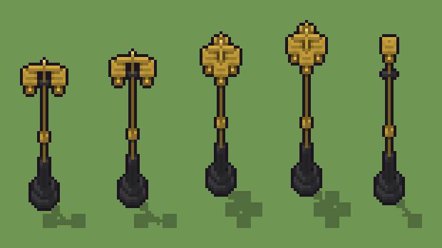

# Lampione a gas in ottone (`steampunk-lampione-a-gas.xml`)

Classe `monumento`, scatola 20 × 20 × 60 voxel, ambientazione `steampunk (orichalcum)`.

Un fusto d'ottone su uno zoccolo di ghisa, con la sbarra per la scala e le lanterne di vetro ambrato acceso. Il seme sceglie l'altezza del fusto e la testa: una lanterna in cima, due su un braccio o quattro su una croce.

## Esito

- validatore (`modelErrors`, `checkProgram`, `analyse` a ogni seme): nessun errore, nessun frammento staccato
- varianza su 5 semi (voxel pieni in un seme e vuoti nell'altro, sui pieni in almeno uno; il colore non conta): **media 0.453**, minima 0.281, massima 0.571 (soglia 0.15) → passa
- voxel per seme: 483, 485, 629, 633, 401; tempo per seme: 33, 30, 31, 29, 31 ms
- avvisi: colori mai usati: L

| coppia | 1-2 | 1-3 | 1-4 | 1-5 | 2-3 | 2-4 | 2-5 | 3-4 | 3-5 | 4-5 |
|---|---|---|---|---|---|---|---|---|---|---|
| distanza | 0.281 | 0.462 | 0.571 | 0.413 | 0.345 | 0.511 | 0.404 | 0.514 | 0.522 | 0.508 |



## Traccia di tre semi a confronto

La traccia di `src/mj/trace.ts` (forma `nodi`): per ogni nodo quante volte gira, quante celle scrive e la scatola di ciò che scrive. Le
righe che cambiano fra i semi sono le scelte del programma.

### Seme 1

```text
Traccia, seme 1: griglia 20×20×60, 17 nodi, 67 passi, finito in 32 ms.
x sinistra→destra, y fondo→davanti, z basso→alto; «.» è la cella vuota; #n è il nodo nell'ordine dell'XML; ×n quante volte ha agito.
Lettere: G=ghisa, P=ottone brunito, O=ottone, A=vetro ambrato acceso, L=pomo lucido, h=altezze possibili (marcatore), k=la quota scelta (marcatore), s=la cima del fusto (marcatore), t=la cima scelta (marcatore).
Alla fine: G 289, O 133, P 30, A 30, L 1.
#2-7 cylinder×2, box×4: 362 celle x0-14 y0-14 z0-59, passi 1-6
#8-9 one×1, all×1: 21 celle x0 y0 z30-50, passi 7-8
 #10 all k. → kk: ×38, 398 celle x0-19 y0-19 z43, passi 9-46, .→k 398
 #11 all k[P] → kk: ×1, 1 celle x10 y10 z43, passi 47, P→k 1
 #12 all [.Pk] k → k k: ×16, 6400 celle x0-19 y0-19 z44-59, passi 48-63, .→k 6384, P→k 16
 #13 all k → .: ×1, 6800 celle x0-19 y0-19 z43-59, passi 64, k→. 6800
#14-16 all×2, one×1: 163 celle x3-17 y8-12 z37-46, passi 65-67
Senza effetto (non hanno mai cambiato una cella):
#17 all s → P: in quel momento nella griglia non c'erano celle "s"
```

### Seme 2

```text
Traccia, seme 2: griglia 20×20×60, 17 nodi, 65 passi, finito in 32 ms.
x sinistra→destra, y fondo→davanti, z basso→alto; «.» è la cella vuota; #n è il nodo nell'ordine dell'XML; ×n quante volte ha agito.
Lettere: G=ghisa, P=ottone brunito, O=ottone, A=vetro ambrato acceso, L=pomo lucido, h=altezze possibili (marcatore), k=la quota scelta (marcatore), s=la cima del fusto (marcatore), t=la cima scelta (marcatore).
Alla fine: G 289, O 133, P 32, A 30, L 1.
#2-7 cylinder×2, box×4: 362 celle x0-14 y0-14 z0-59, passi 1-6
#8-9 one×1, all×1: 21 celle x0 y0 z30-50, passi 7-8
 #10 all k. → kk: ×38, 398 celle x0-19 y0-19 z45, passi 9-46, .→k 398
 #11 all k[P] → kk: ×1, 1 celle x10 y10 z45, passi 47, P→k 1
 #12 all [.Pk] k → k k: ×14, 5600 celle x0-19 y0-19 z46-59, passi 48-61, .→k 5586, P→k 14
 #13 all k → .: ×1, 6000 celle x0-19 y0-19 z45-59, passi 62, k→. 6000
#14-16 all×2, one×1: 163 celle x3-17 y8-12 z39-48, passi 63-65
Senza effetto (non hanno mai cambiato una cella):
#17 all s → P: in quel momento nella griglia non c'erano celle "s"
```

### Seme 3

```text
Traccia, seme 3: griglia 20×20×60, 17 nodi, 65 passi, finito in 32 ms.
x sinistra→destra, y fondo→davanti, z basso→alto; «.» è la cella vuota; #n è il nodo nell'ordine dell'XML; ×n quante volte ha agito.
Lettere: G=ghisa, P=ottone brunito, O=ottone, A=vetro ambrato acceso, L=pomo lucido, h=altezze possibili (marcatore), k=la quota scelta (marcatore), s=la cima del fusto (marcatore), t=la cima scelta (marcatore).
Alla fine: G 289, O 247, A 60, P 32, L 1.
#2-7 cylinder×2, box×4: 362 celle x0-14 y0-14 z0-59, passi 1-6
#8-9 one×1, all×1: 21 celle x0 y0 z30-50, passi 7-8
 #10 all k. → kk: ×38, 398 celle x0-19 y0-19 z45, passi 9-46, .→k 398
 #11 all k[P] → kk: ×1, 1 celle x10 y10 z45, passi 47, P→k 1
 #12 all [.Pk] k → k k: ×14, 5600 celle x0-19 y0-19 z46-59, passi 48-61, .→k 5586, P→k 14
 #13 all k → .: ×1, 6000 celle x0-19 y0-19 z45-59, passi 62, k→. 6000
#14-16 all×2, one×1: 307 celle x4-16 y4-16 z39-48, passi 63-65
Senza effetto (non hanno mai cambiato una cella):
#17 all s → P: in quel momento nella griglia non c'erano celle "s"
```
