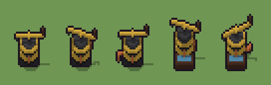

# Pompa idraulica (`steampunk-pompa-idraulica.xml`)

Classe `mobile`, scatola 20 × 20 × 20 voxel, ambientazione `steampunk (orichalcum)`.

Un cilindro di ghisa cerchiato d'ottone con il bilanciere e la bocca che versa, e un tubo di rame che scende a terra. Il seme sceglie l'altezza del cilindro, come pende il bilanciere, se c'è il trogolo con l'acqua e da che parte corre il tubo.

## Esito

- validatore (`modelErrors`, `checkProgram`, `analyse` a ogni seme): nessun errore, nessun frammento staccato
- varianza su 5 semi (voxel pieni in un seme e vuoti nell'altro, sui pieni in almeno uno; il colore non conta): **media 0.251**, minima 0.083, massima 0.364 (soglia 0.15) → passa
- voxel per seme: 466, 507, 503, 679, 607; tempo per seme: 9, 9, 9, 8, 16 ms
- avvisi: colori mai usati: W Q; colori mai usati: Q

| coppia | 1-2 | 1-3 | 1-4 | 1-5 | 2-3 | 2-4 | 2-5 | 3-4 | 3-5 | 4-5 |
|---|---|---|---|---|---|---|---|---|---|---|
| distanza | 0.154 | 0.158 | 0.364 | 0.291 | 0.083 | 0.308 | 0.342 | 0.309 | 0.331 | 0.173 |



## Traccia di tre semi a confronto

La traccia di `src/mj/trace.ts` (forma `nodi`): per ogni nodo quante volte gira, quante celle scrive e la scatola di ciò che scrive. Le
righe che cambiano fra i semi sono le scelte del programma.

### Seme 1

```text
Traccia, seme 1: griglia 20×20×20, 34 nodi, 83 passi, finito in 11 ms.
x sinistra→destra, y fondo→davanti, z basso→alto; «.» è la cella vuota; #n è il nodo nell'ordine dell'XML; ×n quante volte ha agito.
Lettere: G=piastra di ghisa, E=ghisa, O=ottone, C=rame, D=legno scuro, A=spia ambrata, Q=ghisa dell'asse, h=altezze possibili (marcatore), k=la quota scelta (marcatore), s=la cima (marcatore), u=il trogolo possibile (marcatore), v=l'acqua possibile (marcatore), m=il dado del trogolo (marcatore), Y=trogolo no (marcatore), t=il tubo (marcatore), V=dove può uscire il tubo (marcatore).
Alla fine: E 290, O 88, G 72, C 12, D 3, A 1.
#2-7 box×3, cylinder×3: 836 celle x0-12 y0-14 z0-18, passi 1-6
#8-11 one×1, all×3: 406 celle x0-19 y0-19 z5-11, passi 7-50
 #12 all [.EOQk] k → k k: ×10, 4000 celle x0-19 y0-19 z10-19, passi 51-60, .→k 3667, E→k 324, Q→k 9
 #13 all k → .: ×1, 4400 celle x0-19 y0-19 z9-19, passi 61, k→. 4400
#14-26 box×6, all×3, one×2: 350 celle x2-15 y9-18 z0-14, passi 62-72
#29-34 box×1, one×3, all×2: 623 celle x0-17 y1-19 z0-2, passi 73-83
Senza effetto (non hanno mai cambiato una cella):
#23 all s → E: in quel momento nella griglia non c'erano celle "s"
#25 all [Xx]u → *X (+1): in quel momento nella griglia non c'erano celle "Xx"
#27 all X → D: in quel momento nella griglia non c'erano celle "X"
#28 all x → W: in quel momento nella griglia non c'erano celle "x"
```

### Seme 2

```text
Traccia, seme 2: griglia 20×20×20, 34 nodi, 82 passi, finito in 11 ms.
x sinistra→destra, y fondo→davanti, z basso→alto; «.» è la cella vuota; #n è il nodo nell'ordine dell'XML; ×n quante volte ha agito.
Lettere: G=piastra di ghisa, E=ghisa, O=ottone, C=rame, D=legno scuro, A=spia ambrata, Q=ghisa dell'asse, h=altezze possibili (marcatore), k=la quota scelta (marcatore), s=la cima (marcatore), u=il trogolo possibile (marcatore), v=l'acqua possibile (marcatore), m=il dado del trogolo (marcatore), Y=trogolo no (marcatore), t=il tubo (marcatore), V=dove può uscire il tubo (marcatore).
Alla fine: E 326, O 93, G 72, C 12, D 3, A 1.
#2-7 box×3, cylinder×3: 836 celle x0-12 y0-14 z0-18, passi 1-6
#8-11 one×1, all×3: 406 celle x0-19 y0-19 z5-11, passi 7-50
 #12 all [.EOQk] k → k k: ×9, 3600 celle x0-19 y0-19 z11-19, passi 51-59, .→k 3304, E→k 288, Q→k 8
 #13 all k → .: ×1, 4000 celle x0-19 y0-19 z10-19, passi 60, k→. 4000
#14-26 box×6, all×3, one×2: 355 celle x2-15 y9-18 z0-14, passi 61-71
#29-34 box×1, one×3, all×2: 623 celle x0-17 y1-19 z0-2, passi 72-82
Senza effetto (non hanno mai cambiato una cella):
#23 all s → E: in quel momento nella griglia non c'erano celle "s"
#25 all [Xx]u → *X (+1): in quel momento nella griglia non c'erano celle "Xx"
#27 all X → D: in quel momento nella griglia non c'erano celle "X"
#28 all x → W: in quel momento nella griglia non c'erano celle "x"
```

### Seme 3

```text
Traccia, seme 3: griglia 20×20×20, 34 nodi, 82 passi, finito in 18 ms.
x sinistra→destra, y fondo→davanti, z basso→alto; «.» è la cella vuota; #n è il nodo nell'ordine dell'XML; ×n quante volte ha agito.
Lettere: G=piastra di ghisa, E=ghisa, O=ottone, C=rame, D=legno scuro, A=spia ambrata, Q=ghisa dell'asse, h=altezze possibili (marcatore), k=la quota scelta (marcatore), s=la cima (marcatore), u=il trogolo possibile (marcatore), v=l'acqua possibile (marcatore), m=il dado del trogolo (marcatore), Y=trogolo no (marcatore), t=il tubo (marcatore), V=dove può uscire il tubo (marcatore).
Alla fine: E 326, O 89, G 72, C 12, D 3, A 1.
#2-7 box×3, cylinder×3: 836 celle x0-12 y0-14 z0-18, passi 1-6
#8-11 one×1, all×3: 406 celle x0-19 y0-19 z5-11, passi 7-50
 #12 all [.EOQk] k → k k: ×9, 3600 celle x0-19 y0-19 z11-19, passi 51-59, .→k 3304, E→k 288, Q→k 8
 #13 all k → .: ×1, 4000 celle x0-19 y0-19 z10-19, passi 60, k→. 4000
#14-26 box×6, all×3, one×2: 351 celle x2-15 y9-18 z0-15, passi 61-71
#29-34 box×1, one×3, all×2: 623 celle x0-17 y1-19 z0-2, passi 72-82
Senza effetto (non hanno mai cambiato una cella):
#23 all s → E: in quel momento nella griglia non c'erano celle "s"
#25 all [Xx]u → *X (+1): in quel momento nella griglia non c'erano celle "Xx"
#27 all X → D: in quel momento nella griglia non c'erano celle "X"
#28 all x → W: in quel momento nella griglia non c'erano celle "x"
```
