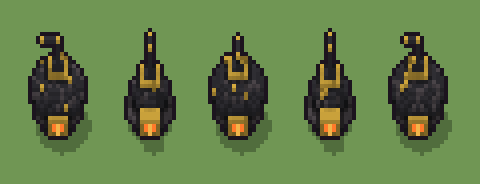

# Stufa in ghisa (`steampunk-stufa-in-ghisa.xml`)

Classe `mobile`, scatola 20 × 20 × 20 voxel, ambientazione `steampunk (orichalcum)`.

Una stufa panciuta di ghisa su quattro piedi, con lo sportello della brace accesa, il collare d'ottone e la canna fumaria a gomito. Il seme sceglie la pancia stretta o larga, quanto sale la canna, da che parte piega e quanto corre.

## Esito

- validatore (`modelErrors`, `checkProgram`, `analyse` a ogni seme): nessun errore, nessun frammento staccato
- varianza su 5 semi (voxel pieni in un seme e vuoti nell'altro, sui pieni in almeno uno; il colore non conta): **media 0.306**, minima 0.007, massima 0.503 (soglia 0.15) → passa
- voxel per seme: 1066, 535, 1067, 537, 1064; tempo per seme: 6, 5, 6, 4, 5 ms
- avvisi: tocca il soffitto della griglia: forse è tagliato in alto; colori mai usati: Q

| coppia | 1-2 | 1-3 | 1-4 | 1-5 | 2-3 | 2-4 | 2-5 | 3-4 | 3-5 | 4-5 |
|---|---|---|---|---|---|---|---|---|---|---|
| distanza | 0.502 | 0.018 | 0.500 | 0.007 | 0.503 | 0.011 | 0.501 | 0.501 | 0.016 | 0.500 |



## Traccia di tre semi a confronto

La traccia di `src/mj/trace.ts` (forma `nodi`): per ogni nodo quante volte gira, quante celle scrive e la scatola di ciò che scrive. Le
righe che cambiano fra i semi sono le scelte del programma.

### Seme 1

```text
Traccia, seme 1: griglia 20×20×20, 32 nodi, 58 passi, finito in 5 ms.
x sinistra→destra, y fondo→davanti, z basso→alto; «.» è la cella vuota; #n è il nodo nell'ordine dell'XML; ×n quante volte ha agito.
Lettere: E=ghisa, O=ottone, G=ghisa chiara, A=vetro ambrato acceso, F=brace, Q=ghisa dell'asse, s=la cima della pancia (marcatore), w=la pancia larga possibile (marcatore), m=il dado della pancia (marcatore), X=pancia larga (marcatore), r=la canna che sale (marcatore), c=il gomito (marcatore).
Alla fine: E 852, G 117, O 83, F 12, A 2.
#2-10 box×6, cylinder×1, ellipsoid×2: 1001 celle x4-16 y4-16 z0-11, passi 1-9
#11-12 prl×1, one×1: 4 celle x9-10 y5-12 z2-4, passi 10-11
 #13 all Xw → XX: ×27, 547 celle x4-16 y4-16 z3-11, passi 12-38, w→X 547
 #14 all X → E: ×1, 548 celle x4-16 y4-16 z3-11, passi 39, X→E 548
#17-19 all×2, prl×1: 43 celle x4-16 y4-16 z3-12, passi 40-42
#20-22 box×3: 74 celle x8-12 y15-18 z3-6, passi 43-45
#23-32 one×4, all×2, prl×2: 60 celle x6-13 y6-16 z8-19, passi 46-58
Senza effetto (non hanno mai cambiato una cella):
#15 all [wY] → .: in quel momento nella griglia non c'erano celle "wY"
#16 all .Q. → ...: le celle cercate c'erano, ma mai disposte come nel pattern
#24 all s → E: in quel momento nella griglia non c'erano celle "s"
#27 all c → r: in quel momento nella griglia non c'erano celle "c"
```

### Seme 2

```text
Traccia, seme 2: griglia 20×20×20, 32 nodi, 33 passi, finito in 4 ms.
x sinistra→destra, y fondo→davanti, z basso→alto; «.» è la cella vuota; #n è il nodo nell'ordine dell'XML; ×n quante volte ha agito.
Lettere: E=ghisa, O=ottone, G=ghisa chiara, A=vetro ambrato acceso, F=brace, Q=ghisa dell'asse, s=la cima della pancia (marcatore), w=la pancia larga possibile (marcatore), m=il dado della pancia (marcatore), Y=pancia stretta (marcatore), r=la canna che sale (marcatore), c=il gomito (marcatore).
Alla fine: E 344, G 97, O 80, F 12, A 2.
#2-10 box×6, cylinder×1, ellipsoid×2: 1001 celle x4-16 y4-16 z0-11, passi 1-9
#11-12 prl×1, one×1: 4 celle x9-11 y5-11 z2-4, passi 10-11
 #15 all [wY] → .: ×1, 548 celle x4-16 y4-16 z3-11, passi 12, w→. 547, Y→. 1
#16-19 all×3, prl×1: 23 celle x6-13 y7-13 z3-11, passi 13-16
#20-22 box×3: 74 celle x8-12 y15-18 z3-6, passi 17-19
#23-32 one×4, all×3, prl×2: 57 celle x8-12 y7-12 z9-17, passi 20-33
Senza effetto (non hanno mai cambiato una cella):
#13 all Xw → XX: in quel momento nella griglia non c'erano celle "X"
#14 all X → E: in quel momento nella griglia non c'erano celle "X"
#24 all s → E: in quel momento nella griglia non c'erano celle "s"
```

### Seme 3

```text
Traccia, seme 3: griglia 20×20×20, 32 nodi, 57 passi, finito in 7 ms.
x sinistra→destra, y fondo→davanti, z basso→alto; «.» è la cella vuota; #n è il nodo nell'ordine dell'XML; ×n quante volte ha agito.
Lettere: E=ghisa, O=ottone, G=ghisa chiara, A=vetro ambrato acceso, F=brace, Q=ghisa dell'asse, s=la cima della pancia (marcatore), w=la pancia larga possibile (marcatore), m=il dado della pancia (marcatore), X=pancia larga (marcatore), r=la canna che sale (marcatore), c=il gomito (marcatore).
Alla fine: E 862, G 104, O 87, F 12, A 2.
#2-10 box×6, cylinder×1, ellipsoid×2: 1001 celle x4-16 y4-16 z0-11, passi 1-9
#11-12 prl×1, one×1: 7 celle x9-12 y5-11 z2-4, passi 10-11
 #13 all Xw → XX: ×26, 547 celle x4-16 y4-16 z3-11, passi 12-37, w→X 547
 #14 all X → E: ×1, 548 celle x4-16 y4-16 z3-11, passi 38, X→E 548
#17-19 all×2, prl×1: 30 celle x7-15 y5-15 z3-12, passi 39-41
#20-22 box×3: 74 celle x8-12 y15-18 z3-6, passi 42-44
#23-32 one×4, all×2, prl×2: 61 celle x4-12 y5-15 z8-19, passi 45-57
Senza effetto (non hanno mai cambiato una cella):
#15 all [wY] → .: in quel momento nella griglia non c'erano celle "wY"
#16 all .Q. → ...: le celle cercate c'erano, ma mai disposte come nel pattern
#24 all s → E: in quel momento nella griglia non c'erano celle "s"
#27 all c → r: in quel momento nella griglia non c'erano celle "c"
```
