# La scala del forte dell'autore e delle strutture (T403, D60)

L'autore (17/11): il forte di `lab/mjx/models/handmade/forte-handmade.xml` (500 × 500 × 150 voxel) è pensato per 100 caselle, il gioco
lo mostra a 20 voxel per casella (25 caselle); ha scelto la scala piena (A, il fattore 4) ma vuole la prova prima di toccare il kernel
(T404). E le strutture generate gli sembrano tutte piccole accanto al viandante. Qui: il forte e quattro strutture a **20, 10 e 5 voxel
per casella** accanto al viandante, che resta alla scala del gioco (30 voxel a 20, **1,5 caselle**), con le misure lette dal programma.

```bash
npx vite-node lab/scripts/forte-scala.ts -- --semi 1,2,3 --json lab/banco/riferimento/forte-scala.json    # il forte: 7-8 s a seme
npx vite-node lab/scripts/strutture-scala.ts -- --json lab/banco/riferimento/strutture-scala.json         # le strutture del banco
npx vite build --mode development --outDir .tmp/dist-dev && npx vite preview --outDir .tmp/dist-dev --port <n> --strictPort
node lab/scripts/foto-scala.mjs --url http://localhost:<n>/lab/3d/                                       # le foto, Chrome headless sulla GPU
```

Nessuna chiamata ai modelli: costo in dollari zero. Le foto sono del laboratorio 3D col comando nuovo «voxel per casella» (nell'ispettore:
del modello, 5, 10, 20 o un valore da 2 a 40; `?vpt=5&modello=<id>` nell'indirizzo; `lab/README.md`), che vale per qualunque modello.

## Come si misura

`forte-scala.ts` fa girare il programma e legge i **posti dove si sta in piedi** (un voxel pieno sotto, aria sopra), colonna per
colonna, con la luce fino al primo pieno sopra e le lettere sotto e sopra: il selciato `A` e la strada `V` (il suolo), le mura `S` col
camminatoio `D` e i merli `M`, la torre della porta `G`, il legno `f` e i solai `F` del mastio (non `K`, che è anche delle caserme,
piene), le torri `T`, le scale `Q`. Il mastio è dove il suo pavimento di legno sta a terra, più lo spessore di un muro; la porta del
mastio è sul pavimento della sala, sotto il muro `K`, più bassa della sala. Le misure sono uguali nei tre semi tranne i piani del mastio
(il seme 3 ne ha uno in meno). `strutture-scala.ts` usa le misure del kernel (`habitableParts`: i piani raggiunti a piedi, le stanze con
la loro luce, le porte che l'azione `open` toglie) e l'alzata dei gradini di `part-stair` (la lettera `k`).

Un viandante è 1,5 caselle: una misura di `v` voxel a `d` voxel per casella è `v / d` caselle e `v / d / 1,5` viandanti. Il corpo del
gioco sale un gradino di `stepOf` = un quinto di casella: **4 voxel a 20, 2 a 10, 1 a 5**.

## Il forte dell'autore (seme 1; i semi 2 e 3 dove cambiano)

| misura | voxel (semi 1, 2, 3) | a 20: caselle · **viandanti** | a 10: caselle · **viandanti** | a 5: caselle · **viandanti** |
|---|---|---|---|---|
| tutto il forte | 500 × 500 × 148 | 25 × 25 · alto 7,4 | 50 × 50 · alto 14,8 | 100 × 100 · alto 29,6 |
| camminatoio delle mura (dal selciato) | 23 | 1,15 · **0,77** | 2,3 · **1,53** | 4,6 · **3,07** |
| parapetto sul camminatoio, la sua cima (dal selciato) | 25 | 1,25 · **0,83** | 2,5 · **1,67** | 5 · **3,33** |
| corridoio dentro le mura, luce | 19 | 0,95 · **0,63** | 1,9 · **1,27** | 3,8 · **2,53** |
| porta del forte (sotto la torre della porta), luce | 31 | 1,55 · **1,03** | 3,1 · **2,07** | 6,2 · **4,13** |
| porta del forte, larghezza | 28 | 1,4 · **0,93** | 2,8 · **1,87** | 5,6 · **3,73** |
| sala del trono (piano terra del mastio), luce | 31 | 1,55 · **1,03** | 3,1 · **2,07** | 6,2 · **4,13** |
| porta del mastio, luce | 27 | 1,35 · **0,9** | 2,7 · **1,8** | 5,4 · **3,6** |
| porta del mastio, larghezza | 12 | 0,6 · **0,4** | 1,2 · **0,8** | 2,4 · **1,6** |
| mastio, piano 2, luce | 20 | 1 · **0,67** | 2 · **1,33** | 4 · **2,67** |
| mastio, piano 3, luce | 20 · 20 · — | 1 · **0,67** | 2 · **1,33** | 4 · **2,67** |
| mastio, terrazza in cima (dal selciato) | 83 · 83 · 59 | 4,15 · **2,77** | 8,3 · **5,53** | 16,6 · **11,07** |
| torre, piano 1, luce | 19 | 0,95 · **0,63** | 1,9 · **1,27** | 3,8 · **2,53** |
| torre, piano 2, luce | 19 | 0,95 · **0,63** | 1,9 · **1,27** | 3,8 · **2,53** |
| torre, terrazza in cima (dal selciato) | 43 | 2,15 · **1,43** | 4,3 · **2,87** | 8,6 · **5,73** |
| scale, alzata di un gradino (pedata 1 voxel) | 2 | 0,1 · **0,07** | 0,2 · **0,13** | 0,4 · **0,27** |
| scale, la rampa più lunga sale di | 32 | 1,6 · **1,07** | 3,2 · **2,13** | 6,4 · **4,27** |

Che cosa dicono:

- **A 20 (oggi)** il forte è un modellino: le mura arrivano al petto del viandante (0,77), la sala del trono e la porta del forte lo
  contengono una volta (1,03), i piani del mastio e delle torri e il corridoio nelle mura sono **più bassi di lui** (0,63-0,67): non ci
  sta in piedi. Lo dice anche D60.
- **A 5 (il fattore 4)** l'esterno è da castello: mura di 3 viandanti, la sala del trono di 4, il mastio di 11, le torri di quasi 6. Ma
  l'interno è grande il doppio del giusto: i piani di 2,5-2,7 viandanti, la porta del mastio di 3,6 × 1,6, la porta del forte di 4,1. E
  **le scale non si salgono**: un gradino è 2 voxel, cioè 0,4 caselle, e il corpo del gioco sale 1 voxel a 5 (`stepOf`). Il fattore 4
  vuole le scale riscritte (gradini di 1 voxel, rampe lunghe il doppio) o `stepOf` contato in voxel e non in caselle.
- **A 10 (il fattore 2)** l'interno è a misura: i piani 1,3, la porta del mastio 1,8 × 0,8 (larga quanto passa un corpo, 0,44 caselle,
  con margine), il corridoio nelle mura 1,3, un gradino 0,2 caselle = `stepOf` (si sale, appena). L'esterno è basso per un castello: le mura
  1,5 viandanti, la sala del trono 2, il mastio 5,5.

Nessuna densità sola dà insieme l'esterno del fattore 4 e l'interno del fattore 2: il programma ha l'interno e l'esterno nello stesso
rapporto, e quel rapporto (mura di 23, piani di 20) è quello di un forte con le mura alte poco più di un piano. Il fattore 4 così com'è
vuole almeno le scale; il fattore 2 vuole mura più alte nel programma.

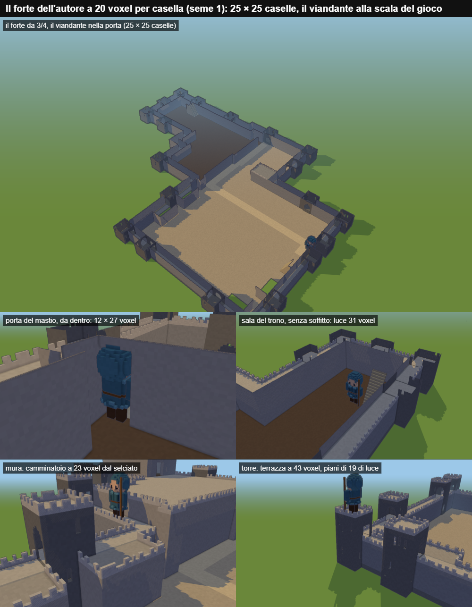
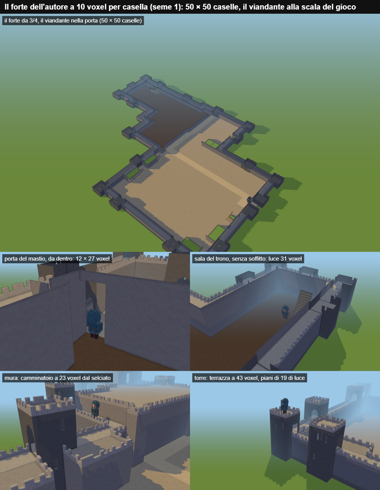
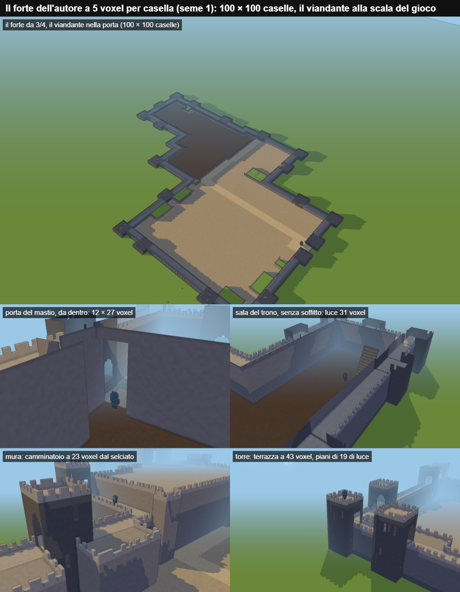

Ogni foto: il forte da 3/4 col viandante nella porta del forte (in alto), poi la porta del mastio vista da dentro la sala col viandante
sulla soglia, la sala del trono senza soffitto, il viandante sul camminatoio delle mura, il viandante sulla terrazza di una torre. La
camera sta a una distanza proporzionale al forte: la stessa inquadratura, il viandante che cambia.

## Le strutture che crescono a regole (seme 1, la scatola del laboratorio a 20)

Tutte includono le parti del seme (`part-door`, `part-stair`, ADR-0182), costruite sulle misure minime di `PARTS` a 20 voxel per casella:
le misure sono le stesse, e lo sono le conclusioni.

| struttura (id del laboratorio) | porta, luce × larghezza | da piano a piano | stanza più alta, luce | gradino |
|---|---|---|---|---|
| villetta, Grande (`taglie:scultore-villetta-large`) | 30 × 11 | 32 | 33 | 2 |
| rocca, Grande (`taglie:scultore-rocca-large`) | 30 × 15 | 32 | 31 | 2 |
| forte del banco, Gargantuesca a 10 × 10 (`taglie:forte-gargantuan`) | 30 × 11 | 32 | 31 | 2 |
| fattoria di Opus 5.5 via OpenRouter, Enorme, voto 8 (`scultori:openrouter/claude-opus-5-5/giro1/fattoria-huge`, T402) | 30 × 15 | 32 | 39 | 2 |

In viandanti:

| misura | voxel | a 20 | a 10 | a 5 |
|---|---|---|---|---|
| porta, luce | 30 | **1** | 2 | 4 |
| porta, larghezza | 11-15 | 0,37-0,5 | 0,73-1 | 1,47-2 |
| da piano a piano | 32 | **1,07** | 2,13 | 4,27 |
| stanza, luce | 31-39 | 1,03-1,3 | 2,07-2,6 | 4,13-5,2 |
| gradino (caselle; `stepOf` 0,2) | 2 | 0,1 | 0,2 | 0,4: non si sale |

**Porte, piani e scale stanno a misura di viandante a 20**, ed è il minimo: la porta è alta esattamente un viandante, la stanza poco più.
È per questo che sembrano piccole: nessuno spazio sopra la testa. A 10 sono il doppio (porte di 2 viandanti, piani di 2,1), a 5 il
quadruplo e le scale non si salgono. Una densità di mezzo (14-16: porta 1,25-1,43, piano 1,33-1,52, gradino 0,13-0,14 caselle, sotto
`stepOf`) le porterebbe a una misura umana: il comando del laboratorio la prova con un valore libero. Il forte di Opus a Grande (giro 1,
voto 9) è quasi identico alla rocca di T354, l'esempio del prompt: per questo nelle foto c'è la sua fattoria Enorme.

| struttura | a 20 | a 10 | a 5 |
|---|---|---|---|
| villetta | 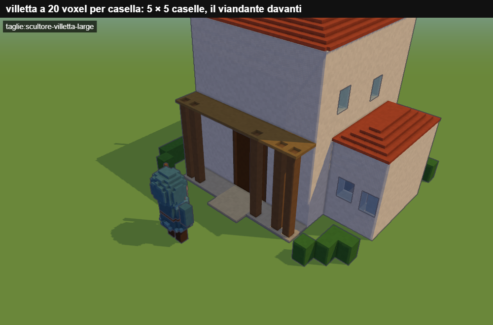 | 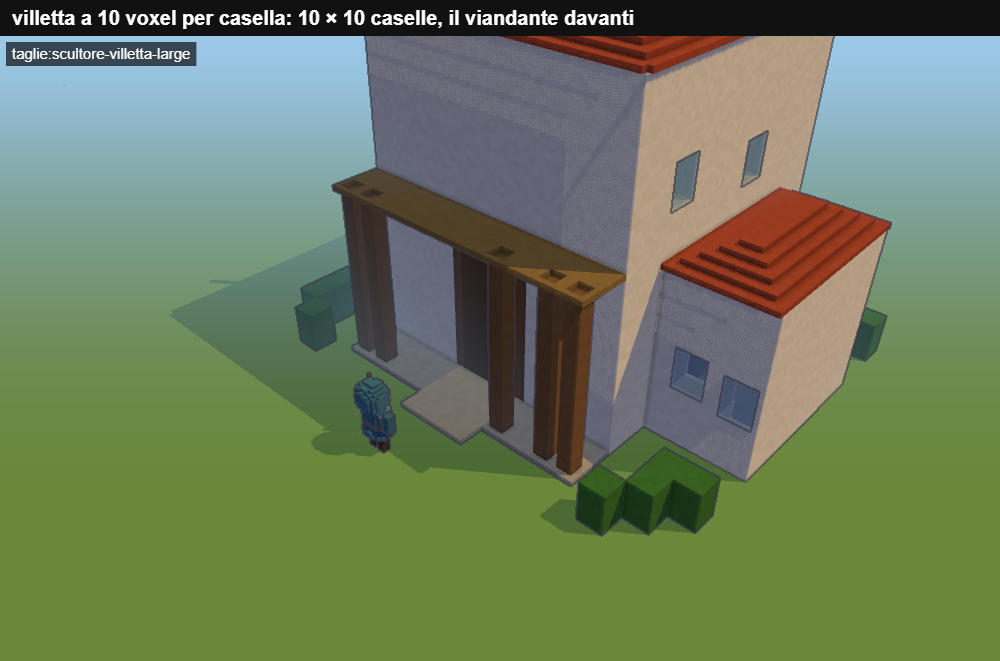 | 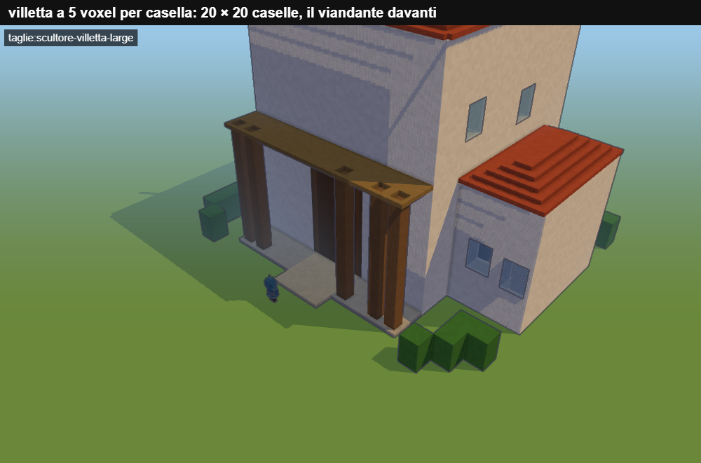 |
| rocca | 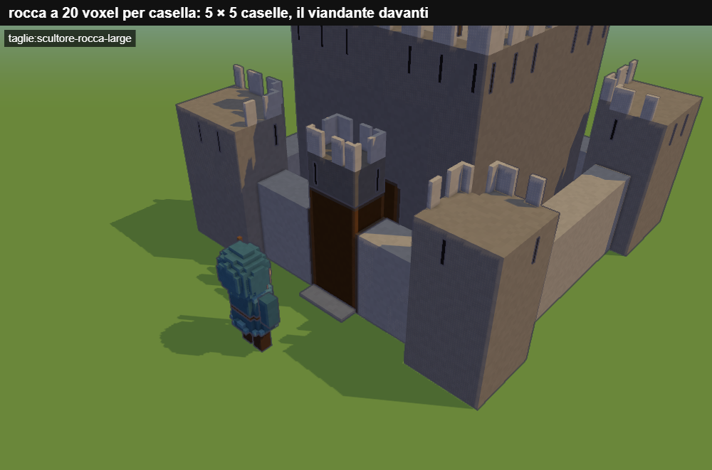 | 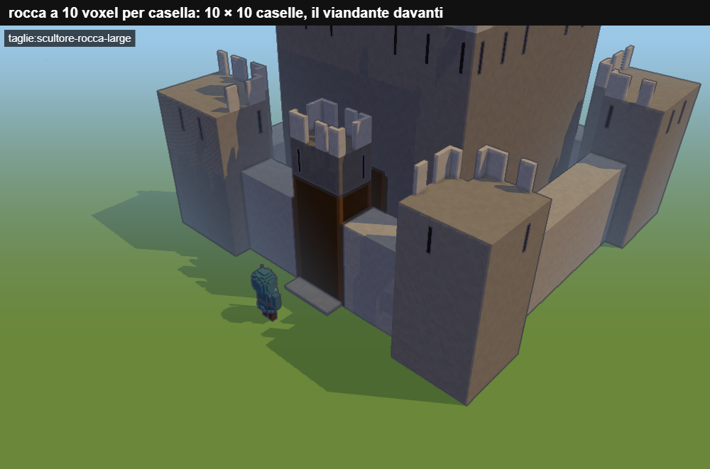 | 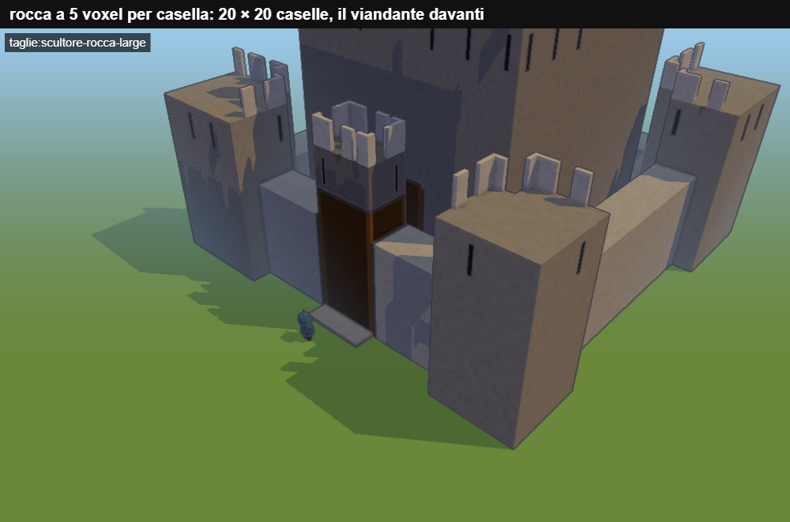 |
| forte del banco | 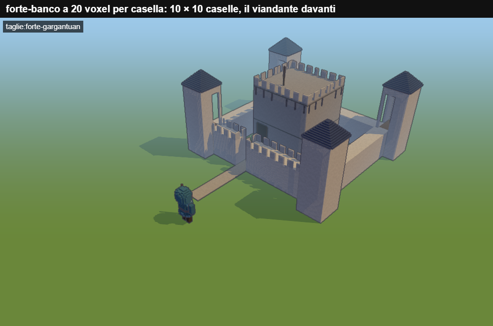 | 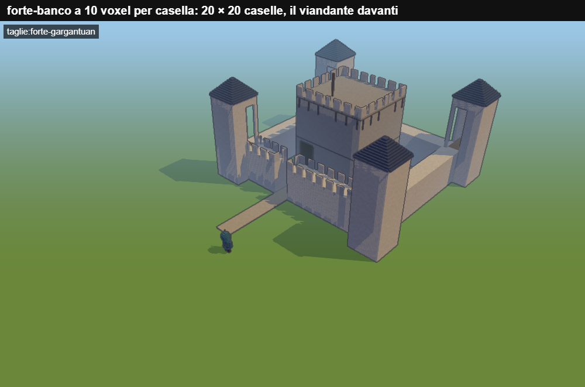 | 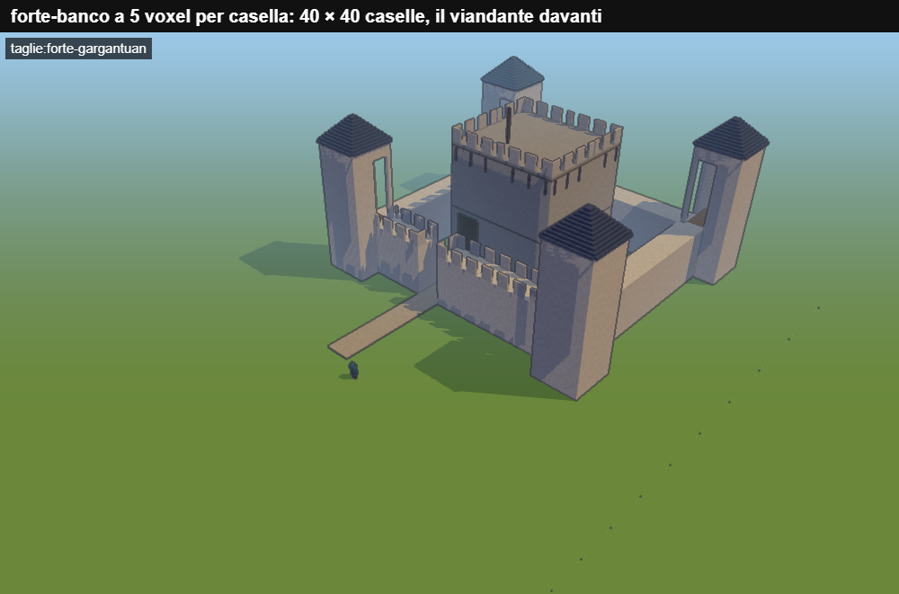 |
| fattoria di Opus | 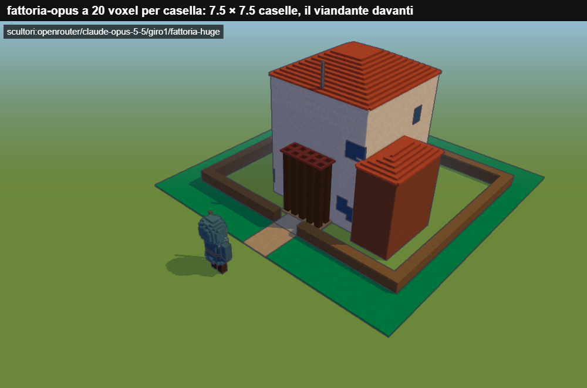 | 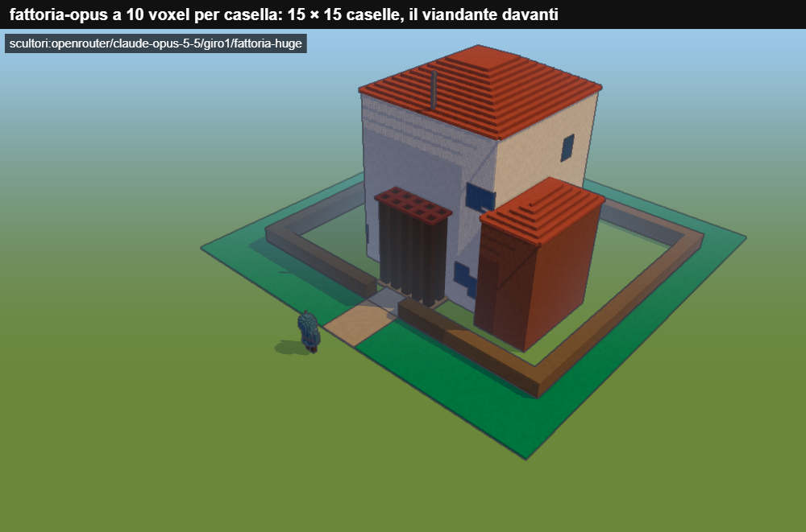 | 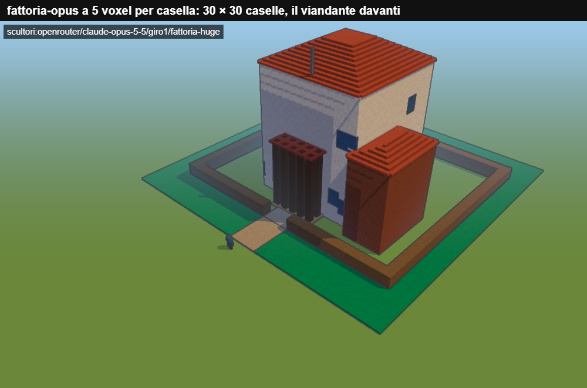 |

## Il costo del lotto che A chiederebbe

Il programma del forte non cambia con la densità: le stesse 37,5 milioni di celle, gli stessi voxel e la stessa mesh, solo scalata (nel
laboratorio cambiare densità non rifà il programma: 0 s). Le misure di T370 (ADR-0206) restano quindi quelle del forte a qualunque
densità: **7,2 s in Node, picco 164 MB, mesh 1,80 milioni di vertici e 77 MB, 8,6 s dal worker nel browser, 197 fps** con il forte
disegnato (3,8 ms di JS e 3,4 di GPU a frame, RTX 2070). Ciò che cresce è **la terra**: un luogo è 18 caselle, e il lotto di un blocco
di `B × B` luoghi è al più `18·B − 4` caselle (`blockLot`: un anello di almeno due caselle per lato, dove passano i sentieri della regola 10).

| densità | forte | blocco minimo (anello) | luoghi | un anello più largo | luoghi |
|---|---|---|---|---|---|
| 20 (oggi, T370) | 25 × 25 | 2 × 2 (5,5) | **4** | 2 × 2 | 4 |
| 10 (fattore 2) | 50 × 50 | 3 × 3 = 54 (2) | **9** | 4 × 4 = 72 (11) | 16 |
| 5 (fattore 4, A) | 100 × 100 | 6 × 6 = 108 (4) | **36** | 7 × 7 = 126 (13) | 49 |

- **In dollari** i luoghi in più non costano: gli altri luoghi del blocco hanno il piano del kernel, senza chiamate né carte (ADR-0206).
- **In memoria e tempo** i luoghi di un blocco si caricano e si scaricano insieme (`updateChunks`): a 5 sono 36 luoghi caricati appena il
  viandante ne vede uno, invece di 4; di solito il kernel carica i luoghi che la camera vede più uno per lato. Il costo di un luogo in più
  (la sua mesh del terreno, il suo piano, le sue entità) qui non è misurato: T370 ha misurato il forte, non i luoghi uno per uno. Una stima
  per difetto è che il terreno del blocco pesi 9 volte quello di oggi a 5 e poco più del doppio a 10; va misurato in T404 con
  `misura-frame.mjs` su un mondo vero.
- **La regola del blocco**: oggi `claimBlock` vuole 2 × 2 bozze libere della stessa regione, senza regioni del master e col lotto al più
  per un quarto d'acqua. 6 × 6 = 36 bozze libere sono rare in un mondo già pianificato, e col rilievo il lotto piano a un livello
  (`blockLevel`) spiana 100 × 100 caselle; 3 × 3 è molto più facile da trovare.
- **Il cerchio**: a 5 il forte (100 caselle) è più largo del cerchio di simulazione (raggio 42, 84 caselle): da nessun punto lo si vede
  tutto; a 10 (50 caselle) ci sta.

## Ciò che non è provato

- Il forte nel gioco a una densità diversa da 20 (è T404: la densità per voce e il lotto parametrico); qui solo il laboratorio.
- Le scale percorse a piedi: il laboratorio fa salire un gradino di `stepOf` del modello come il gioco, ma le foto mettono il viandante
  sul camminatoio e sulle torri dalla console, non a piedi.
- Il costo dei luoghi di un blocco grande (sopra).
