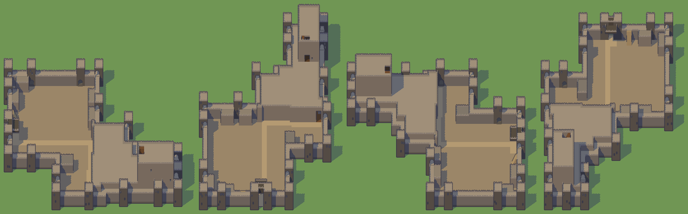
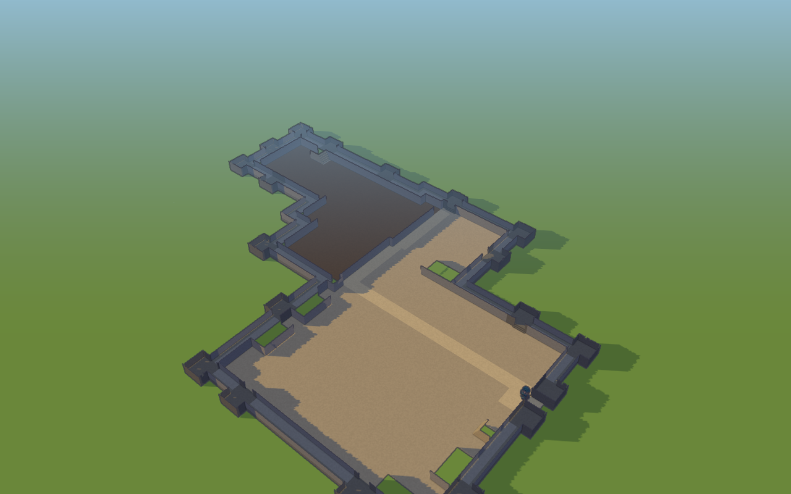

# Il riferimento dell'ottima: il forte dell'autore (T371, D53)

L'autore (13/11, D53): il forte disegnato a mano (`lab/mjx/models/handmade/forte-handmade.xml`, `docs/img/castello-gargantuan-handmade.png`:
cortili come unioni di rettangoli, mura irregolari con torri agli angoli, mastio su più piani) fissa lo standard della qualità «ottima». Non
ci si aspetta che i modelli di oggi lo raggiungano: è il riferimento. La prima versione è quella del commit del 15/11 (**v1**); altre possono
arrivare, quindi qui il riferimento è **versionato**: una versione nuova sostituisce le misure, la scala resta. La scala del forte è quella di
D61 (A2): **10 voxel per casella, 50 × 50 caselle** (`REFERENCE_VPT`); il programma e i suoi 500 × 500 × 150 voxel non cambiano, la sua voce
nella libreria è di T404. La decisione è [ADR-0210](../../../../docs/adr/0210-il-forte-dell-autore-riferimento-dell-ottima.md).

```bash
npx vite-node lab/scripts/banco-ottima.ts -- --riferimento [--versione v2] [--semi 1,2,3]   # il forte: forte-<v>.json (i tratti, l'impronta), .png (i quattro lati), -viste.txt; 7-8 s a seme
npx vite-node lab/scripts/banco-ottima.ts -- [--solo argon-giro2,rocca] [--semi 1,2,3] [--taglia gargantuan] --json giudizi.json --tabella tabella.md   # ogni forte contro il riferimento
npx vite build --mode development --outDir .tmp/dist-dev && npx vite preview --outDir .tmp/dist-dev --port <n> --strictPort
node lab/scripts/foto-ottima.mjs --url http://localhost:<n>/lab/3d/ [--versione v1] [--vpt 10]   # la foto nel laboratorio 3D, Chrome headless sulla GPU (localhost: la preview non ascolta su 127.0.0.1)
npx vitest run lab/tests/ottima.test.ts
```

Nessuna chiamata ai modelli: costo in dollari zero. **Una versione nuova del forte**: `--riferimento --versione v2` scrive `forte-v2.*`, poi
`REFERENCE_VERSION` in `../ottima.ts` passa a `v2` (il test controlla che l'impronta SHA-256 salvata sia quella del file su disco: un forte
cambiato senza una versione nuova non passa) e la tabella si rifà; `forte-v1.*` resta come storia.

## Il forte v1

`forte-v1.json`: `lab/mjx/models/handmade/forte-handmade.xml` al commit `394783b5` (15/11), 500 × 500 × 148 voxel, tre semi (6-7 s l'uno in
Node), i tratti di ognuno e la media; la varietà fra i semi (`planDistance`, la misura che il kernel rimanda allo Scultore) è **0,93**: a ogni
seme il cortile, il mastio e le torri sono altrove, è un altro forte, ben oltre la fascia 0,15-0,6 che il prompt dice a chi scrive.




I quattro lati sono a cartone, un pixel per voxel, seme 1; nel laboratorio (`?modello=forte-handmade&vpt=10`) il viandante nel portone alla scala
del gioco (le misure in viandanti sono in [`../forte-scala.md`](../forte-scala.md), T403; le foto da vicino in `docs/img/forte-scala-10.png`).
`forte-v1-viste.txt` è ciò che lo Scultore vedrebbe di lui con le viste in testo del kernel (`viewsText`, un carattere una casella: pianta,
altezze, fronte, lato, tre tagli; ≈ 4 400 token).

## La scala (`../ottima.ts`)

Quattordici tratti letti **dai soli voxel**, mai dalle lettere della palette (una lettera conta se ha un colore e non è nascosta; solo per le
aperture conta anche un nome che dice vetro o feritoia), così un forte di Gemini, di Claude o a mano si misura allo stesso modo. Le quote e le
altezze in viandanti non dipendono dalla densità. Un programma vale, su ogni tratto, la quota del riferimento che raggiunge (al più 1); il voto
su 10 è la media; un tratto che il riferimento non ha resta fuori dalla media.

| tratto | che cosa misura |
|---|---|
| cortile | della pianta dentro il contorno (ciò che è alto almeno una casella, e ciò che racchiude), la parte che è cortile |
| cortile a rettangoli | gli angoli rientranti del cortile: un rettangolo solo ne ha zero, un'unione di rettangoli molti |
| mura irregolari | gli angoli rientranti del contorno esterno (mura che girano, torri che sporgono) |
| torri agli angoli | degli angoli convessi del contorno, la parte con una torre entro una cella (un quarto di casella) |
| torri | le masse separate più alte delle mura di almeno mezza casella: torri, mastio, torre della porta |
| mura | l'altezza mediana dell'anello esterno, in viandanti |
| cima | il punto più alto, in viandanti |
| sagoma | le altezze della cima, ognuna su almeno l'1,5 % del costruito |
| piani raggiunti | i piani coperti che il corpo del kernel raggiunge a piedi dal portone (`habitableParts`, il forte girato col portone davanti, su qualunque lato stia) |
| piani in quota | di quelli, i piani almeno un viandante sopra il suolo: camminamenti, piani alti, terrazze |
| piani con stanze | i pavimenti con una stanza in cui si sta in piedi (la luce e il lato di `PARTS`) |
| merlature | la parte del perimetro con la cima a denti: corse corte con i vicini tutti e due più alti o più bassi di un voxel fino a mezza casella; il bordo di un tetto scende da un lato solo e non conta |
| aperture | la parte del perimetro con un vuoto fra due pieni nella faccia (feritoie) o vetro (finestre) |
| mastio lontano dal portone | la distanza fra la massa più alta e il portone (un varco nell'anello che si passa a terra, anche sotto una torre della porta), sulla diagonale del contorno |

Il contorno si legge su celle di un quarto di casella: una cella è «alta» se metà delle sue colonne arrivano a una casella (le mura; non
una siepe, una staccionata, un pozzo); un varco dell'anello fino a una casella e mezza (un portone senza torre) è chiuso per il riempimento
che decide che cos'è fuori, così il cortile resta cortile. La varietà fra i semi è accanto, non nel voto.

## I forti contro il riferimento (semi 1, 2, 3; valore e, fra parentesi, la quota del riferimento)

| programma | voto | cortile | cortile a rettangoli | mura irregolari | torri agli angoli | torri | mura | cima | sagoma | piani raggiunti | piani in quota | piani con stanze | merlature | aperture | mastio lontano dal portone | varietà |
|---|---|---|---|---|---|---|---|---|---|---|---|---|---|---|---|---|
| **il forte dell'autore v1** · 500 × 500 × 148 a 10 | 10,0 | 46 % (100 %) | 22.7 (100 %) | 39.7 (100 %) | 88 % (100 %) | 9.7 (100 %) | 1,7 (100 %) | 5,33 (100 %) | 7.3 (100 %) | 3.3 (100 %) | 2.3 (100 %) | 6.3 (100 %) | 82 % (100 %) | 8 % (100 %) | 0,57 (100 %) | 0.93 |
| Argon, T355 giro2 (voto 9) · Enorme, 150 × 150 × 120 | 5,9 | 44 % (97 %) | 5.3 (24 %) | 8 (20 %) | 100 % (100 %) | 6 (62 %) | 0,8 (47 %) | 2,63 (49 %) | 8.7 (100 %) | 2 (60 %) | 1 (43 %) | 3 (47 %) | 30 % (37 %) | 21 % (100 %) | 0,24 (43 %) | 0.27 |
| Argon, T355 giro3 (voto 7) · Enorme, 150 × 150 × 120 | 5,7 | 51 % (100 %) | 8 (35 %) | 8 (20 %) | 100 % (100 %) | 7 (72 %) | 0,83 (49 %) | 2,13 (40 %) | 9 (100 %) | 2 (60 %) | 1 (43 %) | 4 (63 %) | 15 % (18 %) | 50 % (100 %) | 0 (0 %) | 0.24 |
| Carbon, T391 giro2 (voto 9) · Enorme, 150 × 150 × 120 | 5,5 | 33 % (72 %) | 12.3 (54 %) | 4.7 (12 %) | 77 % (87 %) | 4.7 (48 %) | 0,92 (54 %) | 3,18 (60 %) | 7 (95 %) | 2 (60 %) | 1 (43 %) | 2 (32 %) | 39 % (48 %) | 28 % (100 %) | 0,01 (2 %) | 0.42 |
| Carbon, T391 giro3 (voto 7) · Enorme, 150 × 150 × 120 | 6,2 | 41 % (90 %) | 11.3 (50 %) | 8.7 (22 %) | 78 % (88 %) | 6.3 (66 %) | 0,81 (48 %) | 4 (75 %) | 10 (100 %) | 2 (60 %) | 1 (43 %) | 3 (47 %) | 24 % (30 %) | 28 % (100 %) | 0,32 (55 %) | 0.51 |
| Carbon, T391 giro1, Grande (voto 8) · Grande, 100 × 100 × 80 | 5,0 | 34 % (73 %) | 4.7 (21 %) | 2.7 (7 %) | 50 % (57 %) | 4 (41 %) | 0,8 (47 %) | 2,67 (50 %) | 14 (100 %) | 2 (60 %) | 1 (43 %) | 2 (32 %) | 23 % (29 %) | 26 % (100 %) | 0,2 (35 %) | 0.23 |
| Hydrogen, T391 giro3, Grande (voto 7) · Grande, 100 × 100 × 80 | 4,7 | 18 % (40 %) | 4 (18 %) | 5.3 (13 %) | 50 % (57 %) | 3 (31 %) | 0,97 (57 %) | 2,5 (47 %) | 13 (100 %) | 2 (60 %) | 1 (43 %) | 3 (47 %) | 0 % (0 %) | 26 % (100 %) | 0,24 (42 %) | 0.23 |
| Opus 5.5, T392 giro1 (voto 9) · Enorme, 150 × 150 × 120 | 4,9 | 36 % (78 %) | 6 (26 %) | 21.3 (54 %) | 0 % (0 %) | 1 (10 %) | 1,35 (79 %) | 2,4 (45 %) | 6 (82 %) | 2 (60 %) | 1 (43 %) | 3 (47 %) | 27 % (33 %) | 14 % (100 %) | 0,18 (32 %) | 0.14 |
| Opus 5.5, T392 giro2 (voto 9) · Enorme, 150 × 150 × 120 | 5,7 | 31 % (68 %) | 5.3 (24 %) | 8 (20 %) | 100 % (100 %) | 6 (62 %) | 0,8 (47 %) | 2,4 (45 %) | 7 (95 %) | 2 (60 %) | 1 (43 %) | 3 (47 %) | 29 % (36 %) | 10 % (100 %) | 0,28 (49 %) | 0.03 |
| Opus 5.5 via OpenRouter, T402 giro1 (voto 6) · Enorme, 150 × 150 × 120 | 5,7 | 51 % (100 %) | 4 (18 %) | 8.7 (22 %) | 89 % (100 %) | 6 (62 %) | 0,8 (47 %) | 2,43 (46 %) | 5.7 (77 %) | 2 (60 %) | 1 (43 %) | 3 (47 %) | 20 % (25 %) | 10 % (100 %) | 0,28 (50 %) | 0.26 |
| Sonnet 5.5, T392 giro1 (voto 9) · Enorme, 150 × 150 × 120 | 5,9 | 41 % (90 %) | 5.7 (25 %) | 11.3 (29 %) | 100 % (100 %) | 7.7 (79 %) | 0,8 (47 %) | 3,2 (60 %) | 6 (82 %) | 2 (60 %) | 1 (43 %) | 3 (47 %) | 20 % (24 %) | 7 % (81 %) | 0,34 (60 %) | 0.13 |
| Fable 5.1, T392 giro2 (voto 8) · Enorme, 150 × 150 × 120 | 5,6 | 35 % (77 %) | 4 (18 %) | 8 (20 %) | 100 % (100 %) | 6 (62 %) | 0,8 (47 %) | 2,4 (45 %) | 6 (82 %) | 2 (60 %) | 1 (43 %) | 3 (47 %) | 29 % (36 %) | 10 % (100 %) | 0,29 (50 %) | 0.19 |
| il forte del banco delle taglie (T346, a mano) · Enorme, 150 × 150 × 120 | 3,8 | 41 % (89 %) | 8 (35 %) | 0.7 (2 %) | 0 % (0 %) | 1 (10 %) | 0,82 (48 %) | 2,57 (48 %) | 4 (55 %) | 2 (60 %) | 1 (43 %) | 2 (32 %) | 63 % (77 %) | 2 % (27 %) | 0 (0 %) | 0.17 |
| la rocca scritta come lo Scultore (T354, a mano) · Enorme, 150 × 150 × 120 | 5,5 | 46 % (100 %) | 4 (18 %) | 8 (20 %) | 100 % (100 %) | 6 (62 %) | 0,8 (47 %) | 2,67 (50 %) | 6 (82 %) | 2 (60 %) | 1 (43 %) | 3 (47 %) | 23 % (28 %) | 5 % (62 %) | 0,29 (51 %) | 0.00 |
| il forte grande di T339 (a mano, il riferimento di prima) · 384 × 384 × 96 a 12 | 5,9 | 61 % (100 %) | 13.7 (60 %) | 24 (61 %) | 100 % (100 %) | 11 (100 %) | 1,33 (78 %) | 3,76 (70 %) | 4.3 (59 %) | 0.7 (20 %) | 0 (0 %) | 0 (0 %) | 20 % (24 %) | 27 % (100 %) | 0,3 (52 %) | 0.97 |
| la rocca di frontiera del cantiere (T181, a mano) · 120 × 120 × 96 a 16 | 6,3 | 31 % (68 %) | 5.3 (24 %) | 3.3 (8 %) | 72 % (82 %) | 5 (52 %) | 1,55 (91 %) | 4 (75 %) | 6 (82 %) | 3 (90 %) | 2 (86 %) | 3.3 (53 %) | 20 % (24 %) | 32 % (100 %) | 0,25 (43 %) | 0.59 |
| la villetta, la risposta offline (T354): non un forte · Enorme, 150 × 150 × 120 | 4,2 | 0 % (0 %) | 0 (0 %) | 2 (5 %) | 22 % (25 %) | 0.7 (7 %) | 1,64 (96 %) | 2,63 (49 %) | 18.7 (100 %) | 2 (60 %) | 1 (43 %) | 3 (47 %) | 0 % (0 %) | 18 % (100 %) | 0,34 (60 %) | 0.28 |

Che cosa dicono:

- **Gli Scultori stanno fra 4,7 e 6,2 su 10**, Argon, Carbon, Opus, Sonnet e Fable alla pari (il voto dell'Artista non segue la scala: il forte
  di Opus col voto 9 fa 4,9 perché non ha torri, quello di Opus via OpenRouter col voto 6 fa 5,7). Il forte grande di T339, il riferimento di
  prima, fa 5,9; la rocca di frontiera del cantiere (T181) 6,3; la rocca scritta come lo Scultore 5,5; il forte del banco delle taglie 3,8.
- **Dove sono vicini**: le torri sugli angoli (quasi sempre 100 %), la quota del cortile (31-51 % contro 46 %), le aperture (più del riferimento),
  la sagoma.
- **Dove mancano**: il cortile è **un rettangolo** cresciuto a passi (4-12 angoli rientranti contro 23) e il contorno lo segue (8 contro 40); le
  mura sono **basse** (0,8 viandanti contro 1,7: a 20 voxel per casella un muro di 24) e la cima pure (2,4 contro 5,3); **due piani raggiunti e
  uno in quota** (contro 3,3 e 2,3: nessun camminamento sulle mura raggiunto a piedi, nessuna torre cava); le merlature stanno sul mastio o sulle
  torri, non su tutto l'anello (15-40 % contro 82 %); il mastio è vicino al portone (0-0,34 contro 0,57). Il forte di T339 ha la composizione
  (cortile 61 %, 25 angoli, 11 torri) e non gli interni (0,7 piani raggiunti, nessuna stanza): il riferimento di prima era un esterno.
- **La varietà**: il forte dell'autore 0,93, gli Scultori 0,03-0,5 (il forte di Opus del giro2 è quasi fermo, 0,03), le rocche a mano 0 e 0,59.
- **I limiti della scala**: i tratti generici (mura, cima, sagoma, piani, aperture) danno punti a ogni edificio, e la villetta, che non è un forte,
  fa 4,2 con zero su cortile, angoli, torri e merlature: la scala misura la distanza dal forte, non giudica una fattoria. I piani raggiunti sono
  quelli della camminata del kernel (il corpo largo 0,44 caselle, un gradino di un quinto): il forte dell'autore ne ha 3-4 raggiunti su più che ha.

## Il metro nel prompt dello Scultore (ADR-0210)

Nel prompt delle strutture (`universe/prompts/agents/sculptor.md` dopo `<!-- strutture -->`) il forte è **un metro, non un esempio**: ADR-0183 ha
misurato che un programma nel prompt si copia (T337), quindi la sezione «The measure of «done well»: the reference fort» lo descrive in dieci righe
(il cortile unione di rettangoli, la cinta col corridoio e il camminamento raggiunto dalle scale, le torri cave sugli angoli e lungo i lati, la torre
della porta, il mastio lontano dal portone su più piani, le caserme, la strada, un altro forte a ogni seme) e dice di fare lo stesso per il proprio
concetto, senza copiare il forte in una fattoria. Il prompt delle strutture resta **sotto la misura che aveva prima** (15 933 caratteri il 17/11, ≈
4 900 token a 3,26 caratteri per token come li ha contati T325; ora 15 903): ciò che il metro aggiunge l'hanno reso i doppioni di ciò che la richiesta
già dice (`bodyLine`, `BLOCKS`); `tests/sculptor-structures.test.ts` lo tiene lì.

## Ciò che non è provato

- **Lo Scultore vero col metro nel prompt**: nessuna chiamata qui; se il metro cambia i forti di Gemini e di Claude lo dice un giro come quello di
  T355 (`lab/scripts/scultore-gemini.ts`), misurato con questa scala.
- **Il forte nel gioco a 10 voxel per casella** e la sua voce nella libreria: T404.
- **Una v2 del forte**: il banco la prende con `--riferimento --versione v2`; nessuna è ancora arrivata.
