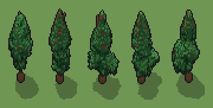

# Pino (`albero.xml`)

Classe `albero`, scatola 40 × 40 × 60 voxel; riscrittura procedurale di `universe/models/albero.xml`.


## Esito

- validatore (`modelErrors`, `checkProgram`, `analyse` a ogni seme): nessun errore, nessun frammento staccato
- varianza su 5 semi (voxel pieni in un seme e vuoti nell'altro, sui pieni in almeno uno; il colore non conta): **media 0.520**, minima 0.406, massima 0.645 (soglia 0.15) → passa
- voxel per seme: 5153, 4484, 5542, 5298, 5457; tempo per seme: 86, 81, 104, 76, 77 ms

| coppia | 1-2 | 1-3 | 1-4 | 1-5 | 2-3 | 2-4 | 2-5 | 3-4 | 3-5 | 4-5 |
|---|---|---|---|---|---|---|---|---|---|---|
| distanza | 0.406 | 0.483 | 0.541 | 0.559 | 0.444 | 0.435 | 0.645 | 0.470 | 0.581 | 0.632 |



## Traccia di tre semi a confronto

La traccia di `src/mj/trace.ts` (forma `nodi`): per ogni nodo quante volte gira, quante celle scrive e la scatola di ciò che scrive. Le
righe che cambiano fra i semi sono le scelte del programma.

### Seme 1

```text
Traccia, seme 1: griglia 40×40×60, 22 nodi, 2769 passi, finito in 80 ms.
x sinistra→destra, y fondo→davanti, z basso→alto; «.» è la cella vuota; #n è il nodo nell'ordine dell'XML; ×n quante volte ha agito.
Lettere: T=tronco, F=aghi, L=aghi al sole, N=aghi in ombra, h=altezze possibili della punta (marcatore), k=la quota scelta (marcatore), V=la sagoma a cono (marcatore), r=punta che cresce (marcatore), x=il piede, senza aghi (marcatore).
Alla fine: F 4001, T 544, N 349, L 259.
#2-5 box×1, one×1, all×2: 1627 celle x0-39 y0-39 z44-57, passi 1-81
#6-9 box×1, one×1, all×2: 1704 celle x0-39 y0-39 z0-52, passi 82-135
#10-12 cylinder×1, cone×1, box×1: 32432 celle x1-39 y1-39 z0-59, passi 136-138
#13-15 prl×1, one×1, all×1: 864 celle x14-26 y12-28 z23-48, passi 139-560
 #16 all TV → TF (+1) passi=3: ×3, 1831 celle x12-28 y10-29 z9-50, passi 561-563, V→F 1831
   r1 TV → TF ×817; r2 FV → FF ×1014
 #17 one FV → FF passi=2200: ×2200, 2200 celle x10-29 y9-30 z9-52, passi 564-2763, V→F 2200
 #18 prl FV → FF passi=1: ×1, 1045 celle x10-29 y9-31 z9-53, passi 2764, V→F 1045
 #19 all [Vx] → .: ×1, 23940 celle x1-39 y1-39 z0-59, passi 2765, x→. 13620, V→. 10320
#20-22 conv×2, prl×1: 1075 celle x10-29 y9-31 z9-53, passi 2766-2769
```

### Seme 2

```text
Traccia, seme 2: griglia 40×40×60, 22 nodi, 2719 passi, finito in 78 ms.
x sinistra→destra, y fondo→davanti, z basso→alto; «.» è la cella vuota; #n è il nodo nell'ordine dell'XML; ×n quante volte ha agito.
Lettere: T=tronco, F=aghi, L=aghi al sole, N=aghi in ombra, h=altezze possibili della punta (marcatore), k=la quota scelta (marcatore), V=la sagoma a cono (marcatore), r=punta che cresce (marcatore), x=il piede, senza aghi (marcatore).
Alla fine: F 3417, T 486, N 347, L 234.
#2-5 box×1, one×1, all×2: 1627 celle x0-39 y0-39 z44-57, passi 1-81
#6-9 box×1, one×1, all×2: 1708 celle x0-39 y0-39 z0-54, passi 82-137
#10-12 cylinder×1, cone×1, box×1: 32430 celle x1-39 y1-39 z0-59, passi 138-140
#13-15 prl×1, one×1, all×1: 744 celle x13-26 y15-26 z32-58, passi 141-509
 #16 all TV → TF (+1) passi=3: ×3, 1319 celle x13-27 y14-27 z9-59, passi 510-512, V→F 1319
   r1 TV → TF ×636; r2 FV → FF ×683
 #17 one FV → FF passi=2200: ×2200, 2200 celle x12-29 y11-28 z9-49, passi 513-2712, V→F 2200
 #18 prl FV → FF passi=1: ×1, 955 celle x11-29 y11-28 z9-42, passi 2713, V→F 955
 #19 all [Vx] → .: ×1, 24600 celle x1-39 y1-39 z0-39, passi 2714, x→. 13620, V→. 10980
#20-22 conv×2, prl×1: 1057 celle x11-29 y11-28 z9-59, passi 2715-2719
```

### Seme 3

```text
Traccia, seme 3: griglia 40×40×60, 22 nodi, 2773 passi, finito in 78 ms.
x sinistra→destra, y fondo→davanti, z basso→alto; «.» è la cella vuota; #n è il nodo nell'ordine dell'XML; ×n quante volte ha agito.
Lettere: T=tronco, F=aghi, L=aghi al sole, N=aghi in ombra, h=altezze possibili della punta (marcatore), k=la quota scelta (marcatore), V=la sagoma a cono (marcatore), r=punta che cresce (marcatore), x=il piede, senza aghi (marcatore).
Alla fine: F 4154, T 545, N 489, L 354.
#2-5 box×1, one×1, all×2: 1627 celle x0-39 y0-39 z44-57, passi 1-81
#6-9 box×1, one×1, all×2: 1708 celle x0-39 y0-39 z0-54, passi 82-137
#10-12 cylinder×1, cone×1, box×1: 32431 celle x1-39 y1-39 z0-59, passi 138-140
#13-15 prl×1, one×1, all×1: 862 celle x12-29 y11-28 z9-54, passi 141-562
 #16 all TV → TF (+1) passi=3: ×3, 2048 celle x11-31 y10-28 z9-56, passi 563-565, V→F 2048
   r1 TV → TF ×851; r2 FV → FF ×1197
 #17 one FV → FF passi=2200: ×2200, 2200 celle x9-34 y10-29 z9-57, passi 566-2765, V→F 2200
 #18 prl FV → FF passi=1: ×1, 1369 celle x9-34 y9-29 z9-56, passi 2766, V→F 1369
 #19 all [Vx] → .: ×1, 23399 celle x1-39 y1-39 z0-59, passi 2767, x→. 13620, V→. 9779
#20-22 conv×2, prl×1: 1463 celle x9-34 y9-29 z9-57, passi 2768-2773
```
