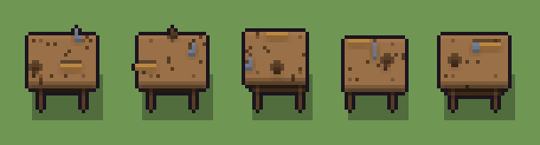

# Banco da lavoro (`banco.xml`)

Classe `mobile`, scatola 20 × 20 × 20 voxel; riscrittura procedurale di `universe/models/banco.xml`.


## Esito

- validatore (`modelErrors`, `checkProgram`, `analyse` a ogni seme): nessun errore, nessun frammento staccato
- varianza su 5 semi (voxel pieni in un seme e vuoti nell'altro, sui pieni in almeno uno; il colore non conta): **media 0.577**, minima 0.039, massima 0.958 (soglia 0.15) → passa
- voxel per seme: 697, 697, 649, 480, 697; tempo per seme: 10, 10, 18, 11, 15 ms
- avvisi: tocca i bordi laterali della griglia: forse è tagliato

| coppia | 1-2 | 1-3 | 1-4 | 1-5 | 2-3 | 2-4 | 2-5 | 3-4 | 3-5 | 4-5 |
|---|---|---|---|---|---|---|---|---|---|---|
| distanza | 0.039 | 0.537 | 0.715 | 0.401 | 0.537 | 0.715 | 0.400 | 0.958 | 0.755 | 0.715 |



## Traccia di tre semi a confronto

La traccia di `src/mj/trace.ts` (forma `nodi`): per ogni nodo quante volte gira, quante celle scrive e la scatola di ciò che scrive. Le
righe che cambiano fra i semi sono le scelte del programma.

### Seme 1

```text
Traccia, seme 1: griglia 20×20×20, 42 nodi, 151 passi, finito in 11 ms.
x sinistra→destra, y fondo→davanti, z basso→alto; «.» è la cella vuota; #n è il nodo nell'ordine dell'XML; ×n quante volte ha agito.
Lettere: N=legno, n=legno scuro, T=piano, I=ferro, G=manico, V=dove può stare il piano (marcatore), h=altezze possibili (marcatore), k=la quota scelta (marcatore), r=dove può stare il ripiano (marcatore), s=un attrezzo che nasce (marcatore), w=la sporgenza (marcatore), a=la morsa (marcatore), b=il martello (marcatore), c=la cassetta (marcatore).
Alla fine: T 470, n 181, N 36, G 6, I 4.
#2-3 box×2: 4420 celle x1-19 y4-16 z6-15, passi 1-2
#4-5 prl×1, all×1: 520 celle x1-19 y4-16 z6-15, passi 3-25
#6-15 all×3, box×5, one×1: 999 celle x0-19 y0-19 z0-15, passi 26-71
 #16 all * k → k *: ×10, 4000 celle x0-19 y0-19 z10-19, passi 72-81, .→k 2518, V→k 1458, N→k 24
 #17 all k → .: ×1, 4400 celle x0-19 y0-19 z9-19, passi 82, k→. 4400
#18-20 all×3: 729 celle x1-19 y4-16 z6-8, passi 83-85
#21-28 box×2, prl×1, one×1, all×4: 1051 celle x0-19 y0-19 z2-5, passi 86-134
#29-42 all×9, prl×2, one×3: 767 celle x0-19 y0-19 z2-10, passi 135-151
Senza effetto (non hanno mai cambiato una cella):
#7 all w → .: in quel momento nella griglia non c'erano celle "w"
```

### Seme 2

```text
Traccia, seme 2: griglia 20×20×20, 42 nodi, 150 passi, finito in 11 ms.
x sinistra→destra, y fondo→davanti, z basso→alto; «.» è la cella vuota; #n è il nodo nell'ordine dell'XML; ×n quante volte ha agito.
Lettere: N=legno, n=legno scuro, T=piano, I=ferro, G=manico, V=dove può stare il piano (marcatore), h=altezze possibili (marcatore), k=la quota scelta (marcatore), r=dove può stare il ripiano (marcatore), s=un attrezzo che nasce (marcatore), w=la sporgenza (marcatore), a=la morsa (marcatore), b=il martello (marcatore), c=la cassetta (marcatore).
Alla fine: T 469, n 182, N 36, G 6, I 4.
#2-3 box×2: 4420 celle x1-19 y4-16 z6-15, passi 1-2
#4-5 prl×1, all×1: 520 celle x1-19 y4-16 z6-15, passi 3-24
#6-15 all×3, box×5, one×1: 999 celle x0-19 y0-19 z0-15, passi 25-70
 #16 all * k → k *: ×10, 4000 celle x0-19 y0-19 z10-19, passi 71-80, .→k 2518, V→k 1458, N→k 24
 #17 all k → .: ×1, 4400 celle x0-19 y0-19 z9-19, passi 81, k→. 4400
#18-20 all×3: 729 celle x1-19 y4-16 z6-8, passi 82-84
#21-28 box×2, prl×1, one×1, all×4: 1049 celle x0-19 y0-19 z2-5, passi 85-133
#29-42 all×9, prl×2, one×3: 774 celle x0-19 y0-19 z2-10, passi 134-150
Senza effetto (non hanno mai cambiato una cella):
#7 all w → .: in quel momento nella griglia non c'erano celle "w"
```

### Seme 3

```text
Traccia, seme 3: griglia 20×20×20, 42 nodi, 148 passi, finito in 11 ms.
x sinistra→destra, y fondo→davanti, z basso→alto; «.» è la cella vuota; #n è il nodo nell'ordine dell'XML; ×n quante volte ha agito.
Lettere: N=legno, n=legno scuro, T=piano, I=ferro, G=manico, V=dove può stare il piano (marcatore), h=altezze possibili (marcatore), k=la quota scelta (marcatore), r=dove può stare il ripiano (marcatore), s=un attrezzo che nasce (marcatore), w=la sporgenza (marcatore), a=la morsa (marcatore), b=il martello (marcatore), c=la cassetta (marcatore).
Alla fine: T 418, n 181, N 40, G 6, I 4.
#2-3 box×2: 4420 celle x1-19 y4-16 z6-15, passi 1-2
#4-6 prl×1, all×2: 520 celle x1-2 y4-16 z6-15, passi 3-23
#7-15 all×3, box×5, one×1: 739 celle x0-19 y0-19 z0-15, passi 24-69
 #16 all * k → k *: ×9, 3600 celle x0-19 y0-19 z11-19, passi 70-78, .→k 2495, V→k 1085, N→k 20
 #17 all k → .: ×1, 4000 celle x0-19 y0-19 z10-19, passi 79, k→. 4000
#18-19 all×2: 434 celle x1-17 y4-16 z8-9, passi 80-81
 #20 all V → .: ×1, 434 celle x1-17 y4-16 z6-7, passi 82, V→. 434
#21-22 box×2: 648 celle x3-19 y5-19 z2-5, passi 83-84
#23-28 prl×1, one×1, all×4: 401 celle x0-19 y0-19 z2-5, passi 85-131
#29-42 all×9, prl×2, one×3: 769 celle x0-19 y0-19 z2-11, passi 132-148
```
