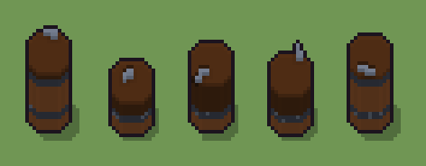

# Barile (`barile.xml`)

Classe `mobile`, scatola 20 × 20 × 20 voxel; riscrittura procedurale di `universe/models/barile.xml`.


## Esito

- validatore (`modelErrors`, `checkProgram`, `analyse` a ogni seme): nessun errore, nessun frammento staccato
- varianza su 5 semi (voxel pieni in un seme e vuoti nell'altro, sui pieni in almeno uno; il colore non conta): **media 0.244**, minima 0.062, massima 0.436 (soglia 0.15) → passa
- voxel per seme: 1750, 987, 1423, 1205, 1641; tempo per seme: 8, 11, 9, 10, 8 ms
- avvisi: colori mai usati: L T

| coppia | 1-2 | 1-3 | 1-4 | 1-5 | 2-3 | 2-4 | 2-5 | 3-4 | 3-5 | 4-5 |
|---|---|---|---|---|---|---|---|---|---|---|
| distanza | 0.436 | 0.188 | 0.313 | 0.062 | 0.306 | 0.181 | 0.399 | 0.156 | 0.134 | 0.268 |



## Traccia di tre semi a confronto

La traccia di `src/mj/trace.ts` (forma `nodi`): per ogni nodo quante volte gira, quante celle scrive e la scatola di ciò che scrive. Le
righe che cambiano fra i semi sono le scelte del programma.

### Seme 1

```text
Traccia, seme 1: griglia 20×20×20, 28 nodi, 77 passi, finito in 11 ms.
x sinistra→destra, y fondo→davanti, z basso→alto; «.» è la cella vuota; #n è il nodo nell'ordine dell'XML; ×n quante volte ha agito.
Lettere: W=legno doghe, D=fessura doghe, I=cerchio ferro, S=ferro lucido, h=altezze possibili (marcatore), k=il taglio (marcatore), p=la pancia larga (marcatore), q=la pancia a botte (marcatore), m=il dado della pancia, poi il mestolo (marcatore), b=scelta: pancia a botte (marcatore).
Alla fine: W 1090, I 371, D 218, S 71.
#2-5 cylinder×3, box×1: 9695 celle x2-18 y2-18 z0-19, passi 1-4
#6-8 one×1, all×2: 218 celle x5-15 y5-15 z0, passi 5-18
 #9 all [pq] → .: ×1, 2380 celle x2-18 y2-18 z1-17, passi 19, q→. 1428, p→. 952
#11-17 box×3, one×1, all×3: 2059 celle x0-19 y0-19 z3-19, passi 20-65
#18-28 all×4, prl×2, one×2: 1894 celle x0-19 y0-19 z3-19, passi 66-77
Senza effetto (non hanno mai cambiato una cella):
#10 convolution W→. se . in [15,16,17,18,19,20,21,22,23,24,25,26]
#20 all D/D/D/D/D D/D/D/D/D → */*/*/*/* */*/W/*/*: le celle cercate c'erano, ma mai disposte come nel pattern
#21 all D/D/D D/D/D → */*/* */T/* passi=1: le celle cercate c'erano, ma mai disposte come nel pattern
#26 prl . W → . D passi=1: le celle cercate c'erano, ma mai disposte come nel pattern
```

### Seme 2

```text
Traccia, seme 2: griglia 20×20×20, 28 nodi, 73 passi, finito in 12 ms.
x sinistra→destra, y fondo→davanti, z basso→alto; «.» è la cella vuota; #n è il nodo nell'ordine dell'XML; ×n quante volte ha agito.
Lettere: W=legno doghe, D=fessura doghe, I=cerchio ferro, S=ferro lucido, h=altezze possibili (marcatore), k=il taglio (marcatore), p=la pancia larga (marcatore), q=la pancia a botte (marcatore), m=il dado della pancia, poi il mestolo (marcatore).
Alla fine: D 436, W 327, I 190, S 34.
#2-5 cylinder×3, box×1: 9695 celle x2-18 y2-18 z0-19, passi 1-4
#6-16 one×2, all×3, box×3: 3240 celle x0-19 y0-19 z0-19, passi 5-49
 #17 all * k → k *: ×10, 4000 celle x0-19 y0-19 z10-19, passi 50-59, .→k 2910, W→k 872, I→k 218
#18-28 all×4, prl×2, one×2: 4879 celle x0-19 y0-19 z3-19, passi 60-73
Senza effetto (non hanno mai cambiato una cella):
#7 all aW → aa (+5): in quel momento nella griglia non c'erano celle "a", "b"
#8 all [ab] → W: in quel momento nella griglia non c'erano celle "ab"
#10 convolution W→. se . in [15,16,17,18,19,20,21,22,23,24,25,26]
#20 all D/D/D/D/D D/D/D/D/D → */*/*/*/* */*/W/*/*: le celle cercate c'erano, ma mai disposte come nel pattern
#21 all D/D/D D/D/D → */*/* */T/* passi=1: le celle cercate c'erano, ma mai disposte come nel pattern
#26 prl . W → . D passi=1: le celle cercate c'erano, ma mai disposte come nel pattern
```

### Seme 3

```text
Traccia, seme 3: griglia 20×20×20, 28 nodi, 73 passi, finito in 12 ms.
x sinistra→destra, y fondo→davanti, z basso→alto; «.» è la cella vuota; #n è il nodo nell'ordine dell'XML; ×n quante volte ha agito.
Lettere: W=legno doghe, D=fessura doghe, I=cerchio ferro, S=ferro lucido, h=altezze possibili (marcatore), k=il taglio (marcatore), p=la pancia larga (marcatore), q=la pancia a botte (marcatore), m=il dado della pancia, poi il mestolo (marcatore).
Alla fine: D 872, W 327, I 190, S 34.
#2-5 cylinder×3, box×1: 9695 celle x2-18 y2-18 z0-19, passi 1-4
#6-16 one×2, all×3, box×3: 3240 celle x0-19 y0-19 z0-19, passi 5-49
 #17 all * k → k *: ×6, 2400 celle x0-19 y0-19 z14-19, passi 50-55, .→k 1746, W→k 654
#18-28 all×4, prl×2, one×2: 3709 celle x0-19 y0-19 z3-19, passi 56-73
Senza effetto (non hanno mai cambiato una cella):
#7 all aW → aa (+5): in quel momento nella griglia non c'erano celle "a", "b"
#8 all [ab] → W: in quel momento nella griglia non c'erano celle "ab"
#10 convolution W→. se . in [15,16,17,18,19,20,21,22,23,24,25,26]
#20 all D/D/D/D/D D/D/D/D/D → */*/*/*/* */*/W/*/*: le celle cercate c'erano, ma mai disposte come nel pattern
#21 all D/D/D D/D/D → */*/* */T/* passi=1: le celle cercate c'erano, ma mai disposte come nel pattern
#26 prl . W → . D passi=1: le celle cercate c'erano, ma mai disposte come nel pattern
```
