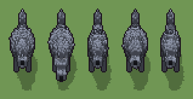

# Lupo (`bestia.xml`)

Classe `bestia`, scatola 25 × 40 × 30 voxel; riscrittura procedurale di `universe/models/bestia.xml`.


## Esito

- validatore (`modelErrors`, `checkProgram`, `analyse` a ogni seme): nessun errore, nessun frammento staccato
- varianza su 5 semi (voxel pieni in un seme e vuoti nell'altro, sui pieni in almeno uno; il colore non conta): **media 0.182**, minima 0.027, massima 0.329 (soglia 0.15) → passa
- voxel per seme: 5400, 5487, 4466, 5404, 4485; tempo per seme: 52, 53, 47, 52, 51 ms
- avvisi: tocca i bordi laterali della griglia: forse è tagliato; tocca il soffitto della griglia: forse è tagliato in alto

| coppia | 1-2 | 1-3 | 1-4 | 1-5 | 2-3 | 2-4 | 2-5 | 3-4 | 3-5 | 4-5 |
|---|---|---|---|---|---|---|---|---|---|---|
| distanza | 0.181 | 0.182 | 0.029 | 0.189 | 0.325 | 0.182 | 0.329 | 0.184 | 0.027 | 0.188 |



## Traccia di tre semi a confronto

La traccia di `src/mj/trace.ts` (forma `nodi`): per ogni nodo quante volte gira, quante celle scrive e la scatola di ciò che scrive. Le
righe che cambiano fra i semi sono le scelte del programma.

### Seme 1

```text
Traccia, seme 1: griglia 25×40×30, 64 nodi, 155 passi, finito in 61 ms.
x sinistra→destra, y fondo→davanti, z basso→alto; «.» è la cella vuota; #n è il nodo nell'ordine dell'XML; ×n quante volte ha agito.
Lettere: 0=mescola (marcatore), A=zampa anteriore sx, I=zampa anteriore dx, U=zampa posteriore sx, V=zampa posteriore dx, F=pelliccia grigia, D=dorso scuro, W=folto pelo chiaro, H=luce pelliccia, C=coda folta, K=tartufo e dettagli, E=occhi ambrati, h=la testa alta (marcatore), j=la testa bassa (marcatore), e=occhi della testa alta (marcatore), n=tartufo della testa alta (marcatore), f=occhi della testa bassa (marcatore), o=tartufo della testa bassa (marcatore), x=la coda bassa (marcatore), y=la coda dritta (marcatore), z=la coda alzata (marcatore), p=il corpo massiccio (marcatore), q=la gorgiera (marcatore), m=dado (marcatore), a=scelta (marcatore).
Alla fine: F 2505, D 692, C 530, W 478, H 290, U 236, V 236, A 210, I 210, K 9, E 4.
#2-20 box×6, prl×1, all×3, ellipsoid×7, cylinder×1, one×1: 11924 celle x0-24 y0-28 z0-29, passi 1-43
#22-64 ellipsoid×8, cylinder×1, box×12, cone×7, one×3, all×7, prl×2: 6339 celle x2-21 y0-39 z3-28, passi 44-155
Senza effetto (non hanno mai cambiato una cella):
#21 all p → .: in quel momento nella griglia non c'erano celle "p"
#52 all [xyz] → .: in quel momento nella griglia non c'erano celle "xyz"
#58 all b → F: in quel momento nella griglia non c'erano celle "b"
#62 convolution .→F se F in [18,19,20,21,22,23,24,25,26]
```

### Seme 2

```text
Traccia, seme 2: griglia 25×40×30, 64 nodi, 151 passi, finito in 59 ms.
x sinistra→destra, y fondo→davanti, z basso→alto; «.» è la cella vuota; #n è il nodo nell'ordine dell'XML; ×n quante volte ha agito.
Lettere: 0=mescola (marcatore), A=zampa anteriore sx, I=zampa anteriore dx, U=zampa posteriore sx, V=zampa posteriore dx, F=pelliccia grigia, D=dorso scuro, W=folto pelo chiaro, H=luce pelliccia, C=coda folta, K=tartufo e dettagli, E=occhi ambrati, h=la testa alta (marcatore), j=la testa bassa (marcatore), e=occhi della testa alta (marcatore), n=tartufo della testa alta (marcatore), f=occhi della testa bassa (marcatore), o=tartufo della testa bassa (marcatore), x=la coda bassa (marcatore), y=la coda dritta (marcatore), z=la coda alzata (marcatore), p=il corpo massiccio (marcatore), q=la gorgiera (marcatore), m=dado (marcatore), a=scelta (marcatore), b=scelta (marcatore).
Alla fine: F 2491, D 700, W 566, C 523, H 302, U 236, V 236, A 210, I 210, K 9, E 4.
#2-17 box×6, prl×1, all×1, ellipsoid×7, cylinder×1: 5922 celle x0-24 y0-28 z0-29, passi 1-16
#18-64 one×4, all×9, ellipsoid×8, cylinder×1, box×12, cone×7, prl×2: 12696 celle x2-22 y0-39 z3-28, passi 17-151
Senza effetto (non hanno mai cambiato una cella):
#21 all p → .: in quel momento nella griglia non c'erano celle "p"
#52 all [xyz] → .: in quel momento nella griglia non c'erano celle "xyz"
#58 all b → F: in quel momento nella griglia non c'erano celle "b"
#62 convolution .→F se F in [18,19,20,21,22,23,24,25,26]
```

### Seme 3

```text
Traccia, seme 3: griglia 25×40×30, 64 nodi, 134 passi, finito in 49 ms.
x sinistra→destra, y fondo→davanti, z basso→alto; «.» è la cella vuota; #n è il nodo nell'ordine dell'XML; ×n quante volte ha agito.
Lettere: 0=mescola (marcatore), A=zampa anteriore sx, I=zampa anteriore dx, U=zampa posteriore sx, V=zampa posteriore dx, F=pelliccia grigia, D=dorso scuro, W=folto pelo chiaro, H=luce pelliccia, C=coda folta, K=tartufo e dettagli, E=occhi ambrati, h=la testa alta (marcatore), j=la testa bassa (marcatore), e=occhi della testa alta (marcatore), n=tartufo della testa alta (marcatore), f=occhi della testa bassa (marcatore), o=tartufo della testa bassa (marcatore), x=la coda bassa (marcatore), y=la coda dritta (marcatore), z=la coda alzata (marcatore), p=il corpo massiccio (marcatore), q=la gorgiera (marcatore), m=dado (marcatore), a=scelta (marcatore), b=scelta (marcatore).
Alla fine: F 2104, D 596, C 537, U 236, V 236, H 222, A 210, I 210, W 102, K 9, E 4.
#2-64 box×18, prl×3, all×9, ellipsoid×15, cylinder×2, one×4, cone×7: 12951 celle x0-24 y0-39 z0-29, passi 1-134
Senza effetto (non hanno mai cambiato una cella):
#19 all aF → aa (+1): in quel momento nella griglia non c'erano celle "a"
#20 all a → F: in quel momento nella griglia non c'erano celle "a"
#52 all [xyz] → .: in quel momento nella griglia non c'erano celle "xyz"
#57 all a → W: in quel momento nella griglia non c'erano celle "a"
#62 convolution .→F se F in [18,19,20,21,22,23,24,25,26]
```
