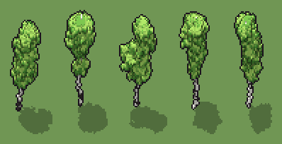

# Betulla (`betulla.xml`)

Classe `albero`, scatola 40 × 40 × 60 voxel; riscrittura procedurale di `universe/models/betulla.xml`.


## Esito

- validatore (`modelErrors`, `checkProgram`, `analyse` a ogni seme): nessun errore, nessun frammento staccato
- varianza su 5 semi (voxel pieni in un seme e vuoti nell'altro, sui pieni in almeno uno; il colore non conta): **media 0.667**, minima 0.523, massima 0.775 (soglia 0.15) → passa
- voxel per seme: 4056, 4106, 4097, 4130, 4104; tempo per seme: 97, 101, 98, 97, 96 ms
- avvisi: tocca il soffitto della griglia: forse è tagliato in alto

| coppia | 1-2 | 1-3 | 1-4 | 1-5 | 2-3 | 2-4 | 2-5 | 3-4 | 3-5 | 4-5 |
|---|---|---|---|---|---|---|---|---|---|---|
| distanza | 0.763 | 0.594 | 0.775 | 0.673 | 0.741 | 0.523 | 0.564 | 0.774 | 0.693 | 0.568 |



## Traccia di tre semi a confronto

La traccia di `src/mj/trace.ts` (forma `nodi`): per ogni nodo quante volte gira, quante celle scrive e la scatola di ciò che scrive. Le
righe che cambiano fra i semi sono le scelte del programma.

### Seme 1

```text
Traccia, seme 1: griglia 40×40×60, 26 nodi, 4420 passi, finito in 114 ms.
x sinistra→destra, y fondo→davanti, z basso→alto; «.» è la cella vuota; #n è il nodo nell'ordine dell'XML; ×n quante volte ha agito.
Lettere: W=corteccia bianca, K=macchia scura, D=corteccia ombra, F=foglie verde chiaro, l=foglie sole, L=foglie ombra, S=foglie profonde, h=altezze possibili della cima (marcatore), k=la quota scelta (marcatore), V=dove possono stare le foglie (marcatore), r=punta che cresce (marcatore), x=il fusto nudo (marcatore), c=dove nasce una nuvola (marcatore).
Alla fine: S 1489, F 1380, L 491, l 462, W 157, K 55, D 22.
#2-9 box×2, one×2, all×4: 3321 celle x0-39 y0-39 z0-54, passi 1-133
#10-11 ellipsoid×1, box×1: 58786 celle x1-39 y1-39 z0-59, passi 134-135
#12-16 prl×1, one×2, all×2: 226 celle x19-30 y16-24 z22-53, passi 136-209
 #17 one cV → cF (+1) passi=4200: ×4200, 4200 celle x14-35 y9-30 z22-57, passi 210-4409, V→F 4200
   r1 cV → cF ×131; r2 FV → FF ×4069
 #18 all c → W: ×1, 76 celle x19-30 y16-24 z25-53, passi 4410, c→W 76
 #19 all [Vx] → .: ×1, 53804 celle x1-39 y1-39 z0-59, passi 4411, x→. 33440, V→. 20364
#20-26 all×2, prl×2, conv×3: 2935 celle x14-35 y9-30 z0-57, passi 4412-4420
```

### Seme 2

```text
Traccia, seme 2: griglia 40×40×60, 26 nodi, 4421 passi, finito in 114 ms.
x sinistra→destra, y fondo→davanti, z basso→alto; «.» è la cella vuota; #n è il nodo nell'ordine dell'XML; ×n quante volte ha agito.
Lettere: W=corteccia bianca, K=macchia scura, D=corteccia ombra, F=foglie verde chiaro, l=foglie sole, L=foglie ombra, S=foglie profonde, h=altezze possibili della cima (marcatore), k=la quota scelta (marcatore), V=dove possono stare le foglie (marcatore), r=punta che cresce (marcatore), x=il fusto nudo (marcatore), c=dove nasce una nuvola (marcatore).
Alla fine: S 1752, F 1249, L 485, l 389, W 164, K 48, D 19.
#2-9 box×2, one×2, all×4: 3325 celle x0-39 y0-39 z0-54, passi 1-135
#10-11 ellipsoid×1, box×1: 58784 celle x1-39 y1-39 z0-59, passi 136-137
#12-16 prl×1, one×2, all×2: 213 celle x17-24 y16-21 z23-59, passi 138-211
 #17 one cV → cF (+1) passi=4200: ×4200, 4200 celle x9-31 y9-29 z22-59, passi 212-4411, V→F 4200
   r1 cV → cF ×120; r2 FV → FF ×4080
 #18 all c → W: ×1, 68 celle x17-24 y16-21 z23-59, passi 4412, c→W 68
 #19 all [Vx] → .: ×1, 53810 celle x1-39 y1-39 z0-59, passi 4413, x→. 33440, V→. 20370
#20-26 all×2, prl×2, conv×3: 3059 celle x9-31 y9-29 z0-59, passi 4414-4421
```

### Seme 3

```text
Traccia, seme 3: griglia 40×40×60, 26 nodi, 4421 passi, finito in 118 ms.
x sinistra→destra, y fondo→davanti, z basso→alto; «.» è la cella vuota; #n è il nodo nell'ordine dell'XML; ×n quante volte ha agito.
Lettere: W=corteccia bianca, K=macchia scura, D=corteccia ombra, F=foglie verde chiaro, l=foglie sole, L=foglie ombra, S=foglie profonde, h=altezze possibili della cima (marcatore), k=la quota scelta (marcatore), V=dove possono stare le foglie (marcatore), r=punta che cresce (marcatore), x=il fusto nudo (marcatore), c=dove nasce una nuvola (marcatore).
Alla fine: S 1451, F 1438, L 505, l 470, W 167, K 42, D 24.
#2-9 box×2, one×2, all×4: 3323 celle x0-39 y0-39 z0-54, passi 1-134
#10-11 ellipsoid×1, box×1: 58785 celle x1-39 y1-39 z0-59, passi 135-136
#12-16 prl×1, one×2, all×2: 225 celle x14-29 y18-24 z22-55, passi 137-210
 #17 one cV → cF (+1) passi=4200: ×4200, 4200 celle x7-34 y13-31 z22-59, passi 211-4410, V→F 4200
   r1 cV → cF ×139; r2 FV → FF ×4061
 #18 all c → W: ×1, 75 celle x14-29 y18-24 z22-55, passi 4411, c→W 75
 #19 all [Vx] → .: ×1, 53804 celle x1-39 y1-39 z0-59, passi 4412, x→. 33440, V→. 20364
#20-26 all×2, prl×2, conv×3: 2865 celle x7-34 y13-31 z0-58, passi 4413-4421
```
