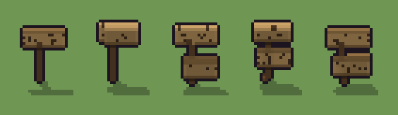

# Cartello (`cartello.xml`)

Classe `mobile`, scatola 20 × 20 × 20 voxel; riscrittura procedurale di `universe/models/cartello.xml`.


## Esito

- validatore (`modelErrors`, `checkProgram`, `analyse` a ogni seme): nessun errore, nessun frammento staccato
- varianza su 5 semi (voxel pieni in un seme e vuoti nell'altro, sui pieni in almeno uno; il colore non conta): **media 0.664**, minima 0.477, massima 0.874 (soglia 0.15) → passa
- voxel per seme: 147, 217, 295, 267, 273; tempo per seme: 9, 6, 6, 5, 5 ms
- avvisi: tocca i bordi laterali della griglia: forse è tagliato; tocca il soffitto della griglia: forse è tagliato in alto

| coppia | 1-2 | 1-3 | 1-4 | 1-5 | 2-3 | 2-4 | 2-5 | 3-4 | 3-5 | 4-5 |
|---|---|---|---|---|---|---|---|---|---|---|
| distanza | 0.532 | 0.852 | 0.749 | 0.874 | 0.631 | 0.487 | 0.697 | 0.652 | 0.477 | 0.689 |



## Traccia di tre semi a confronto

La traccia di `src/mj/trace.ts` (forma `nodi`): per ogni nodo quante volte gira, quante celle scrive e la scatola di ciò che scrive. Le
righe che cambiano fra i semi sono le scelte del programma.

### Seme 1

```text
Traccia, seme 1: griglia 20×20×20, 27 nodi, 86 passi, finito in 5 ms.
x sinistra→destra, y fondo→davanti, z basso→alto; «.» è la cella vuota; #n è il nodo nell'ordine dell'XML; ×n quante volte ha agito.
Lettere: N=palo, L=tavola, n=bordo, d=incisione, h=altezze possibili (marcatore), k=la quota scelta (marcatore), r=la punta del palo (marcatore), t=dove nasce una tavola (marcatore), a=una tavola che si allunga (marcatore), S=la cima (marcatore).
Alla fine: N 61, L 47, n 28, d 11.
#2-4 box×1, one×1, all×1: 14 celle x0 y0 z12-18, passi 1-3
 #5 all k. → kk: ×38, 399 celle x0-19 y0-19 z16, passi 4-41, .→k 399
#6-8 box×1, one×1, all×1: 32 celle x10 y10-11 z0-15, passi 42-58
 #9 all k → .: ×1, 400 celle x0-19 y0-19 z16, passi 59, k→. 400
#10-21 all×4, one×2, prl×1: 62 celle x5-19 y10-12 z0-15, passi 60-77
#22-25 all×4: 99 celle x5-19 y12 z13-18, passi 78-84
#26-27 all×1, prl×1: 69 celle x5-19 y12 z14-17, passi 85-86
Senza effetto (non hanno mai cambiato una cella):
#13 all * S → * N: in quel momento nella griglia non c'erano celle "S"
#14 prl N/. → */t passi=1
#15 all t/*/* */*/* */*/* */*/* → */*/* */*/* */*/* */*/*: le celle cercate c'erano, ma mai disposte come nel pattern
#17 all t → .: in quel momento nella griglia non c'erano celle "t"
#20 prl a. → aa passi=4: le celle cercate c'erano, ma mai disposte come nel pattern
```

### Seme 2

```text
Traccia, seme 2: griglia 20×20×20, 27 nodi, 86 passi, finito in 5 ms.
x sinistra→destra, y fondo→davanti, z basso→alto; «.» è la cella vuota; #n è il nodo nell'ordine dell'XML; ×n quante volte ha agito.
Lettere: N=palo, L=tavola, n=bordo, d=incisione, h=altezze possibili (marcatore), k=la quota scelta (marcatore), r=la punta del palo (marcatore), t=dove nasce una tavola (marcatore), a=una tavola che si allunga (marcatore), S=la cima (marcatore).
Alla fine: L 123, N 65, n 24, d 5.
#2-4 box×1, one×1, all×1: 14 celle x0 y0 z12-18, passi 1-3
 #5 all k. → kk: ×38, 399 celle x0-19 y0-19 z17, passi 4-41, .→k 399
#6-8 box×1, one×1, all×1: 34 celle x10-11 y10 z0-16, passi 42-59
 #9 all k → .: ×1, 400 celle x0-19 y0-19 z17, passi 60, k→. 400
#10-25 all×7, one×2, prl×1: 226 celle x6-19 y10-12 z0-19, passi 61-84
#26-27 all×1, prl×1: 133 celle x6-19 y11-12 z15-19, passi 85-86
Senza effetto (non hanno mai cambiato una cella):
#13 all * S → * N: in quel momento nella griglia non c'erano celle "S"
#14 prl N/. → */t passi=1
#15 all t/*/* */*/* */*/* */*/* → */*/* */*/* */*/* */*/*: le celle cercate c'erano, ma mai disposte come nel pattern
#17 all t → .: in quel momento nella griglia non c'erano celle "t"
#20 prl a. → aa passi=4: le celle cercate c'erano, ma mai disposte come nel pattern
#24 all . a → * n: le celle cercate c'erano, ma mai disposte come nel pattern
```

### Seme 3

```text
Traccia, seme 3: griglia 20×20×20, 27 nodi, 90 passi, finito in 6 ms.
x sinistra→destra, y fondo→davanti, z basso→alto; «.» è la cella vuota; #n è il nodo nell'ordine dell'XML; ×n quante volte ha agito.
Lettere: N=palo, L=tavola, n=bordo, d=incisione, h=altezze possibili (marcatore), k=la quota scelta (marcatore), r=la punta del palo (marcatore), t=dove nasce una tavola (marcatore), a=una tavola che si allunga (marcatore), S=la cima (marcatore).
Alla fine: L 158, N 65, n 60, d 12.
#2-4 box×1, one×1, all×1: 14 celle x0 y0 z12-18, passi 1-3
 #5 all k. → kk: ×38, 399 celle x0-19 y0-19 z17, passi 4-41, .→k 399
#6-8 box×1, one×1, all×1: 34 celle x9-10 y10 z0-16, passi 42-59
 #9 all k → .: ×1, 400 celle x0-19 y0-19 z17, passi 60, k→. 400
#10-22 all×5, prl×2, one×2: 207 celle x5-19 y10-13 z0-19, passi 61-84
#23-25 all×3: 134 celle x5-19 y11-13 z4-15, passi 85-88
#26-27 all×1, prl×1: 182 celle x5-19 y11-13 z5-19, passi 89-90
Senza effetto (non hanno mai cambiato una cella):
#13 all * S → * N: in quel momento nella griglia non c'erano celle "S"
#15 all t/*/* */*/* */*/* */*/* → */*/* */*/* */*/* */*/*: le celle cercate c'erano, ma mai disposte come nel pattern
#17 all t → .: in quel momento nella griglia non c'erano celle "t"
#20 prl a. → aa passi=4: le celle cercate c'erano, ma mai disposte come nel pattern
```
