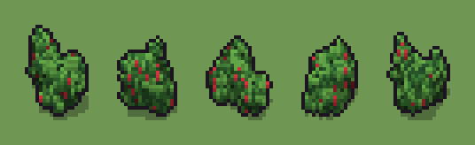

# Cespuglio con bacche (`cespuglio-con-bacche.xml`)

Classe `cespuglio`, scatola 20 × 20 × 16 voxel; riscrittura procedurale di `universe/models/cespuglio-con-bacche.xml`.


## Esito

- validatore (`modelErrors`, `checkProgram`, `analyse` a ogni seme): nessun errore, nessun frammento staccato
- varianza su 5 semi (voxel pieni in un seme e vuoti nell'altro, sui pieni in almeno uno; il colore non conta): **media 0.600**, minima 0.512, massima 0.716 (soglia 0.15) → passa
- voxel per seme: 889, 956, 791, 815, 894; tempo per seme: 7, 7, 9, 7, 8 ms
- avvisi: tocca i bordi laterali della griglia: forse è tagliato

| coppia | 1-2 | 1-3 | 1-4 | 1-5 | 2-3 | 2-4 | 2-5 | 3-4 | 3-5 | 4-5 |
|---|---|---|---|---|---|---|---|---|---|---|
| distanza | 0.611 | 0.661 | 0.572 | 0.610 | 0.623 | 0.523 | 0.512 | 0.716 | 0.584 | 0.588 |



## Traccia di tre semi a confronto

La traccia di `src/mj/trace.ts` (forma `nodi`): per ogni nodo quante volte gira, quante celle scrive e la scatola di ciò che scrive. Le
righe che cambiano fra i semi sono le scelte del programma.

### Seme 1

```text
Traccia, seme 1: griglia 20×20×16, 14 nodi, 741 passi, finito in 8 ms.
x sinistra→destra, y fondo→davanti, z basso→alto; «.» è la cella vuota; #n è il nodo nell'ordine dell'XML; ×n quante volte ha agito.
Lettere: L=foglie, H=foglie chiare, D=foglie scure, I=bacche, V=dove nasce un ciuffo (marcatore), c=un ciuffo che sale (marcatore).
Alla fine: L 606, D 187, H 76, I 20.
#2-3 ellipsoid×1, box×1: 98 celle x5-15 y5-15 z0, passi 1-2
#4-6 one×1, prl×1, all×1: 96 celle x5-15 y5-15 z0, passi 3-5
#7-8 prl×1, all×1: 77 celle x7-16 y4-12 z0-9, passi 6-16
 #9 one L. → LL passi=520: ×520, 520 celle x4-19 y3-16 z0-11, passi 17-536, .→L 520
 #10 one L. → LL passi=200: ×200, 200 celle x3-19 y1-16 z0-10, passi 537-736, .→L 200
 #11 all c → L: ×1, 27 celle x8-15 y5-11 z0-8, passi 737, c→L 27
 #12 convolution .→L se L in [14,15,16,17,18,19,20,21,22,23,24,25,26]; L→. se L in [1,2,3,4,5,6]: ×2, 204 celle x3-19 y1-16 z0-11, passi 738-739, .→L 146, L→. 58
   r1 .→L ×146; r2 L→. ×58
 #13 prl . L → . H (+1) passi=1: ×1, 271 celle x4-19 y2-16 z0-10, passi 740, L→D 187, L→H 84
   r1 . L → . H ×100; r2 L → D ×187
 #14 prl [LH]. → I. passi=1: ×1, 20 celle x5-18 y3-15 z2-9, passi 741, L→I 12, H→I 8
```

### Seme 2

```text
Traccia, seme 2: griglia 20×20×16, 14 nodi, 741 passi, finito in 8 ms.
x sinistra→destra, y fondo→davanti, z basso→alto; «.» è la cella vuota; #n è il nodo nell'ordine dell'XML; ×n quante volte ha agito.
Lettere: L=foglie, H=foglie chiare, D=foglie scure, I=bacche, V=dove nasce un ciuffo (marcatore), c=un ciuffo che sale (marcatore).
Alla fine: L 640, D 210, H 69, I 37.
#2-3 ellipsoid×1, box×1: 98 celle x5-15 y5-15 z0, passi 1-2
#4-7 one×1, prl×2, all×1: 141 celle x5-15 y5-15 z0-8, passi 3-14
 #8 all c. → cL passi=2: ×2, 106 celle x5-15 y6-14 z0-9, passi 15-16, .→L 106
 #9 one L. → LL passi=520: ×520, 520 celle x3-18 y3-16 z0-10, passi 17-536, .→L 520
 #10 one L. → LL passi=200: ×200, 200 celle x2-18 y3-17 z0-10, passi 537-736, .→L 200
 #11 all c → L: ×1, 53 celle x6-14 y7-13 z0-8, passi 737, c→L 53
 #12 convolution .→L se L in [14,15,16,17,18,19,20,21,22,23,24,25,26]; L→. se L in [1,2,3,4,5,6]: ×2, 189 celle x2-18 y3-17 z0-10, passi 738-739, .→L 133, L→. 56
   r1 .→L ×133; r2 L→. ×56
 #13 prl . L → . H (+1) passi=1: ×1, 287 celle x3-17 y4-16 z0-10, passi 740, L→D 210, L→H 77
   r1 . L → . H ×100; r2 L → D ×210
 #14 prl [LH]. → I. passi=1: ×1, 37 celle x3-17 y5-16 z0-10, passi 741, L→I 29, H→I 8
```

### Seme 3

```text
Traccia, seme 3: griglia 20×20×16, 14 nodi, 733 passi, finito in 8 ms.
x sinistra→destra, y fondo→davanti, z basso→alto; «.» è la cella vuota; #n è il nodo nell'ordine dell'XML; ×n quante volte ha agito.
Lettere: L=foglie, H=foglie chiare, D=foglie scure, I=bacche, V=dove nasce un ciuffo (marcatore), c=un ciuffo che sale (marcatore).
Alla fine: L 534, D 150, H 82, I 25.
#2-3 ellipsoid×1, box×1: 98 celle x5-15 y5-15 z0, passi 1-2
#4-6 one×1, prl×1, all×1: 96 celle x5-15 y5-15 z0, passi 3-5
#7-8 prl×1, all×1: 24 celle x4-11 y4-12 z0-2, passi 6-8
 #9 one L. → LL passi=520: ×520, 520 celle x0-15 y1-16 z0-7, passi 9-528, .→L 520
 #10 one L. → LL passi=200: ×200, 200 celle x0-17 y0-17 z0-7, passi 529-728, .→L 200
 #11 all c → L: ×1, 10 celle x5-10 y5-12 z0-1, passi 729, c→L 10
 #12 convolution .→L se L in [14,15,16,17,18,19,20,21,22,23,24,25,26]; L→. se L in [1,2,3,4,5,6]: ×2, 129 celle x0-17 y0-17 z0-7, passi 730-731, .→L 85, L→. 44
   r1 .→L ×85; r2 L→. ×44
 #13 prl . L → . H (+1) passi=1: ×1, 240 celle x0-15 y0-16 z0-7, passi 732, L→D 150, L→H 90
   r1 . L → . H ×108; r2 L → D ×150
 #14 prl [LH]. → I. passi=1: ×1, 25 celle x0-16 y1-16 z0-7, passi 733, L→I 17, H→I 8
```
