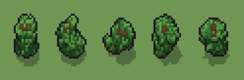

# Cespuglio (`cespuglio.xml`)

Classe `cespuglio`, scatola 20 × 20 × 16 voxel; riscrittura procedurale di `universe/models/cespuglio.xml`.


## Esito

- validatore (`modelErrors`, `checkProgram`, `analyse` a ogni seme): nessun errore, nessun frammento staccato
- varianza su 5 semi (voxel pieni in un seme e vuoti nell'altro, sui pieni in almeno uno; il colore non conta): **media 0.556**, minima 0.427, massima 0.718 (soglia 0.15) → passa
- voxel per seme: 776, 786, 753, 773, 781; tempo per seme: 8, 8, 8, 8, 8 ms

| coppia | 1-2 | 1-3 | 1-4 | 1-5 | 2-3 | 2-4 | 2-5 | 3-4 | 3-5 | 4-5 |
|---|---|---|---|---|---|---|---|---|---|---|
| distanza | 0.537 | 0.505 | 0.543 | 0.435 | 0.703 | 0.718 | 0.427 | 0.514 | 0.604 | 0.570 |



## Traccia di tre semi a confronto

La traccia di `src/mj/trace.ts` (forma `nodi`): per ogni nodo quante volte gira, quante celle scrive e la scatola di ciò che scrive. Le
righe che cambiano fra i semi sono le scelte del programma.

### Seme 1

```text
Traccia, seme 1: griglia 20×20×16, 11 nodi, 738 passi, finito in 8 ms.
x sinistra→destra, y fondo→davanti, z basso→alto; «.» è la cella vuota; #n è il nodo nell'ordine dell'XML; ×n quante volte ha agito.
Lettere: L=foglie, H=foglie chiare, D=foglie scure, T=rametti, V=lo spazio del cespuglio (marcatore), r=punta di un rametto (marcatore).
Alla fine: L 536, D 141, H 67, T 32.
#2-3 ellipsoid×1, box×1: 1990 celle x2-18 y2-18 z0-12, passi 1-2
#4-6 one×2: 61 celle x8-13 y10-14 z1-12, passi 3-33
 #7 all r → T: ×1, 1 celle x8 y11 z12, passi 34, r→T 1
 #8 one TV → TL (+1) passi=700: ×700, 700 celle x5-16 y4-18 z0-12, passi 35-734, V→L 700
   r1 TV → TL ×58; r2 LV → LL ×642
 #9 all V → .: ×1, 1257 celle x2-18 y2-18 z0-12, passi 735, V→. 1257
 #10 convolution .→L se L in [15,16,17,18,19,20,21,22,23,24,25,26]; L→. se L in [1,2,3,4,5]: ×2, 84 celle x5-16 y4-18 z1-12, passi 736-737, .→L 64, L→. 20
   r1 .→L ×64; r2 L→. ×20
 #11 prl . L → . H (+1) passi=1: ×1, 208 celle x6-15 y6-18 z0-12, passi 738, L→D 141, L→H 67
   r1 . L → . H ×88; r2 L → D ×141
Senza effetto (non hanno mai cambiato una cella):
#5 prl VV *T → r* ** passi=1: le celle cercate c'erano, ma mai disposte come nel pattern
```

### Seme 2

```text
Traccia, seme 2: griglia 20×20×16, 11 nodi, 738 passi, finito in 8 ms.
x sinistra→destra, y fondo→davanti, z basso→alto; «.» è la cella vuota; #n è il nodo nell'ordine dell'XML; ×n quante volte ha agito.
Lettere: L=foglie, H=foglie chiare, D=foglie scure, T=rametti, V=lo spazio del cespuglio (marcatore), r=punta di un rametto (marcatore).
Alla fine: L 507, D 176, H 71, T 32.
#2-3 ellipsoid×1, box×1: 1990 celle x2-18 y2-18 z0-12, passi 1-2
#4-6 one×2: 61 celle x4-12 y10-13 z1-12, passi 3-33
 #7 all r → T: ×1, 1 celle x7 y10 z12, passi 34, r→T 1
 #8 one TV → TL (+1) passi=700: ×700, 700 celle x2-16 y7-17 z0-12, passi 35-734, V→L 700
   r1 TV → TL ×55; r2 LV → LL ×645
 #9 all V → .: ×1, 1257 celle x2-18 y2-18 z0-12, passi 735, V→. 1257
 #10 convolution .→L se L in [15,16,17,18,19,20,21,22,23,24,25,26]; L→. se L in [1,2,3,4,5]: ×2, 98 celle x3-16 y7-17 z1-12, passi 736-737, .→L 76, L→. 22
   r1 .→L ×76; r2 L→. ×22
 #11 prl . L → . H (+1) passi=1: ×1, 247 celle x2-15 y7-17 z0-12, passi 738, L→D 176, L→H 71
   r1 . L → . H ×87; r2 L → D ×176
Senza effetto (non hanno mai cambiato una cella):
#5 prl VV *T → r* ** passi=1: le celle cercate c'erano, ma mai disposte come nel pattern
```

### Seme 3

```text
Traccia, seme 3: griglia 20×20×16, 11 nodi, 732 passi, finito in 12 ms.
x sinistra→destra, y fondo→davanti, z basso→alto; «.» è la cella vuota; #n è il nodo nell'ordine dell'XML; ×n quante volte ha agito.
Lettere: L=foglie, H=foglie chiare, D=foglie scure, T=rametti, V=lo spazio del cespuglio (marcatore), r=punta di un rametto (marcatore).
Alla fine: L 530, D 140, H 57, T 26.
#2-3 ellipsoid×1, box×1: 1990 celle x2-18 y2-18 z0-12, passi 1-2
#4-6 one×2: 49 celle x10-15 y10-15 z1-11, passi 3-27
 #7 all r → T: ×1, 1 celle x11 y15 z11, passi 28, r→T 1
 #8 one TV → TL (+1) passi=700: ×700, 700 celle x4-18 y5-18 z0-12, passi 29-728, V→L 700
   r1 TV → TL ×43; r2 LV → LL ×657
 #9 all V → .: ×1, 1263 celle x2-18 y2-18 z0-12, passi 729, V→. 1263
 #10 convolution .→L se L in [15,16,17,18,19,20,21,22,23,24,25,26]; L→. se L in [1,2,3,4,5]: ×2, 77 celle x4-16 y5-18 z0-12, passi 730-731, .→L 52, L→. 25
   r1 .→L ×52; r2 L→. ×25
 #11 prl . L → . H (+1) passi=1: ×1, 197 celle x5-18 y6-18 z0-12, passi 732, L→D 140, L→H 57
   r1 . L → . H ×73; r2 L → D ×140
Senza effetto (non hanno mai cambiato una cella):
#5 prl VV *T → r* ** passi=1: le celle cercate c'erano, ma mai disposte come nel pattern
```
