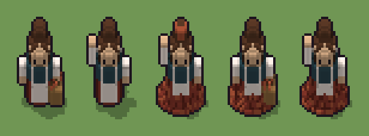

# Contadina (`contadina.xml`)

Classe `persona`, scatola 20 × 15 × 30 voxel; riscrittura procedurale di `universe/models/contadina.xml`.


## Esito

- validatore (`modelErrors`, `checkProgram`, `analyse` a ogni seme): nessun errore, nessun frammento staccato
- varianza su 5 semi (voxel pieni in un seme e vuoti nell'altro, sui pieni in almeno uno; il colore non conta): **media 0.243**, minima 0.110, massima 0.382 (soglia 0.15) → passa
- voxel per seme: 2153, 2255, 2560, 2674, 2828; tempo per seme: 15, 15, 24, 18, 20 ms
- avvisi: tocca i bordi laterali della griglia: forse è tagliato; colori mai usati: M C L; colori mai usati: M R C L T; colori mai usati: C L T; colori mai usati: C L

| coppia | 1-2 | 1-3 | 1-4 | 1-5 | 2-3 | 2-4 | 2-5 | 3-4 | 3-5 | 4-5 |
|---|---|---|---|---|---|---|---|---|---|---|
| distanza | 0.254 | 0.303 | 0.197 | 0.364 | 0.311 | 0.382 | 0.203 | 0.116 | 0.110 | 0.194 |



## Traccia di tre semi a confronto

La traccia di `src/mj/trace.ts` (forma `nodi`): per ogni nodo quante volte gira, quante celle scrive e la scatola di ciò che scrive. Le
righe che cambiano fra i semi sono le scelte del programma.

### Seme 1

```text
Traccia, seme 1: griglia 20×15×30, 64 nodi, 74 passi, finito in 15 ms.
x sinistra→destra, y fondo→davanti, z basso→alto; «.» è la cella vuota; #n è il nodo nell'ordine dell'XML; ×n quante volte ha agito.
Lettere: 0=mescola (marcatore), 1=scelta: la cesta (marcatore), 4=il braccio alzato possibile (marcatore), 5=la mano alzata possibile (marcatore), 8=il braccio lungo il fianco (marcatore), 9=la mano lungo il fianco (marcatore), G=scarpe, K=gonna rosso mattone, R=luce gonna, D=corsetto blu scuro, W=camicia e grembiule, F=ombra grembiule, S=carnagione, H=capelli castani, E=occhi, p=la gonna larga (marcatore), q=la gonna a campana (marcatore), m=dado (marcatore), b=scelta (marcatore), c=la cesta possibile (marcatore), d=il fazzoletto possibile (marcatore), r=la crocchia possibile (marcatore), T=vimini della cesta, u=il sacco possibile (marcatore), v=la brocca possibile (marcatore), y=niente da portare (marcatore).
Alla fine: K 654, D 435, H 420, S 219, T 192, W 180, G 36, F 7, R 6, E 4.
Senza effetto (non hanno mai cambiato una cella):
#12 all aK → aa (+3): in quel momento nella griglia non c'erano celle "a", "b"
#13 all [ab] → K: in quel momento nella griglia non c'erano celle "ab"
#23 all a[89] → aa (+4): in quel momento nella griglia non c'erano celle "a", "6", "7"
#40 box at 10 6 22 size 6 6 1 d su .
#45 all a → C: in quel momento nella griglia non c'erano celle "a"
#48 all r → .: in quel momento nella griglia non c'erano celle "r"
#59 all 2 → F: in quel momento nella griglia non c'erano celle "2"
… tagliato: oltre il tetto di token.
```

### Seme 2

```text
Traccia, seme 2: griglia 20×15×30, 64 nodi, 94 passi, finito in 17 ms.
x sinistra→destra, y fondo→davanti, z basso→alto; «.» è la cella vuota; #n è il nodo nell'ordine dell'XML; ×n quante volte ha agito.
Lettere: 0=mescola (marcatore), 2=scelta: il sacco (marcatore), 4=il braccio alzato possibile (marcatore), 5=la mano alzata possibile (marcatore), 6=il braccio alzato scelto (marcatore), 7=la mano alzata scelta (marcatore), 8=il braccio lungo il fianco (marcatore), 9=la mano lungo il fianco (marcatore), G=scarpe, K=gonna rosso mattone, D=corsetto blu scuro, W=camicia e grembiule, F=ombra grembiule, S=carnagione, H=capelli castani, E=occhi, p=la gonna larga (marcatore), q=la gonna a campana (marcatore), m=dado (marcatore), a=scelta (marcatore), b=scelta (marcatore), c=la cesta possibile (marcatore), d=il fazzoletto possibile (marcatore), r=la crocchia possibile (marcatore), u=il sacco possibile (marcatore), v=la brocca possibile (marcatore), y=niente da portare (marcatore).
Alla fine: K 654, D 435, H 420, F 295, S 210, W 201, G 36, E 4.
Senza effetto (non hanno mai cambiato una cella):
#12 all aK → aa (+3): in quel momento nella griglia non c'erano celle "a", "b"
#13 all [ab] → K: in quel momento nella griglia non c'erano celle "ab"
#40 box at 10 6 22 size 6 6 1 d su .
#45 all a → C: in quel momento nella griglia non c'erano celle "a"
#48 all r → .: in quel momento nella griglia non c'erano celle "r"
#58 all 1 → T: in quel momento nella griglia non c'erano celle "1"
#60 all 3 → R: in quel momento nella griglia non c'erano celle "3"
… tagliato: oltre il tetto di token.
```

### Seme 3

```text
Traccia, seme 3: griglia 20×15×30, 64 nodi, 112 passi, finito in 21 ms.
x sinistra→destra, y fondo→davanti, z basso→alto; «.» è la cella vuota; #n è il nodo nell'ordine dell'XML; ×n quante volte ha agito.
Lettere: 0=mescola (marcatore), 3=scelta: la brocca (marcatore), 4=il braccio alzato possibile (marcatore), 5=la mano alzata possibile (marcatore), 6=il braccio alzato scelto (marcatore), 7=la mano alzata scelta (marcatore), 8=il braccio lungo il fianco (marcatore), 9=la mano lungo il fianco (marcatore), G=scarpe, K=gonna rosso mattone, M=ombra gonna, R=luce gonna, D=corsetto blu scuro, W=camicia e grembiule, F=ombra grembiule, S=carnagione, H=capelli castani, E=occhi, p=la gonna larga (marcatore), q=la gonna a campana (marcatore), m=dado (marcatore), a=scelta (marcatore), b=scelta (marcatore), c=la cesta possibile (marcatore), d=il fazzoletto possibile (marcatore), r=la crocchia possibile (marcatore), u=il sacco possibile (marcatore), v=la brocca possibile (marcatore), y=niente da portare (marcatore).
Alla fine: K 1156, D 435, H 420, S 210, W 203, R 76, G 36, M 18, E 4, F 2.
Senza effetto (non hanno mai cambiato una cella):
#14 all [pq] → .: in quel momento nella griglia non c'erano celle "pq"
#40 box at 10 6 22 size 6 6 1 d su .
#45 all a → C: in quel momento nella griglia non c'erano celle "a"
#48 all r → .: in quel momento nella griglia non c'erano celle "r"
#58 all 1 → T: in quel momento nella griglia non c'erano celle "1"
#59 all 2 → F: in quel momento nella griglia non c'erano celle "2"
#61 prl . T → R * passi=1: in quel momento nella griglia non c'erano celle "T"
```
