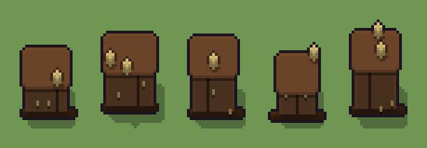

# Credenza (`credenza.xml`)

Classe `mobile`, scatola 20 × 20 × 20 voxel; riscrittura procedurale di `universe/models/credenza.xml`.


## Esito

- validatore (`modelErrors`, `checkProgram`, `analyse` a ogni seme): nessun errore, nessun frammento staccato
- varianza su 5 semi (voxel pieni in un seme e vuoti nell'altro, sui pieni in almeno uno; il colore non conta): **media 0.301**, minima 0.102, massima 0.453 (soglia 0.15) → passa
- voxel per seme: 2239, 3154, 2959, 1795, 3154; tempo per seme: 9, 8, 7, 9, 9 ms
- avvisi: tocca i bordi laterali della griglia: forse è tagliato; tocca il soffitto della griglia: forse è tagliato in alto

| coppia | 1-2 | 1-3 | 1-4 | 1-5 | 2-3 | 2-4 | 2-5 | 3-4 | 3-5 | 4-5 |
|---|---|---|---|---|---|---|---|---|---|---|
| distanza | 0.315 | 0.278 | 0.238 | 0.322 | 0.200 | 0.446 | 0.240 | 0.418 | 0.102 | 0.453 |



## Traccia di tre semi a confronto

La traccia di `src/mj/trace.ts` (forma `nodi`): per ogni nodo quante volte gira, quante celle scrive e la scatola di ciò che scrive. Le
righe che cambiano fra i semi sono le scelte del programma.

### Seme 1

```text
Traccia, seme 1: griglia 20×20×20, 32 nodi, 103 passi, finito in 12 ms.
x sinistra→destra, y fondo→davanti, z basso→alto; «.» è la cella vuota; #n è il nodo nell'ordine dell'XML; ×n quante volte ha agito.
Lettere: N=legno scuro, n=ombra, L=anta, K=cornice, I=maniglia d'ottone, h=altezze possibili (marcatore), k=la quota scelta (marcatore), w=i fianchi che possono mancare (marcatore), a=scelta (marcatore), c=dove possono stare i divisori delle ante (marcatore), d=il divisorio scelto (marcatore), e=un vaso che nasce (marcatore).
Alla fine: N 1815, K 234, L 126, n 47, I 17.
#2-3 box×2: 6270 celle x2-18 y2-12 z0-18, passi 1-2
#4-7 prl×1, all×3: 1254 celle x2-18 y2-12 z0-18, passi 3-19
#8-23 box×6, one×2, all×6: 924 celle x0-19 y0-19 z0-19, passi 20-86
 #24 all * k → k *: ×7, 2800 celle x0-19 y0-19 z13-19, passi 87-93, .→k 1719, N→k 990, L→k 84, n→k 7
 #25 all k [NLn] → * K: ×1, 180 celle x2-16 y2-13 z11, passi 94, N→K 165, L→K 14, n→K 1
 #26 all k → .: ×1, 3200 celle x0-19 y0-19 z12-19, passi 95, k→. 3200
#27-32 prl×2, one×1, all×3: 86 celle x1-17 y1-14 z5-14, passi 96-103
Senza effetto (non hanno mai cambiato una cella):
#9 all L/. → */*: le celle cercate c'erano, ma mai disposte come nel pattern
#10 all LN/.. → **/**: le celle cercate c'erano, ma mai disposte come nel pattern
```

### Seme 2

```text
Traccia, seme 2: griglia 20×20×20, 32 nodi, 105 passi, finito in 11 ms.
x sinistra→destra, y fondo→davanti, z basso→alto; «.» è la cella vuota; #n è il nodo nell'ordine dell'XML; ×n quante volte ha agito.
Lettere: N=legno scuro, n=ombra, L=anta, K=cornice, I=maniglia d'ottone, h=altezze possibili (marcatore), k=la quota scelta (marcatore), w=i fianchi che possono mancare (marcatore), a=scelta (marcatore), c=dove possono stare i divisori delle ante (marcatore), d=il divisorio scelto (marcatore), e=un vaso che nasce (marcatore).
Alla fine: N 2618, K 262, L 192, n 50, I 32.
#2-3 box×2: 6270 celle x2-18 y2-12 z0-18, passi 1-2
#4-6 prl×1, all×2: 1672 celle x2-18 y2-12 z0-18, passi 3-24
#8-23 box×6, one×2, all×6: 890 celle x0-19 y0-19 z0-19, passi 25-91
 #24 all * k → k *: ×4, 1600 celle x0-19 y0-19 z16-19, passi 92-95, .→k 987, N→k 561, L→k 48, n→k 4
 #25 all k [NLn] → * K: ×1, 204 celle x2-18 y2-13 z14, passi 96, N→K 187, L→K 16, n→K 1
 #26 all k → .: ×1, 2000 celle x0-19 y0-19 z15-19, passi 97, k→. 2000
#27-32 prl×2, one×1, all×3: 120 celle x1-19 y1-15 z6-17, passi 98-105
Senza effetto (non hanno mai cambiato una cella):
#7 all w → .: in quel momento nella griglia non c'erano celle "w"
#9 all L/. → */*: le celle cercate c'erano, ma mai disposte come nel pattern
#10 all LN/.. → **/**: le celle cercate c'erano, ma mai disposte come nel pattern
```

### Seme 3

```text
Traccia, seme 3: griglia 20×20×20, 32 nodi, 114 passi, finito in 14 ms.
x sinistra→destra, y fondo→davanti, z basso→alto; «.» è la cella vuota; #n è il nodo nell'ordine dell'XML; ×n quante volte ha agito.
Lettere: N=legno scuro, n=ombra, L=anta, K=cornice, I=maniglia d'ottone, h=altezze possibili (marcatore), k=la quota scelta (marcatore), w=i fianchi che possono mancare (marcatore), a=scelta (marcatore), c=dove possono stare i divisori delle ante (marcatore), d=il divisorio scelto (marcatore), e=un vaso che nasce (marcatore).
Alla fine: N 2475, K 234, L 182, n 51, I 17.
#2-3 box×2: 6270 celle x2-18 y2-12 z0-18, passi 1-2
#4-7 prl×1, all×3: 1254 celle x2-18 y2-12 z0-18, passi 3-34
#8-23 box×6, one×2, all×6: 924 celle x0-19 y0-19 z0-19, passi 35-101
 #24 all * k → k *: ×3, 1200 celle x0-19 y0-19 z17-19, passi 102-104, .→k 839, N→k 330, L→k 28, n→k 3
 #25 all k [NLn] → * K: ×1, 180 celle x2-16 y2-13 z15, passi 105, N→K 165, L→K 14, n→K 1
 #26 all k → .: ×1, 1600 celle x0-19 y0-19 z16-19, passi 106, k→. 1600
#27-32 prl×2, one×1, all×3: 86 celle x1-17 y1-14 z2-18, passi 107-114
Senza effetto (non hanno mai cambiato una cella):
#9 all L/. → */*: le celle cercate c'erano, ma mai disposte come nel pattern
#10 all LN/.. → **/**: le celle cercate c'erano, ma mai disposte come nel pattern
```
