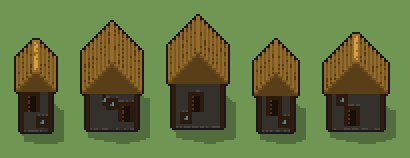

# Casetta (`edificio.xml`)

Classe `edificio`, scatola 50 × 50 × 50 voxel; riscrittura procedurale di `universe/models/edificio.xml`.


## Esito

- validatore (`modelErrors`, `checkProgram`, `analyse` a ogni seme): nessun errore, nessun frammento staccato
- varianza su 5 semi (voxel pieni in un seme e vuoti nell'altro, sui pieni in almeno uno; il colore non conta): **media 0.408**, minima 0.139, massima 0.546 (soglia 0.15) → passa
- voxel per seme: 7040, 14480, 14904, 7488, 11088; tempo per seme: 71, 69, 101, 91, 67 ms
- avvisi: colori mai usati: W n F

| coppia | 1-2 | 1-3 | 1-4 | 1-5 | 2-3 | 2-4 | 2-5 | 3-4 | 3-5 | 4-5 |
|---|---|---|---|---|---|---|---|---|---|---|
| distanza | 0.546 | 0.534 | 0.139 | 0.520 | 0.219 | 0.483 | 0.343 | 0.504 | 0.337 | 0.455 |



## Traccia di tre semi a confronto

La traccia di `src/mj/trace.ts` (forma `nodi`): per ogni nodo quante volte gira, quante celle scrive e la scatola di ciò che scrive. Le
righe che cambiano fra i semi sono le scelte del programma.

### Seme 1

```text
Traccia, seme 1: griglia 25×25×24 → 50×50×48, 50 nodi, 260 passi, finito in 92 ms.
x sinistra→destra, y fondo→davanti, z basso→alto; «.» è la cella vuota; #n è il nodo nell'ordine dell'XML; ×n quante volte ha agito.
Lettere: X=volume casa (marcatore), Q=prisma tetto (marcatore), N=legno scuro travi, D=pietra grigia, O=porta asse, U=vetro finestra, R=paglia chiara, r=paglia scura ombra, G=muschio verde, H=ferramenta e ombra profonda, h=misure possibili (marcatore), k=il taglio (marcatore), m=mescola (marcatore), d=fuga tra pietre, p=riflesso vetro.
Alla fine: d 4470, R 1366, r 554, N 500, D 72, H 54, O 10, p 8, U 4, G 2.
#2-12 box×2, prl×1, all×6, one×2: 9626 celle x0-24 y0-24 z0-23, passi 1-101
#13-17 all×3, box×1, one×1: 13813 celle x0-24 y0-24 z0-23, passi 102-164
#18-23 all×4, box×1, one×1: 15357 celle x0-24 y0-24 z0-23, passi 165-229
#24-37 all×9, one×3: 10662 celle x0-24 y0-24 z0-23, passi 230-250
  #39 map scala 2 2 2: ×1, 7040 celle x0-49 y0-49 z0-47, passi 251
#40-49 prl×4, all×5: 5092 celle x8-27 y22-37 z0-29, passi 252-260
Senza effetto (non hanno mai cambiato una cella):
#30 all R Q → * n: le celle cercate c'erano, ma mai disposte come nel pattern
#31 all n Q → * n: in quel momento nella griglia non c'erano celle "n"
#44 prl . D → * F passi=1: le celle cercate c'erano, ma mai disposte come nel pattern
#50 prl G D → * G passi=1: le celle cercate c'erano, ma mai disposte come nel pattern
```

### Seme 2

```text
Traccia, seme 2: griglia 25×25×24 → 50×50×48, 50 nodi, 256 passi, finito in 83 ms.
x sinistra→destra, y fondo→davanti, z basso→alto; «.» è la cella vuota; #n è il nodo nell'ordine dell'XML; ×n quante volte ha agito.
Lettere: X=volume casa (marcatore), Q=prisma tetto (marcatore), N=legno scuro travi, D=pietra grigia, O=porta asse, U=vetro finestra, R=paglia chiara, r=paglia scura ombra, G=muschio verde, H=ferramenta e ombra profonda, h=misure possibili (marcatore), k=il taglio (marcatore), m=mescola (marcatore), d=fuga tra pietre, p=riflesso vetro.
Alla fine: d 8668, R 3970, r 1150, N 468, D 145, H 54, O 10, p 8, U 4, G 3.
#2-12 box×2, prl×1, all×6, one×2: 6626 celle x0-24 y0-24 z0-23, passi 1-96
#13-17 all×3, box×1, one×1: 9613 celle x0-24 y0-24 z0-23, passi 97-157
#18-23 all×4, box×1, one×1: 14782 celle x0-24 y0-24 z0-23, passi 158-223
#24-37 all×9, one×3: 12863 celle x0-24 y0-24 z0-23, passi 224-246
  #39 map scala 2 2 2: ×1, 14480 celle x0-49 y0-49 z0-47, passi 247
#40-49 prl×4, all×5: 9887 celle x8-37 y18-37 z0-33, passi 248-256
Senza effetto (non hanno mai cambiato una cella):
#30 all R Q → * n: le celle cercate c'erano, ma mai disposte come nel pattern
#31 all n Q → * n: in quel momento nella griglia non c'erano celle "n"
#44 prl . D → * F passi=1: le celle cercate c'erano, ma mai disposte come nel pattern
#50 prl G D → * G passi=1: le celle cercate c'erano, ma mai disposte come nel pattern
```

### Seme 3

```text
Traccia, seme 3: griglia 25×25×24 → 50×50×48, 50 nodi, 254 passi, finito in 84 ms.
x sinistra→destra, y fondo→davanti, z basso→alto; «.» è la cella vuota; #n è il nodo nell'ordine dell'XML; ×n quante volte ha agito.
Lettere: X=volume casa (marcatore), Q=prisma tetto (marcatore), N=legno scuro travi, D=pietra grigia, O=porta asse, U=vetro finestra, R=paglia chiara, r=paglia scura ombra, G=muschio verde, H=ferramenta e ombra profonda, h=misure possibili (marcatore), k=il taglio (marcatore), m=mescola (marcatore), d=fuga tra pietre, p=riflesso vetro.
Alla fine: d 9537, R 3536, r 1072, N 532, D 145, H 55, O 9, p 8, G 6, U 4.
#2-12 box×2, prl×1, all×6, one×2: 6626 celle x0-24 y0-24 z0-23, passi 1-96
#13-17 all×3, box×1, one×1: 10213 celle x0-24 y0-24 z0-23, passi 97-157
#18-23 all×4, box×1, one×1: 14132 celle x0-24 y0-24 z0-23, passi 158-221
#24-37 all×9, one×3: 11513 celle x0-24 y0-24 z0-23, passi 222-244
  #39 map scala 2 2 2: ×1, 14904 celle x0-49 y0-49 z0-47, passi 245
#40-49 prl×4, all×5: 10682 celle x8-37 y20-37 z0-37, passi 246-254
Senza effetto (non hanno mai cambiato una cella):
#30 all R Q → * n: le celle cercate c'erano, ma mai disposte come nel pattern
#31 all n Q → * n: in quel momento nella griglia non c'erano celle "n"
#44 prl . D → * F passi=1: le celle cercate c'erano, ma mai disposte come nel pattern
#50 prl G D → * G passi=1: le celle cercate c'erano, ma mai disposte come nel pattern
```
