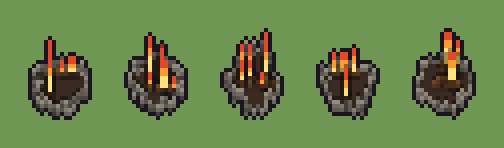

# Falò (`falo.xml`)

Classe `mobile`, scatola 20 × 20 × 20 voxel; riscrittura procedurale di `universe/models/falo.xml`.


## Esito

- validatore (`modelErrors`, `checkProgram`, `analyse` a ogni seme): nessun errore, nessun frammento staccato
- varianza su 5 semi (voxel pieni in un seme e vuoti nell'altro, sui pieni in almeno uno; il colore non conta): **media 0.596**, minima 0.530, massima 0.649 (soglia 0.15) → passa
- voxel per seme: 221, 220, 245, 193, 210; tempo per seme: 5, 4, 4, 4, 4 ms
- avvisi: colori mai usati: e

| coppia | 1-2 | 1-3 | 1-4 | 1-5 | 2-3 | 2-4 | 2-5 | 3-4 | 3-5 | 4-5 |
|---|---|---|---|---|---|---|---|---|---|---|
| distanza | 0.530 | 0.649 | 0.587 | 0.627 | 0.632 | 0.571 | 0.562 | 0.627 | 0.596 | 0.581 |



## Traccia di tre semi a confronto

La traccia di `src/mj/trace.ts` (forma `nodi`): per ogni nodo quante volte gira, quante celle scrive e la scatola di ciò che scrive. Le
righe che cambiano fra i semi sono le scelte del programma.

### Seme 1

```text
Traccia, seme 1: griglia 20×20×20, 21 nodi, 66 passi, finito in 4 ms.
x sinistra→destra, y fondo→davanti, z basso→alto; «.» è la cella vuota; #n è il nodo nell'ordine dell'XML; ×n quante volte ha agito.
Lettere: X=seme (marcatore), D=pietra, d=pietra scura, E=cenere, N=ciocco, n=corteccia, Y=cuore della fiamma, O=fiamma, R=punta.
Alla fine: E 84, D 51, Y 26, d 24, O 15, R 9, n 6, N 6.
 #2 one X . → . X: ×10, 20 celle x10 y10 z0-10, passi 1-10, .→X 10, X→. 10
 #3 prl X. → *X passi=6: ×6, 67 celle x6-15 y6-15 z0, passi 11-16, .→X 67
 #4 prl X*/*. → **/*X passi=2: ×2, 64 celle x4-17 y5-17 z0, passi 17-18, .→X 64
 #6 all X. → D*: ×1, 48 celle x4-17 y5-17 z0, passi 19, X→D 48
 #7 prl X → E passi=1: ×1, 84 celle x5-16 y6-16 z0, passi 20, X→E 84
 #8 prl . D → D * passi=1: ×1, 27 celle x4-17 y5-17 z1, passi 21, .→D 27
 #9 prl D → d passi=1: ×1, 24 celle x4-17 y5-17 z0-1, passi 22, D→d 24
#10-14 one×2, prl×1: 21 celle x8-14 y8-13 z1-2, passi 23-25
#15-17 one×2, prl×1: 41 celle x8-14 y8-13 z3-8, passi 26-62
#18-21 all×3, prl×1: 30 celle x8-14 y8-13 z1-8, passi 63-66
Senza effetto (non hanno mai cambiato una cella):
#5 all .X. → *X* passi=1: le celle cercate c'erano, ma mai disposte come nel pattern
#12 prl ..... EEEEE → NNNNN ***** passi=1
#13 prl ..... NNNNN → NNNNN ***** passi=1
```

### Seme 2

```text
Traccia, seme 2: griglia 20×20×20, 21 nodi, 58 passi, finito in 4 ms.
x sinistra→destra, y fondo→davanti, z basso→alto; «.» è la cella vuota; #n è il nodo nell'ordine dell'XML; ×n quante volte ha agito.
Lettere: X=seme (marcatore), D=pietra, d=pietra scura, E=cenere, N=ciocco, n=corteccia, Y=cuore della fiamma, O=fiamma, R=punta.
Alla fine: E 85, D 46, d 21, Y 21, N 16, O 16, R 9, n 6.
 #2 one X . → . X: ×10, 20 celle x10 y10 z0-10, passi 1-10, .→X 10, X→. 10
 #3 prl X. → *X passi=6: ×6, 64 celle x5-14 y6-16 z0, passi 11-16, .→X 64
 #4 prl X*/*. → **/*X passi=2: ×2, 69 celle x3-16 y4-18 z0, passi 17-18, .→X 69
 #6 all X. → D*: ×1, 49 celle x3-16 y4-18 z0, passi 19, X→D 49
 #7 prl X → E passi=1: ×1, 85 celle x4-15 y5-16 z0, passi 20, X→E 85
 #8 prl . D → D * passi=1: ×1, 18 celle x3-16 y5-18 z1, passi 21, .→D 18
#9-12 prl×2, one×2: 38 celle x4-16 y4-18 z0-1, passi 22-25
#13-15 prl×2, one×1: 28 celle x8-14 y8-13 z2-6, passi 26-41
#16-18 prl×1, one×1, all×1: 32 celle x8-14 y8-13 z3-9, passi 42-55
#19-21 all×2, prl×1: 22 celle x8-14 y8-13 z1-8, passi 56-58
Senza effetto (non hanno mai cambiato una cella):
#5 all .X. → *X* passi=1: le celle cercate c'erano, ma mai disposte come nel pattern
```

### Seme 3

```text
Traccia, seme 3: griglia 20×20×20, 21 nodi, 61 passi, finito in 4 ms.
x sinistra→destra, y fondo→davanti, z basso→alto; «.» è la cella vuota; #n è il nodo nell'ordine dell'XML; ×n quante volte ha agito.
Lettere: X=seme (marcatore), D=pietra, d=pietra scura, E=cenere, N=ciocco, n=corteccia, Y=cuore della fiamma, O=fiamma, R=punta.
Alla fine: E 97, D 52, d 20, N 20, Y 20, O 18, R 11, n 7.
 #2 one X . → . X: ×10, 20 celle x10 y10 z0-10, passi 1-10, .→X 10, X→. 10
 #3 prl X. → *X passi=6: ×6, 74 celle x5-14 y4-16 z0, passi 11-16, .→X 74
 #4 prl X*/*. → **/*X passi=2: ×2, 70 celle x3-16 y2-18 z0, passi 17-18, .→X 70
 #6 all X. → D*: ×1, 48 celle x3-16 y2-18 z0, passi 19, X→D 48
 #7 prl X → E passi=1: ×1, 97 celle x4-15 y4-17 z0, passi 20, X→E 97
#8-9 prl×2: 44 celle x3-16 y2-18 z0-1, passi 21-22
#10-13 one×2, prl×2: 27 celle x7-15 y6-12 z1-2, passi 23-26
#14-15 prl×1, one×1: 25 celle x7-13 y7-12 z2-5, passi 27-41
#16-17 prl×1, one×1: 24 celle x7-13 y7-11 z3-8, passi 42-57
#18-21 all×3, prl×1: 36 celle x7-15 y7-12 z1-8, passi 58-61
Senza effetto (non hanno mai cambiato una cella):
#5 all .X. → *X* passi=1: le celle cercate c'erano, ma mai disposte come nel pattern
```
