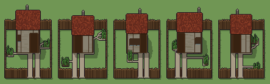

# Fattoria (`fattoria.xml`)

Classe `grande`, scatola 100 × 100 × 80 voxel; riscrittura procedurale di `universe/models/fattoria.xml`.


## Esito

- validatore (`modelErrors`, `checkProgram`, `analyse` a ogni seme): nessun errore, nessun frammento staccato
- varianza su 5 semi (voxel pieni in un seme e vuoti nell'altro, sui pieni in almeno uno; il colore non conta): **media 0.557**, minima 0.251, massima 0.756 (soglia 0.15) → passa
- voxel per seme: 27110, 23249, 23377, 26891, 23103; tempo per seme: 1686, 1513, 1507, 1563, 1495 ms
- avvisi: colori mai usati: S

| coppia | 1-2 | 1-3 | 1-4 | 1-5 | 2-3 | 2-4 | 2-5 | 3-4 | 3-5 | 4-5 |
|---|---|---|---|---|---|---|---|---|---|---|
| distanza | 0.756 | 0.641 | 0.533 | 0.721 | 0.468 | 0.671 | 0.387 | 0.579 | 0.251 | 0.566 |



## Traccia di tre semi a confronto

La traccia di `src/mj/trace.ts` (forma `nodi`): per ogni nodo quante volte gira, quante celle scrive e la scatola di ciò che scrive. Le
righe che cambiano fra i semi sono le scelte del programma.

### Seme 1

```text
Traccia, seme 1: griglia 100×100×80, 85 nodi, 1434 passi, finito in 1537 ms.
x sinistra→destra, y fondo→davanti, z basso→alto; «.» è la cella vuota; #n è il nodo nell'ordine dell'XML; ×n quante volte ha agito.
Lettere: 0=mescola (marcatore), X=volume della casa (marcatore), Y=cortile (marcatore), F=pali, f=pali scuri, E=cancello (marcatore), P=ghiaia, p=pietra della soglia, Q=volume del tetto (marcatore), R=coppi, r=coppi in ombra, I=interno (marcatore), W=intonaco, w=intonaco scrostato, N=travi, n=assito, D=pietra, d=pietra scura, O=porta, o=asse scura, U=vetro, K=comignolo, G=terra dell'orto, g=ortaggi, T=seme di un palo (marcatore), t=tavolo, a=muro già diviso (marcatore), z=quote possibili dei muri (marcatore), v=la quota scelta (marcatore).
Alla fine: R 8959, W 5860, N 2798, F 2143, f 1885, n 1700, r 827, o 704, w 665, P 660, g 247, D 183, G 154, O 128, d 69, U 65, K 32, t 29, p 2.
#2-16 box×2, prl×3, all×7, one×3: 17581 celle x0-99 y0-99 z0-79, passi 1-369
 #17 all . X → X * passi=40: ×39, 42978 celle x32-69 y22-50 z1-39, passi 370-408, .→X 42978
#18-22 all×5: 37192 celle x0-99 y0-99 z40-61, passi 409-432
#23-25 all×1, prl×2: 59956 celle x31-70 y21-51 z0-61, passi 433-450
#26-27 prl×2: 33150 celle x34-67 y24-48 z1-39, passi 451-452
#28-85 prl×16, all×31, one×8, path×3: 28694 celle x13-88 y10-90 z0-57, passi 453-1434
```

### Seme 2

```text
Traccia, seme 2: griglia 100×100×80, 85 nodi, 1416 passi, finito in 1570 ms.
x sinistra→destra, y fondo→davanti, z basso→alto; «.» è la cella vuota; #n è il nodo nell'ordine dell'XML; ×n quante volte ha agito.
Lettere: 0=mescola (marcatore), X=volume della casa (marcatore), Y=cortile (marcatore), F=pali, f=pali scuri, E=cancello (marcatore), P=ghiaia, p=pietra della soglia, Q=volume del tetto (marcatore), R=coppi, r=coppi in ombra, I=interno (marcatore), W=intonaco, w=intonaco scrostato, N=travi, n=assito, D=pietra, d=pietra scura, O=porta, o=asse scura, U=vetro, K=comignolo, G=terra dell'orto, g=ortaggi, T=seme di un palo (marcatore), t=tavolo, a=muro già diviso (marcatore), z=quote possibili dei muri (marcatore), v=la quota scelta (marcatore).
Alla fine: R 8044, W 3742, F 2428, N 2259, f 1703, n 1500, r 718, P 676, o 660, w 639, g 255, D 167, G 154, O 120, d 69, U 52, K 32, t 29, p 2.
#2-17 box×2, prl×3, all×8, one×3: 47288 celle x0-99 y0-99 z0-79, passi 1-401
#18-22 all×5: 34464 celle x0-99 y0-99 z31-52, passi 402-425
#23-24 all×1, prl×1: 23352 celle x33-68 y21-51 z32-52, passi 426-442
#25-27 prl×3: 45750 celle x36-65 y24-48 z0-30, passi 443-445
#28-85 prl×16, all×30, one×8, path×3: 25229 celle x11-89 y10-90 z0-46, passi 446-1416
Senza effetto (non hanno mai cambiato una cella):
#47 all # O → N * passi=1: le celle cercate c'erano, ma mai disposte come nel pattern
```

### Seme 3

```text
Traccia, seme 3: griglia 100×100×80, 85 nodi, 1447 passi, finito in 1610 ms.
x sinistra→destra, y fondo→davanti, z basso→alto; «.» è la cella vuota; #n è il nodo nell'ordine dell'XML; ×n quante volte ha agito.
Lettere: 0=mescola (marcatore), X=volume della casa (marcatore), Y=cortile (marcatore), F=pali, f=pali scuri, E=cancello (marcatore), P=ghiaia, p=pietra della soglia, Q=volume del tetto (marcatore), R=coppi, r=coppi in ombra, I=interno (marcatore), W=intonaco, w=intonaco scrostato, N=travi, n=assito, D=pietra, d=pietra scura, O=porta, o=asse scura, U=vetro, K=comignolo, G=terra dell'orto, g=ortaggi, T=seme di un palo (marcatore), t=tavolo, a=muro già diviso (marcatore), z=quote possibili dei muri (marcatore), v=la quota scelta (marcatore).
Alla fine: R 7777, W 2597, F 2476, N 2300, O 1856, f 1521, n 1450, r 729, P 680, w 636, o 576, g 247, D 166, G 154, U 83, d 66, K 32, t 29, p 2.
#2-17 box×2, prl×2, all×8, one×3: 48936 celle x0-99 y0-99 z0-79, passi 1-398
#18-22 all×5: 33782 celle x0-99 y0-99 z34-55, passi 399-422
#23-25 all×1, prl×2: 47351 celle x33-67 y21-51 z0-55, passi 423-440
#26-27 prl×2: 23925 celle x36-64 y24-48 z1-33, passi 441-442
#28-85 prl×16, all×30, one×8, path×3: 27602 celle x13-87 y10-90 z0-49, passi 443-1447
Senza effetto (non hanno mai cambiato una cella):
#11 prl XY → *X passi=12
#47 all # O → N * passi=1: le celle cercate c'erano, ma mai disposte come nel pattern
```
