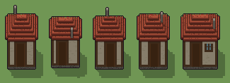

# Casa a graticcio (`grande.xml`)

Classe `grande`, scatola 100 × 100 × 80 voxel; riscrittura procedurale di `universe/models/grande.xml`.


## Esito

- validatore (`modelErrors`, `checkProgram`, `analyse` a ogni seme): nessun errore, nessun frammento staccato
- varianza su 5 semi (voxel pieni in un seme e vuoti nell'altro, sui pieni in almeno uno; il colore non conta): **media 0.347**, minima 0.006, massima 0.598 (soglia 0.15) → passa
- voxel per seme: 33858, 27918, 30888, 33858, 40824; tempo per seme: 103, 102, 101, 102, 132 ms
- avvisi: colori mai usati: S

| coppia | 1-2 | 1-3 | 1-4 | 1-5 | 2-3 | 2-4 | 2-5 | 3-4 | 3-5 | 4-5 |
|---|---|---|---|---|---|---|---|---|---|---|
| distanza | 0.354 | 0.274 | 0.006 | 0.381 | 0.298 | 0.354 | 0.598 | 0.274 | 0.556 | 0.380 |



## Traccia di tre semi a confronto

La traccia di `src/mj/trace.ts` (forma `nodi`): per ogni nodo quante volte gira, quante celle scrive e la scatola di ciò che scrive. Le
righe che cambiano fra i semi sono le scelte del programma.

### Seme 1

```text
Traccia, seme 1: griglia 24×24×30 → 72×72×90, 44 nodi, 523 passi, finito in 115 ms.
x sinistra→destra, y fondo→davanti, z basso→alto; «.» è la cella vuota; #n è il nodo nell'ordine dell'XML; ×n quante volte ha agito.
Lettere: 0=mescola (marcatore), X=volume della casa (marcatore), Q=volume del tetto (marcatore), I=interno (marcatore), W=intonaco, N=travi, n=assito, D=pietra, O=porta, U=vetro, R=coppi, r=coppi in ombra, K=comignolo, h=porta aperta (marcatore), k=il taglio (marcatore), w=intonaco scrostato, d=pietra scura, o=asse scura, g=muschio.
Alla fine: R 11269, W 7236, N 5298, n 4752, r 1679, o 990, D 806, w 540, U 480, d 328, O 198, g 174, K 108.
#2-17 box×2, prl×1, all×10, one×2: 2649 celle x0-23 y0-18 z0-29, passi 1-79
 #18 all . Q → Q * passi=10: ×10, 1760 celle x5-19 y7-18 z16-25, passi 80-89, .→Q 1760
 #19 all *Q .* → *. **: ×6, 1626 celle x5-19 y7-18 z15-25, passi 90-95, Q→. 1626
#20-22 prl×3: 2376 celle x7-17 y9-16 z0-13, passi 96-98
#23-33 prl×4, all×4, one×3: 1252 celle x6-18 y8-17 z0-21, passi 99-114
  #35 map scala 3 3 3: ×1, 33858 celle x0-71 y0-71 z0-89, passi 115
  #36 prl R. → r* passi=1: ×1, 1746 celle x15-59 y21-56 z42-59, passi 116, R→r 1746
#37-44 prl×4, one×1, all×3: 2307 celle x15-59 y21-55 z0-59, passi 117-523
Senza effetto (non hanno mai cambiato una cella):
#7 prl X. → *X passi=3
```

### Seme 2

```text
Traccia, seme 2: griglia 24×24×30 → 72×72×90, 44 nodi, 524 passi, finito in 103 ms.
x sinistra→destra, y fondo→davanti, z basso→alto; «.» è la cella vuota; #n è il nodo nell'ordine dell'XML; ×n quante volte ha agito.
Lettere: 0=mescola (marcatore), X=volume della casa (marcatore), Q=volume del tetto (marcatore), I=interno (marcatore), W=intonaco, N=travi, n=assito, D=pietra, O=porta, U=vetro, R=coppi, r=coppi in ombra, K=comignolo, h=porta aperta (marcatore), k=il taglio (marcatore), w=intonaco scrostato, d=pietra scura, o=asse scura, g=muschio.
Alla fine: R 8331, W 6045, N 5082, n 3564, r 1388, o 990, D 736, w 543, U 480, d 290, O 198, g 163, K 108.
#2-17 box×2, prl×1, all×10, one×2: 2347 celle x0-23 y0-18 z0-29, passi 1-81
 #18 all . Q → Q * passi=10: ×10, 1460 celle x5-19 y9-18 z16-25, passi 82-91, .→Q 1460
 #19 all *Q .* → *. **: ×5, 1386 celle x5-19 y9-18 z15-25, passi 92-96, Q→. 1386
#20-22 prl×3: 1782 celle x7-17 y11-16 z0-13, passi 97-99
#23-33 prl×4, all×4, one×3: 1076 celle x6-18 y10-18 z0-18, passi 100-115
  #35 map scala 3 3 3: ×1, 27918 celle x0-71 y0-71 z0-89, passi 116
  #36 prl R. → r* passi=1: ×1, 1449 celle x15-59 y27-56 z42-56, passi 117, R→r 1449
#37-44 prl×4, one×1, all×3: 2256 celle x15-58 y27-55 z0-56, passi 118-524
Senza effetto (non hanno mai cambiato una cella):
#7 prl X. → *X passi=3
```

### Seme 3

```text
Traccia, seme 3: griglia 24×24×30 → 72×72×90, 44 nodi, 523 passi, finito in 103 ms.
x sinistra→destra, y fondo→davanti, z basso→alto; «.» è la cella vuota; #n è il nodo nell'ordine dell'XML; ×n quante volte ha agito.
Lettere: 0=mescola (marcatore), X=volume della casa (marcatore), Q=volume del tetto (marcatore), I=interno (marcatore), W=intonaco, N=travi, n=assito, D=pietra, O=porta, U=vetro, R=coppi, r=coppi in ombra, K=comignolo, h=porta aperta (marcatore), k=il taglio (marcatore), w=intonaco scrostato, d=pietra scura, o=asse scura, g=muschio.
Alla fine: R 9753, W 7064, N 4854, n 4158, r 1593, o 990, D 757, w 550, U 384, d 323, O 198, g 156, K 108.
#2-17 box×2, prl×1, all×10, one×2: 2498 celle x0-23 y0-18 z0-29, passi 1-80
 #18 all . Q → Q * passi=10: ×10, 1610 celle x5-19 y8-18 z16-25, passi 81-90, .→Q 1610
 #19 all *Q .* → *. **: ×6, 1506 celle x5-19 y8-18 z15-25, passi 91-96, Q→. 1506
#20-22 prl×3: 2079 celle x7-17 y10-16 z0-13, passi 97-99
#23-33 prl×4, all×4, one×3: 1148 celle x6-18 y9-17 z0-22, passi 100-114
  #35 map scala 3 3 3: ×1, 30888 celle x0-71 y0-71 z0-89, passi 115
  #36 prl R. → r* passi=1: ×1, 1635 celle x15-59 y24-56 z42-59, passi 116, R→r 1635
#37-44 prl×4, one×1, all×3: 2235 celle x15-58 y24-55 z0-59, passi 117-523
Senza effetto (non hanno mai cambiato una cella):
#7 prl X. → *X passi=3
```
