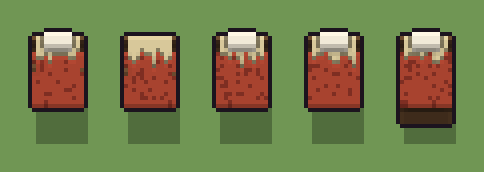

# Letto (`letto.xml`)

Classe `mobile`, scatola 20 × 20 × 20 voxel; riscrittura procedurale di `universe/models/letto.xml`.


## Esito

- validatore (`modelErrors`, `checkProgram`, `analyse` a ogni seme): nessun errore, nessun frammento staccato
- varianza su 5 semi (voxel pieni in un seme e vuoti nell'altro, sui pieni in almeno uno; il colore non conta): **media 0.180**, minima 0.015, massima 0.337 (soglia 0.15) → passa
- voxel per seme: 1130, 1170, 1127, 1034, 1548; tempo per seme: 14, 7, 8, 12, 7 ms
- avvisi: tocca i bordi laterali della griglia: forse è tagliato; colori mai usati: n; colori mai usati: n P

| coppia | 1-2 | 1-3 | 1-4 | 1-5 | 2-3 | 2-4 | 2-5 | 3-4 | 3-5 | 4-5 |
|---|---|---|---|---|---|---|---|---|---|---|
| distanza | 0.126 | 0.015 | 0.093 | 0.282 | 0.128 | 0.189 | 0.260 | 0.091 | 0.283 | 0.337 |



## Traccia di tre semi a confronto

La traccia di `src/mj/trace.ts` (forma `nodi`): per ogni nodo quante volte gira, quante celle scrive e la scatola di ciò che scrive. Le
righe che cambiano fra i semi sono le scelte del programma.

### Seme 1

```text
Traccia, seme 1: griglia 20×20×20, 36 nodi, 108 passi, finito in 11 ms.
x sinistra→destra, y fondo→davanti, z basso→alto; «.» è la cella vuota; #n è il nodo nell'ordine dell'XML; ×n quante volte ha agito.
Lettere: N=legno, W=pagliericcio, C=coperta, R=coperta in ombra, P=cuscino, t=dove può salire la testiera (marcatore), c=la testiera che sale (marcatore), f=dove può piegarsi la coperta (marcatore), k=il taglio (marcatore), h=lunghezze possibili (marcatore), p=i posti dei cuscini (marcatore), q=la pediera, forse (marcatore).
Alla fine: N 607, W 330, C 135, P 42, R 16.
#2-13 box×6, all×4, one×1: 1827 celle x0-16 y1-19 z0-13, passi 1-17
#14-15 all×2: 3251 celle x0-19 y11-19 z0-19, passi 18-64
 #16 all k → .: ×1, 3200 celle x0-19 y12-19 z0-19, passi 65, k→. 3200
#17-35 one×3, all×5, prl×3, box×3: 587 celle x4-16 y0-19 z0-8, passi 66-108
Senza effetto (non hanno mai cambiato una cella):
#7 prl t c → c c passi=9
#19 all q → N: in quel momento nella griglia non c'erano celle "q"
#21 all ./c → */*: le celle cercate c'erano, ma mai disposte come nel pattern
#32 all p P → P P: in quel momento nella griglia non c'erano celle "p"
#33 all R → .: in quel momento nella griglia non c'erano celle "R"
#34 all p → .: in quel momento nella griglia non c'erano celle "p"
#36 prl N . → n * passi=1: le celle cercate c'erano, ma mai disposte come nel pattern
```

### Seme 2

```text
Traccia, seme 2: griglia 20×20×20, 36 nodi, 100 passi, finito in 10 ms.
x sinistra→destra, y fondo→davanti, z basso→alto; «.» è la cella vuota; #n è il nodo nell'ordine dell'XML; ×n quante volte ha agito.
Lettere: N=legno, W=pagliericcio, C=coperta, R=coperta in ombra, t=dove può salire la testiera (marcatore), c=la testiera che sale (marcatore), f=dove può piegarsi la coperta (marcatore), k=il taglio (marcatore), h=lunghezze possibili (marcatore), p=i posti dei cuscini (marcatore), q=la pediera, forse (marcatore).
Alla fine: N 659, W 363, C 123, R 25.
#2-13 box×6, all×4, one×1: 1827 celle x0-16 y1-19 z0-13, passi 1-17
#14-15 all×2: 2851 celle x0-19 y12-19 z0-19, passi 18-63
 #16 all k → .: ×1, 2800 celle x0-19 y13-19 z0-19, passi 64, k→. 2800
#17-35 one×3, all×5, prl×3, box×3: 597 celle x4-16 y0-19 z0-8, passi 65-100
Senza effetto (non hanno mai cambiato una cella):
#7 prl t c → c c passi=9
#19 all q → N: in quel momento nella griglia non c'erano celle "q"
#21 all ./c → */*: le celle cercate c'erano, ma mai disposte come nel pattern
#30 all Pp → PP: in quel momento nella griglia non c'erano celle "P"
#31 all P p → P P: in quel momento nella griglia non c'erano celle "P"
#32 all p P → P P: in quel momento nella griglia non c'erano celle "P"
#36 prl N . → n * passi=1: le celle cercate c'erano, ma mai disposte come nel pattern
```

### Seme 3

```text
Traccia, seme 3: griglia 20×20×20, 36 nodi, 105 passi, finito in 11 ms.
x sinistra→destra, y fondo→davanti, z basso→alto; «.» è la cella vuota; #n è il nodo nell'ordine dell'XML; ×n quante volte ha agito.
Lettere: N=legno, W=pagliericcio, C=coperta, R=coperta in ombra, P=cuscino, t=dove può salire la testiera (marcatore), c=la testiera che sale (marcatore), f=dove può piegarsi la coperta (marcatore), k=il taglio (marcatore), h=lunghezze possibili (marcatore), p=i posti dei cuscini (marcatore), q=la pediera, forse (marcatore).
Alla fine: N 604, W 330, C 122, P 42, R 29.
#2-13 box×6, all×4, one×1: 1827 celle x0-16 y1-19 z0-13, passi 1-17
#14-15 all×2: 3251 celle x0-19 y11-19 z0-19, passi 18-63
 #16 all k → .: ×1, 3200 celle x0-19 y12-19 z0-19, passi 64, k→. 3200
#17-35 one×3, all×5, prl×3, box×3: 596 celle x4-16 y0-19 z0-8, passi 65-105
Senza effetto (non hanno mai cambiato una cella):
#7 prl t c → c c passi=9
#19 all q → N: in quel momento nella griglia non c'erano celle "q"
#21 all ./c → */*: le celle cercate c'erano, ma mai disposte come nel pattern
#32 all p P → P P: in quel momento nella griglia non c'erano celle "p"
#33 all R → .: in quel momento nella griglia non c'erano celle "R"
#34 all p → .: in quel momento nella griglia non c'erano celle "p"
#36 prl N . → n * passi=1: le celle cercate c'erano, ma mai disposte come nel pattern
```
