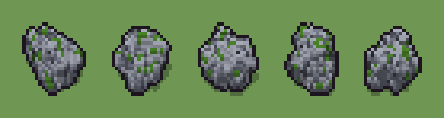

# Masso muschioso (`masso-muschioso.xml`)

Classe `roccia`, scatola 20 × 20 × 16 voxel; riscrittura procedurale di `universe/models/masso-muschioso.xml`.


## Esito

- validatore (`modelErrors`, `checkProgram`, `analyse` a ogni seme): nessun errore, nessun frammento staccato
- varianza su 5 semi (voxel pieni in un seme e vuoti nell'altro, sui pieni in almeno uno; il colore non conta): **media 0.345**, minima 0.301, massima 0.412 (soglia 0.15) → passa
- voxel per seme: 956, 979, 1007, 958, 948; tempo per seme: 8, 8, 9, 7, 7 ms
- avvisi: tocca i bordi laterali della griglia: forse è tagliato

| coppia | 1-2 | 1-3 | 1-4 | 1-5 | 2-3 | 2-4 | 2-5 | 3-4 | 3-5 | 4-5 |
|---|---|---|---|---|---|---|---|---|---|---|
| distanza | 0.397 | 0.335 | 0.356 | 0.412 | 0.353 | 0.313 | 0.343 | 0.326 | 0.316 | 0.301 |



## Traccia di tre semi a confronto

La traccia di `src/mj/trace.ts` (forma `nodi`): per ogni nodo quante volte gira, quante celle scrive e la scatola di ciò che scrive. Le
righe che cambiano fra i semi sono le scelte del programma.

### Seme 1

```text
Traccia, seme 1: griglia 20×20×16, 16 nodi, 980 passi, finito in 10 ms.
x sinistra→destra, y fondo→davanti, z basso→alto; «.» è la cella vuota; #n è il nodo nell'ordine dell'XML; ×n quante volte ha agito.
Lettere: R=granito grigio base, S=granito chiaro illuminato, D=crepa e ombra pietra, M=muschio vivace, V=dove corre la spina (marcatore).
Alla fine: R 662, S 192, D 71, M 31.
#2-3 ellipsoid×1, box×1: 138 celle x4-16 y4-16 z0, passi 1-2
#4-6 one×1, prl×1, all×1: 136 celle x4-16 y4-16 z0, passi 3-11
 #7 one R. → *R passi=760: ×760, 760 celle x2-19 y1-17 z0-7, passi 12-771, .→R 760
 #8 one R. → *R passi=200: ×200, 200 celle x1-19 y1-18 z0-7, passi 772-971, .→R 200
 #9 convolution .→R se R in [14,15,16,17,18,19,20,21,22,23,24,25,26]; R→. se R in [1,2,3,4,5,6,7,8]: ×3, 160 celle x1-19 y1-18 z0-7, passi 972-974, R→. 87, .→R 73
   r1 .→R ×73; r2 R→. ×87
 #10 prl R → D (+1) passi=1: ×1, 176 celle x2-18 y1-17 z0-7, passi 975, R→S 105, R→D 71
   r1 R → D ×83; r2 R → S ×105
#11-14 prl×3, all×1: 136 celle x3-19 y1-17 z1-7, passi 976-980
Senza effetto (non hanno mai cambiato una cella):
#15 all . M → * M passi=2: le celle cercate c'erano, ma mai disposte come nel pattern
#16 prl .. MR → ** *M passi=1: le celle cercate c'erano, ma mai disposte come nel pattern
```

### Seme 2

```text
Traccia, seme 2: griglia 20×20×16, 16 nodi, 980 passi, finito in 11 ms.
x sinistra→destra, y fondo→davanti, z basso→alto; «.» è la cella vuota; #n è il nodo nell'ordine dell'XML; ×n quante volte ha agito.
Lettere: R=granito grigio base, S=granito chiaro illuminato, D=crepa e ombra pietra, M=muschio vivace, V=dove corre la spina (marcatore).
Alla fine: R 668, S 219, D 59, M 33.
#2-3 ellipsoid×1, box×1: 138 celle x4-16 y4-16 z0, passi 1-2
#4-6 one×1, prl×1, all×1: 136 celle x4-16 y4-16 z0, passi 3-11
 #7 one R. → *R passi=760: ×760, 760 celle x1-17 y3-19 z0-8, passi 12-771, .→R 760
 #8 one R. → *R passi=200: ×200, 200 celle x0-18 y1-19 z0-8, passi 772-971, .→R 200
 #9 convolution .→R se R in [14,15,16,17,18,19,20,21,22,23,24,25,26]; R→. se R in [1,2,3,4,5,6,7,8]: ×3, 200 celle x0-18 y1-19 z0-8, passi 972-974, .→R 103, R→. 97
   r1 .→R ×103; r2 R→. ×97
 #10 prl R → D (+1) passi=1: ×1, 198 celle x1-16 y3-18 z0-8, passi 975, R→S 139, R→D 59
   r1 R → D ×70; r2 R → S ×139
#11-14 prl×3, all×1: 137 celle x1-17 y3-18 z1-8, passi 976-980
Senza effetto (non hanno mai cambiato una cella):
#15 all . M → * M passi=2: le celle cercate c'erano, ma mai disposte come nel pattern
#16 prl .. MR → ** *M passi=1: le celle cercate c'erano, ma mai disposte come nel pattern
```

### Seme 3

```text
Traccia, seme 3: griglia 20×20×16, 16 nodi, 981 passi, finito in 9 ms.
x sinistra→destra, y fondo→davanti, z basso→alto; «.» è la cella vuota; #n è il nodo nell'ordine dell'XML; ×n quante volte ha agito.
Lettere: R=granito grigio base, S=granito chiaro illuminato, D=crepa e ombra pietra, M=muschio vivace, V=dove corre la spina (marcatore).
Alla fine: R 694, S 225, D 62, M 26.
#2-3 ellipsoid×1, box×1: 138 celle x4-16 y4-16 z0, passi 1-2
#4-6 one×1, prl×1, all×1: 136 celle x4-16 y4-16 z0, passi 3-11
 #7 one R. → *R passi=760: ×760, 760 celle x1-19 y1-17 z0-8, passi 12-771, .→R 760
 #8 one R. → *R passi=200: ×200, 200 celle x1-19 y1-18 z0-8, passi 772-971, .→R 200
 #9 convolution .→R se R in [14,15,16,17,18,19,20,21,22,23,24,25,26]; R→. se R in [1,2,3,4,5,6,7,8]: ×3, 206 celle x1-19 y1-18 z0-8, passi 972-974, .→R 122, R→. 84
   r1 .→R ×122; r2 R→. ×84
 #10 prl R → D (+1) passi=1: ×1, 190 celle x4-18 y2-17 z0-7, passi 975, R→S 128, R→D 62
   r1 R → D ×71; r2 R → S ×128
#11-14 prl×3, all×1: 141 celle x3-19 y2-16 z1-7, passi 976-981
Senza effetto (non hanno mai cambiato una cella):
#15 all . M → * M passi=2: le celle cercate c'erano, ma mai disposte come nel pattern
#16 prl .. MR → ** *M passi=1: le celle cercate c'erano, ma mai disposte come nel pattern
```
