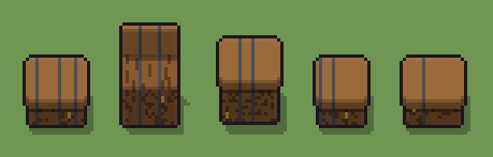

# Cassa (`mobile.xml`)

Classe `mobile`, scatola 20 × 20 × 20 voxel; riscrittura procedurale di `universe/models/mobile.xml`.


## Esito

- validatore (`modelErrors`, `checkProgram`, `analyse` a ogni seme): nessun errore, nessun frammento staccato
- varianza su 5 semi (voxel pieni in un seme e vuoti nell'altro, sui pieni in almeno uno; il colore non conta): **media 0.304**, minima 0.001, massima 0.512 (soglia 0.15) → passa
- voxel per seme: 1852, 2381, 2787, 1537, 1852; tempo per seme: 17, 12, 15, 16, 13 ms
- avvisi: tocca i bordi laterali della griglia: forse è tagliato; tocca il soffitto della griglia: forse è tagliato in alto

| coppia | 1-2 | 1-3 | 1-4 | 1-5 | 2-3 | 2-4 | 2-5 | 3-4 | 3-5 | 4-5 |
|---|---|---|---|---|---|---|---|---|---|---|
| distanza | 0.339 | 0.431 | 0.171 | 0.001 | 0.212 | 0.432 | 0.339 | 0.512 | 0.431 | 0.171 |



## Traccia di tre semi a confronto

La traccia di `src/mj/trace.ts` (forma `nodi`): per ogni nodo quante volte gira, quante celle scrive e la scatola di ciò che scrive. Le
righe che cambiano fra i semi sono le scelte del programma.

### Seme 1

```text
Traccia, seme 1: griglia 20×20×20, 31 nodi, 159 passi, finito in 16 ms.
x sinistra→destra, y fondo→davanti, z basso→alto; «.» è la cella vuota; #n è il nodo nell'ordine dell'XML; ×n quante volte ha agito.
Lettere: N=assi, n=fessure, I=ferro, K=coperchio, S=serratura, w=i fianchi che possono esserci (marcatore), a=scelta (marcatore), h=altezze possibili (marcatore), k=il taglio (marcatore), f=dove possono stare le fasce (marcatore), g=una fascia scelta (marcatore), o=il coperchio alzato (marcatore).
Alla fine: N 766, K 612, I 315, n 158, S 1.
#2-3 box×2: 3696 celle x2-18 y5-15 z0-11, passi 1-2
#4-11 prl×1, all×4, box×1, one×1: 1997 celle x0-19 y0-19 z0-12, passi 3-62
#12-13 all×2: 5387 celle x0-19 y0-19 z6-19, passi 63-76
 #14 all k → .: ×1, 5413 celle x0-19 y0-19 z6-19, passi 77, k→. 5413
#15-31 one×2, all×6, prl×3, box×1: 3004 celle x1-19 y0-19 z0-19, passi 78-159
Senza effetto (non hanno mai cambiato una cella):
#7 all w → .: in quel momento nella griglia non c'erano celle "w"
#17 all ao → aa: in quel momento nella griglia non c'erano celle "a", "o"
#20 all ./a → */o: in quel momento nella griglia non c'erano celle "a"
#21 all a → .: in quel momento nella griglia non c'erano celle "a"
#22 all . o → o * passi=9: in quel momento nella griglia non c'erano celle "o"
#23 all o → K: in quel momento nella griglia non c'erano celle "o"
```

### Seme 2

```text
Traccia, seme 2: griglia 20×20×20, 31 nodi, 140 passi, finito in 14 ms.
x sinistra→destra, y fondo→davanti, z basso→alto; «.» è la cella vuota; #n è il nodo nell'ordine dell'XML; ×n quante volte ha agito.
Lettere: N=assi, n=fessure, I=ferro, K=coperchio, S=serratura, w=i fianchi che possono esserci (marcatore), a=scelta (marcatore), h=altezze possibili (marcatore), k=il taglio (marcatore), f=dove possono stare le fasce (marcatore), g=una fascia scelta (marcatore), o=il coperchio alzato (marcatore).
Alla fine: N 1578, n 402, I 280, K 120, S 1.
#2-3 box×2: 3696 celle x2-18 y5-15 z0-11, passi 1-2
#4-5 prl×1, all×1: 792 celle x2-18 y5-15 z0-11, passi 3-22
#6-11 all×3, box×1, one×1: 1205 celle x0-19 y0-19 z0-12, passi 23-64
 #12 all * k → k *: ×7, 2800 celle x0-19 y0-19 z13-19, passi 65-71, .→k 2800
 #13 all k N → o *: ×1, 187 celle x2-18 y5-15 z12, passi 72, k→o 187
 #14 all k → .: ×1, 3013 celle x0-19 y0-19 z12-19, passi 73, k→. 3013
#15-31 one×2, all×9, box×1, prl×2: 1744 celle x2-18 y0-16 z0-19, passi 74-140
Senza effetto (non hanno mai cambiato una cella):
#7 all w → .: in quel momento nella griglia non c'erano celle "w"
#16 all Ko → KK: in quel momento nella griglia non c'erano celle "K"
#18 prl K. → *K passi=1: in quel momento nella griglia non c'erano celle "K"
#19 all . K → K * passi=2: in quel momento nella griglia non c'erano celle "K"
```

### Seme 3

```text
Traccia, seme 3: griglia 20×20×20, 31 nodi, 164 passi, finito in 20 ms.
x sinistra→destra, y fondo→davanti, z basso→alto; «.» è la cella vuota; #n è il nodo nell'ordine dell'XML; ×n quante volte ha agito.
Lettere: N=assi, n=fessure, I=ferro, K=coperchio, S=serratura, w=i fianchi che possono esserci (marcatore), a=scelta (marcatore), h=altezze possibili (marcatore), k=il taglio (marcatore), f=dove possono stare le fasce (marcatore), g=una fascia scelta (marcatore), o=il coperchio alzato (marcatore).
Alla fine: N 1462, K 651, n 353, I 320, S 1.
#2-3 box×2: 3696 celle x2-18 y5-15 z0-11, passi 1-2
#4-11 prl×1, all×4, box×1, one×1: 1997 celle x0-19 y0-19 z0-12, passi 3-66
#12-13 all×2: 3387 celle x0-19 y0-19 z11-19, passi 67-75
 #14 all k → .: ×1, 3413 celle x0-19 y0-19 z11-19, passi 76, k→. 3413
#15-31 one×2, all×6, prl×3, box×1: 2395 celle x1-19 y0-19 z0-19, passi 77-164
Senza effetto (non hanno mai cambiato una cella):
#7 all w → .: in quel momento nella griglia non c'erano celle "w"
#17 all ao → aa: in quel momento nella griglia non c'erano celle "a", "o"
#20 all ./a → */o: in quel momento nella griglia non c'erano celle "a"
#21 all a → .: in quel momento nella griglia non c'erano celle "a"
#22 all . o → o * passi=9: in quel momento nella griglia non c'erano celle "o"
#23 all o → K: in quel momento nella griglia non c'erano celle "o"
```
