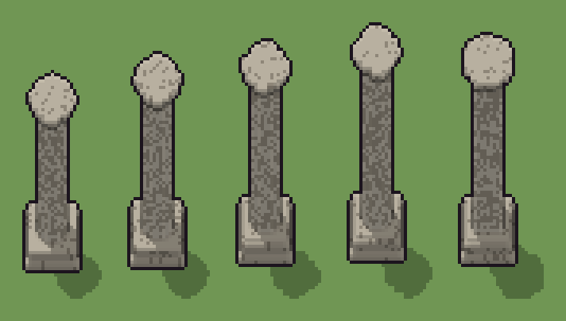

# Colonna (`monumento.xml`)

Classe `monumento`, scatola 20 × 20 × 60 voxel; riscrittura procedurale di `universe/models/monumento.xml`.


## Esito

- validatore (`modelErrors`, `checkProgram`, `analyse` a ogni seme): nessun errore, nessun frammento staccato
- varianza su 5 semi (voxel pieni in un seme e vuoti nell'altro, sui pieni in almeno uno; il colore non conta): **media 0.187**, minima 0.113, massima 0.293 (soglia 0.15) → passa
- voxel per seme: 4238, 4586, 4898, 5174, 5677; tempo per seme: 62, 65, 66, 69, 78 ms

| coppia | 1-2 | 1-3 | 1-4 | 1-5 | 2-3 | 2-4 | 2-5 | 3-4 | 3-5 | 4-5 |
|---|---|---|---|---|---|---|---|---|---|---|
| distanza | 0.139 | 0.192 | 0.234 | 0.293 | 0.125 | 0.170 | 0.234 | 0.113 | 0.182 | 0.185 |



## Traccia di tre semi a confronto

La traccia di `src/mj/trace.ts` (forma `nodi`): per ogni nodo quante volte gira, quante celle scrive e la scatola di ciò che scrive. Le
righe che cambiano fra i semi sono le scelte del programma.

### Seme 1

```text
Traccia, seme 1: griglia 20×20×60, 37 nodi, 196 passi, finito in 80 ms.
x sinistra→destra, y fondo→davanti, z basso→alto; «.» è la cella vuota; #n è il nodo nell'ordine dell'XML; ×n quante volte ha agito.
Lettere: D=pietra, d=pietra consumata, W=marmo, w=scanalatura, h=altezze possibili (marcatore), k=il taglio (marcatore), p=il pilastro quadrato possibile (marcatore), c=il capitello che si allarga (marcatore), s=il gradino in più possibile (marcatore), m=dado (marcatore), q=il capitello (marcatore).
Alla fine: W 2514, D 1394, w 177, d 153, s 88.
#2-15 box×7, prl×1, all×3, one×1, cylinder×1: 10069 celle x1-19 y0-18 z0-59, passi 1-26
#16-27 one×3, all×5, box×2: 13486 celle x0-19 y0-19 z0-59, passi 27-87
 #28 all c. → cc (+1): ×100, 19967 celle x0-19 y0-19 z0-59, passi 88-187, .→c 19967
   r1 c. → cc ×19967; r2 r. → rr ×0
 #30 all c W → q *: ×1, 69 celle x6-14 y6-14 z44, passi 188, c→q 69
 #31 all [cr] → .: ×1, 19899 celle x0-19 y0-19 z0-59, passi 189, c→. 19899
#32-37 all×4, prl×2: 849 celle x2-18 y2-18 z0-45, passi 190-196
Senza effetto (non hanno mai cambiato una cella):
#10 all Ds → DD: le celle cercate c'erano, ma mai disposte come nel pattern
#17 all cW → cc (+1): in quel momento nella griglia non c'erano celle "c"
#18 all c → W: in quel momento nella griglia non c'erano celle "c"
#29 prl r W → * r passi=5: in quel momento nella griglia non c'erano celle "r"
```

### Seme 2

```text
Traccia, seme 2: griglia 20×20×60, 37 nodi, 190 passi, finito in 82 ms.
x sinistra→destra, y fondo→davanti, z basso→alto; «.» è la cella vuota; #n è il nodo nell'ordine dell'XML; ×n quante volte ha agito.
Lettere: D=pietra, d=pietra consumata, W=marmo, w=scanalatura, h=altezze possibili (marcatore), k=il taglio (marcatore), p=il pilastro quadrato possibile (marcatore), c=il capitello che si allarga (marcatore), s=il gradino in più possibile (marcatore), m=dado (marcatore), q=il capitello (marcatore).
Alla fine: W 2862, D 1369, d 181, w 174, s 88.
#2-15 box×7, prl×1, all×3, one×1, cylinder×1: 10069 celle x1-19 y0-18 z0-59, passi 1-26
#16-27 one×3, all×5, box×2: 9486 celle x0-19 y0-19 z0-59, passi 27-82
 #28 all c. → cc (+1): ×99, 19622 celle x0-19 y0-19 z0-59, passi 83-181, .→c 19622
   r1 c. → cc ×19622; r2 r. → rr ×0
 #30 all c W → q *: ×1, 69 celle x6-14 y6-14 z49, passi 182, c→q 69
 #31 all [cr] → .: ×1, 19554 celle x0-19 y0-19 z0-59, passi 183, c→. 19554
#32-37 all×4, prl×2: 880 celle x2-18 y2-18 z0-50, passi 184-190
Senza effetto (non hanno mai cambiato una cella):
#10 all Ds → DD: le celle cercate c'erano, ma mai disposte come nel pattern
#17 all cW → cc (+1): in quel momento nella griglia non c'erano celle "c"
#18 all c → W: in quel momento nella griglia non c'erano celle "c"
#29 prl r W → * r passi=5: in quel momento nella griglia non c'erano celle "r"
```

### Seme 3

```text
Traccia, seme 3: griglia 20×20×60, 37 nodi, 186 passi, finito in 77 ms.
x sinistra→destra, y fondo→davanti, z basso→alto; «.» è la cella vuota; #n è il nodo nell'ordine dell'XML; ×n quante volte ha agito.
Lettere: D=pietra, d=pietra consumata, W=marmo, w=scanalatura, h=altezze possibili (marcatore), k=il taglio (marcatore), p=il pilastro quadrato possibile (marcatore), c=il capitello che si allarga (marcatore), s=il gradino in più possibile (marcatore), m=dado (marcatore), q=il capitello (marcatore).
Alla fine: W 3048, D 1479, w 195, d 176, s 88.
#2-15 box×7, prl×1, all×2, one×1, cylinder×1: 9819 celle x1-19 y0-18 z0-59, passi 1-25
#16-27 one×3, all×5, box×2: 7074 celle x0-19 y0-19 z0-59, passi 26-78
 #28 all c. → cc (+1): ×99, 19315 celle x0-19 y0-19 z0-59, passi 79-177, .→c 19315
   r1 c. → cc ×19315; r2 r. → rr ×0
 #30 all c W → q *: ×1, 69 celle x6-14 y6-14 z52, passi 178, c→q 69
 #31 all [cr] → .: ×1, 19247 celle x0-19 y0-19 z0-59, passi 179, c→. 19247
#32-37 all×4, prl×2: 906 celle x2-18 y2-18 z0-53, passi 180-186
Senza effetto (non hanno mai cambiato una cella):
#11 all ks → kk: in quel momento nella griglia non c'erano celle "k"
#12 all k → .: in quel momento nella griglia non c'erano celle "k"
#17 all cW → cc (+1): in quel momento nella griglia non c'erano celle "c"
#18 all c → W: in quel momento nella griglia non c'erano celle "c"
#29 prl r W → * r passi=5: in quel momento nella griglia non c'erano celle "r"
```
