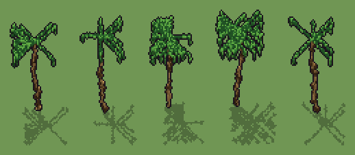

# Palma (`palma.xml`)

Classe `albero`, scatola 40 × 40 × 60 voxel; riscrittura procedurale di `universe/models/palma.xml`.


## Esito

- validatore (`modelErrors`, `checkProgram`, `analyse` a ogni seme): nessun errore, nessun frammento staccato
- varianza su 5 semi (voxel pieni in un seme e vuoti nell'altro, sui pieni in almeno uno; il colore non conta): **media 0.959**, minima 0.881, massima 0.991 (soglia 0.15) → passa
- voxel per seme: 586, 425, 777, 917, 421; tempo per seme: 82, 83, 83, 84, 82 ms

| coppia | 1-2 | 1-3 | 1-4 | 1-5 | 2-3 | 2-4 | 2-5 | 3-4 | 3-5 | 4-5 |
|---|---|---|---|---|---|---|---|---|---|---|
| distanza | 0.978 | 0.978 | 0.991 | 0.944 | 0.984 | 0.983 | 0.911 | 0.970 | 0.881 | 0.973 |



## Traccia di tre semi a confronto

La traccia di `src/mj/trace.ts` (forma `nodi`): per ogni nodo quante volte gira, quante celle scrive e la scatola di ciò che scrive. Le
righe che cambiano fra i semi sono le scelte del programma.

### Seme 1

```text
Traccia, seme 1: griglia 40×40×60, 24 nodi, 167 passi, finito in 88 ms.
x sinistra→destra, y fondo→davanti, z basso→alto; «.» è la cella vuota; #n è il nodo nell'ordine dell'XML; ×n quante volte ha agito.
Lettere: T=fusto palma, K=anello tronco scuro, H=fusto illuminato, F=fronda, L=fronda al sole, D=fronda in ombra, C=noce di cocco, h=altezze possibili (marcatore), k=la quota scelta (marcatore), r=la punta del fusto (marcatore), f=punta di una fronda che si allunga (marcatore), c=la cima (marcatore).
Alla fine: D 198, F 113, L 96, C 80, T 78, H 12, K 9.
#2-4 box×1, one×1, all×1: 22 celle x0 y0 z44-54, passi 1-3
 #5 all k. → kk: ×78, 1599 celle x0-39 y0-39 z50, passi 4-81, .→k 1599
#6-8 box×1, one×1, all×1: 100 celle x17-21 y20-23 z0-49, passi 82-132
 #9 all k → .: ×1, 1600 celle x0-39 y0-39 z50, passi 133, k→. 1600
#10-14 all×3, prl×2: 265 celle x4-31 y11-32 z0-50, passi 134-153
#15-17 all×3: 205 celle x2-33 y9-34 z46-50, passi 154-160
#18-23 prl×4, all×2: 288 celle x1-33 y9-35 z0-50, passi 161-166
 #24 prl . F → . L (+2) passi=1: ×1, 306 celle x1-33 y9-35 z0-50, passi 167, F→D 198, F→L 96, T→H 12
   r1 . F → . L ×230; r2 F . → D . ×198; r3 . T → . H ×12
```

### Seme 2

```text
Traccia, seme 2: griglia 40×40×60, 24 nodi, 169 passi, finito in 82 ms.
x sinistra→destra, y fondo→davanti, z basso→alto; «.» è la cella vuota; #n è il nodo nell'ordine dell'XML; ×n quante volte ha agito.
Lettere: T=fusto palma, K=anello tronco scuro, H=fusto illuminato, F=fronda, L=fronda al sole, D=fronda in ombra, C=noce di cocco, h=altezze possibili (marcatore), k=la quota scelta (marcatore), r=la punta del fusto (marcatore), f=punta di una fronda che si allunga (marcatore), c=la cima (marcatore).
Alla fine: D 143, T 70, F 63, C 58, L 58, H 18, K 15.
#2-4 box×1, one×1, all×1: 22 celle x0 y0 z44-54, passi 1-3
 #5 all k. → kk: ×78, 1599 celle x0-39 y0-39 z52, passi 4-81, .→k 1599
#6-8 box×1, one×1, all×1: 104 celle x17-20 y19-20 z0-51, passi 82-134
 #9 all k → .: ×1, 1600 celle x0-39 y0-39 z52, passi 135, k→. 1600
#10-14 all×3, prl×2: 214 celle x6-31 y9-31 z0-52, passi 136-155
#15-17 all×3: 104 celle x4-33 y7-33 z48-52, passi 156-162
#18-23 prl×4, all×2: 207 celle x3-34 y6-34 z0-52, passi 163-168
 #24 prl . F → . L (+2) passi=1: ×1, 219 celle x3-33 y6-34 z3-52, passi 169, F→D 143, F→L 58, T→H 18
   r1 . F → . L ×149; r2 F . → D . ×143; r3 . T → . H ×18
```

### Seme 3

```text
Traccia, seme 3: griglia 40×40×60, 24 nodi, 168 passi, finito in 84 ms.
x sinistra→destra, y fondo→davanti, z basso→alto; «.» è la cella vuota; #n è il nodo nell'ordine dell'XML; ×n quante volte ha agito.
Lettere: T=fusto palma, K=anello tronco scuro, H=fusto illuminato, F=fronda, L=fronda al sole, D=fronda in ombra, C=noce di cocco, h=altezze possibili (marcatore), k=la quota scelta (marcatore), r=la punta del fusto (marcatore), f=punta di una fronda che si allunga (marcatore), c=la cima (marcatore).
Alla fine: D 281, F 182, L 157, T 69, C 56, H 21, K 11.
#2-4 box×1, one×1, all×1: 22 celle x0 y0 z44-54, passi 1-3
 #5 all k. → kk: ×78, 1599 celle x0-39 y0-39 z51, passi 4-81, .→k 1599
#6-8 box×1, one×1, all×1: 102 celle x20-21 y19-21 z0-50, passi 82-133
 #9 all k → .: ×1, 1600 celle x0-39 y0-39 z51, passi 134, k→. 1600
#10-14 all×3, prl×2: 402 celle x9-33 y9-34 z0-51, passi 135-154
#15-17 all×3: 391 celle x7-35 y7-36 z47-51, passi 155-161
#18-23 prl×4, all×2: 318 celle x6-36 y6-37 z0-51, passi 162-167
 #24 prl . F → . L (+2) passi=1: ×1, 459 celle x7-36 y6-37 z0-51, passi 168, F→D 281, F→L 157, T→H 21
   r1 . F → . L ×332; r2 F . → D . ×281; r3 . T → . H ×21
```
