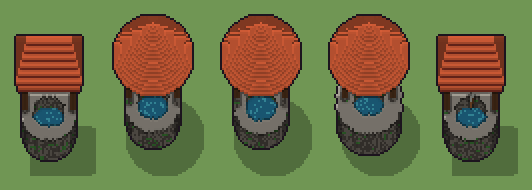

# Pozzo (`pozzo.xml`)

Classe `edificio`, scatola 50 × 50 × 50 voxel; riscrittura procedurale di `universe/models/pozzo.xml`.


## Esito

- validatore (`modelErrors`, `checkProgram`, `analyse` a ogni seme): nessun errore, nessun frammento staccato
- varianza su 5 semi (voxel pieni in un seme e vuoti nell'altro, sui pieni in almeno uno; il colore non conta): **media 0.271**, minima 0.008, massima 0.417 (soglia 0.15) → passa
- voxel per seme: 11426, 11944, 11683, 15705, 11421; tempo per seme: 183, 175, 191, 194, 163 ms
- avvisi: colori mai usati: C c

| coppia | 1-2 | 1-3 | 1-4 | 1-5 | 2-3 | 2-4 | 2-5 | 3-4 | 3-5 | 4-5 |
|---|---|---|---|---|---|---|---|---|---|---|
| distanza | 0.324 | 0.342 | 0.416 | 0.008 | 0.035 | 0.244 | 0.323 | 0.261 | 0.342 | 0.417 |



## Traccia di tre semi a confronto

La traccia di `src/mj/trace.ts` (forma `nodi`): per ogni nodo quante volte gira, quante celle scrive e la scatola di ciò che scrive. Le
righe che cambiano fra i semi sono le scelte del programma.

### Seme 1

```text
Traccia, seme 1: griglia 50×50×50, 62 nodi, 243 passi, finito in 214 ms.
x sinistra→destra, y fondo→davanti, z basso→alto; «.» è la cella vuota; #n è il nodo nell'ordine dell'XML; ×n quante volte ha agito.
Lettere: P=pietra base, p=pietra chiara rilievo, d=pietra scura fessure, W=acqua pozzo profonda, g=muschio umido, N=legno scuro travi, n=legno caldo doghe, R=tegole tetto rossicce, o=tegole cresta calda, U=riflesso acqua brillante, m=mescola e dadi (marcatore), k=il taglio (marcatore), h=altezze possibili (marcatore), q=il parapetto largo (marcatore), r=il tetto a due falde (marcatore), s=il tetto a cono (marcatore), t=nessun tetto (marcatore), u=scelta: due falde (marcatore), y=scelta del secchio (marcatore), z=la corda possibile (marcatore), w=dove i due tetti si sovrappongono (marcatore).
Alla fine: R 4517, d 1895, o 1672, P 1095, W 825, N 522, p 347, g 312, U 171, n 70.
#2-62 box×17, prl×8, all×17, cylinder×5, one×4, cone×2: 247921 celle x0-49 y0-49 z0-49, passi 1-243
Senza effetto (non hanno mai cambiato una cella):
#9 all aP → aa (+1): in quel momento nella griglia non c'erano celle "a"
#10 all a → P: in quel momento nella griglia non c'erano celle "a"
#28 all N/. → */*: le celle cercate c'erano, ma mai disposte come nel pattern
#49 all n z → * C: le celle cercate c'erano, ma mai disposte come nel pattern
#50 all C z → * C: in quel momento nella griglia non c'erano celle "C"
#54 all . y → * x: le celle cercate c'erano, ma mai disposte come nel pattern
#55 all xy → *x: in quel momento nella griglia non c'erano celle "x"
… tagliato: oltre il tetto di token.
```

### Seme 2

```text
Traccia, seme 2: griglia 50×50×50, 62 nodi, 264 passi, finito in 234 ms.
x sinistra→destra, y fondo→davanti, z basso→alto; «.» è la cella vuota; #n è il nodo nell'ordine dell'XML; ×n quante volte ha agito.
Lettere: P=pietra base, p=pietra chiara rilievo, d=pietra scura fessure, W=acqua pozzo profonda, g=muschio umido, N=legno scuro travi, n=legno caldo doghe, C=corda e ferro, c=ferro chiaro secchio, R=tegole tetto rossicce, o=tegole cresta calda, U=riflesso acqua brillante, m=mescola e dadi (marcatore), k=il taglio (marcatore), h=altezze possibili (marcatore), q=il parapetto largo (marcatore), r=il tetto a due falde (marcatore), s=il tetto a cono (marcatore), t=nessun tetto (marcatore), v=scelta: cono (marcatore), x=il secchio possibile (marcatore), y=scelta del secchio (marcatore), z=la corda possibile (marcatore), w=dove i due tetti si sovrappongono (marcatore).
Alla fine: R 5018, o 2204, d 1559, P 959, W 850, N 522, p 333, g 274, U 146, n 66, C 9, c 4.
#2-16 box×3, prl×1, all×5, cylinder×2, one×2: 120729 celle x0-49 y0-49 z0-49, passi 1-148
 #17 all k → .: ×1, 100000 celle x0-49 y0-49 z10-49, passi 149, k→. 100000
#18-62 cylinder×3, all×16, prl×7, box×14, cone×2, one×2: 37452 celle x6-44 y6-44 z0-48, passi 150-264
Senza effetto (non hanno mai cambiato una cella):
#9 all aP → aa (+1): in quel momento nella griglia non c'erano celle "a"
#10 all a → P: in quel momento nella griglia non c'erano celle "a"
#28 all N/. → */*: le celle cercate c'erano, ma mai disposte come nel pattern
```

### Seme 3

```text
Traccia, seme 3: griglia 50×50×50, 62 nodi, 257 passi, finito in 203 ms.
x sinistra→destra, y fondo→davanti, z basso→alto; «.» è la cella vuota; #n è il nodo nell'ordine dell'XML; ×n quante volte ha agito.
Lettere: P=pietra base, p=pietra chiara rilievo, d=pietra scura fessure, W=acqua pozzo profonda, g=muschio umido, N=legno scuro travi, n=legno caldo doghe, C=corda e ferro, c=ferro chiaro secchio, R=tegole tetto rossicce, o=tegole cresta calda, U=riflesso acqua brillante, m=mescola e dadi (marcatore), k=il taglio (marcatore), h=altezze possibili (marcatore), q=il parapetto largo (marcatore), r=il tetto a due falde (marcatore), s=il tetto a cono (marcatore), t=nessun tetto (marcatore), v=scelta: cono (marcatore), x=il secchio possibile (marcatore), y=scelta del secchio (marcatore), z=la corda possibile (marcatore), w=dove i due tetti si sovrappongono (marcatore).
Alla fine: R 5005, o 2217, d 1418, P 894, W 838, N 522, p 334, g 225, U 158, n 66, c 4, C 2.
#2-16 box×3, prl×1, all×5, cylinder×2, one×2: 123229 celle x0-49 y0-49 z0-49, passi 1-149
 #17 all k → .: ×1, 102500 celle x0-49 y0-49 z9-49, passi 150, k→. 102500
#18-62 cylinder×3, all×16, prl×7, box×14, cone×2, one×2: 37068 celle x6-44 y6-44 z0-48, passi 151-257
Senza effetto (non hanno mai cambiato una cella):
#9 all aP → aa (+1): in quel momento nella griglia non c'erano celle "a"
#10 all a → P: in quel momento nella griglia non c'erano celle "a"
#28 all N/. → */*: le celle cercate c'erano, ma mai disposte come nel pattern
```
