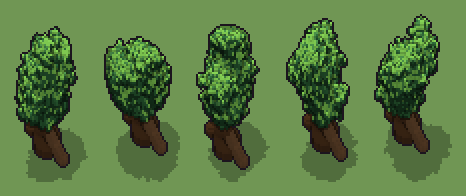

# Quercia (`quercia.xml`)

Classe `albero`, scatola 40 × 40 × 60 voxel; riscrittura procedurale di `universe/models/quercia.xml`.


## Esito

- validatore (`modelErrors`, `checkProgram`, `analyse` a ogni seme): nessun errore, nessun frammento staccato
- varianza su 5 semi (voxel pieni in un seme e vuoti nell'altro, sui pieni in almeno uno; il colore non conta): **media 0.494**, minima 0.414, massima 0.665 (soglia 0.15) → passa
- voxel per seme: 12389, 12291, 12260, 12390, 12191; tempo per seme: 162, 160, 153, 153, 154 ms

| coppia | 1-2 | 1-3 | 1-4 | 1-5 | 2-3 | 2-4 | 2-5 | 3-4 | 3-5 | 4-5 |
|---|---|---|---|---|---|---|---|---|---|---|
| distanza | 0.484 | 0.432 | 0.414 | 0.426 | 0.665 | 0.453 | 0.422 | 0.526 | 0.601 | 0.514 |



## Traccia di tre semi a confronto

La traccia di `src/mj/trace.ts` (forma `nodi`): per ogni nodo quante volte gira, quante celle scrive e la scatola di ciò che scrive. Le
righe che cambiano fra i semi sono le scelte del programma.

### Seme 1

```text
Traccia, seme 1: griglia 40×40×60, 29 nodi, 9237 passi, finito in 178 ms.
x sinistra→destra, y fondo→davanti, z basso→alto; «.» è la cella vuota; #n è il nodo nell'ordine dell'XML; ×n quante volte ha agito.
Lettere: T=tronco base, t=legno ombra, F=chioma base, f=chioma ombra, L=foglie medie, Y=foglie luce, h=quote possibili della biforcazione (marcatore), k=la quota scelta (marcatore), V=la cupola della chioma (marcatore), r=punta di una branca (marcatore), x=sotto la chioma (marcatore).
Alla fine: F 9948, t 828, f 696, Y 445, T 338, L 134.
#2-5 box×1, one×1, all×2: 1617 celle x0-39 y0-39 z14-22, passi 1-81
#6-8 box×1, one×1, all×1: 1637 celle x0-39 y0-39 z0-19, passi 82-101
#9-10 ellipsoid×1, box×1: 49977 celle x1-39 y1-39 z0-51, passi 102-103
#11-22 one×3, prl×2, all×4, cylinder×1, line×2: 1272 celle x10-30 y10-30 z0-42, passi 104-228
 #23 all [Tt]V → *F (+1) passi=3: ×3, 1422 celle x10-27 y11-27 z14-44, passi 229-231, V→F 1422
   r1 [Tt]V → *F ×433; r2 FV → FF ×989
 #24 one FV → FF passi=9000: ×9000, 9000 celle x5-34 y4-33 z14-51, passi 232-9231, V→F 9000
 #25 all [Vx] → .: ×1, 38415 celle x1-39 y1-39 z0-51, passi 9232, V→. 19675, x→. 18740
#26-27 conv×1, prl×1: 1709 celle x5-34 y4-33 z14-51, passi 9233-9235
#28-29 prl×2: 1024 celle x6-33 y5-32 z18-51, passi 9236-9237
```

### Seme 2

```text
Traccia, seme 2: griglia 40×40×60, 29 nodi, 9238 passi, finito in 173 ms.
x sinistra→destra, y fondo→davanti, z basso→alto; «.» è la cella vuota; #n è il nodo nell'ordine dell'XML; ×n quante volte ha agito.
Lettere: T=tronco base, t=legno ombra, F=chioma base, f=chioma ombra, L=foglie medie, Y=foglie luce, h=quote possibili della biforcazione (marcatore), k=la quota scelta (marcatore), V=la cupola della chioma (marcatore), r=punta di una branca (marcatore), x=sotto la chioma (marcatore).
Alla fine: F 9758, t 828, f 712, Y 498, T 342, L 153.
#2-5 box×1, one×1, all×2: 1617 celle x0-39 y0-39 z14-22, passi 1-81
#6-8 box×1, one×1, all×1: 1639 celle x0-39 y0-39 z0-20, passi 82-102
#9-10 ellipsoid×1, box×1: 49976 celle x1-39 y1-39 z0-51, passi 103-104
#11-22 one×3, prl×2, all×4, cylinder×1, line×2: 1278 celle x3-30 y10-30 z0-42, passi 105-229
 #23 all [Tt]V → *F (+1) passi=3: ×3, 1413 celle x2-26 y16-29 z14-44, passi 230-232, V→F 1413
   r1 [Tt]V → *F ×430; r2 FV → FF ×983
 #24 one FV → FF passi=9000: ×9000, 9000 celle x1-32 y9-35 z14-48, passi 233-9232, V→F 9000
 #25 all [Vx] → .: ×1, 38420 celle x1-39 y1-39 z0-51, passi 9233, V→. 19680, x→. 18740
#26-27 conv×1, prl×1: 1542 celle x1-32 y9-35 z14-48, passi 9234-9236
#28-29 prl×2: 1149 celle x1-32 y9-35 z16-48, passi 9237-9238
```

### Seme 3

```text
Traccia, seme 3: griglia 40×40×60, 29 nodi, 9238 passi, finito in 229 ms.
x sinistra→destra, y fondo→davanti, z basso→alto; «.» è la cella vuota; #n è il nodo nell'ordine dell'XML; ×n quante volte ha agito.
Lettere: T=tronco base, t=legno ombra, F=chioma base, f=chioma ombra, L=foglie medie, Y=foglie luce, h=quote possibili della biforcazione (marcatore), k=la quota scelta (marcatore), V=la cupola della chioma (marcatore), r=punta di una branca (marcatore), x=sotto la chioma (marcatore).
Alla fine: F 9739, t 827, f 695, Y 489, T 338, L 172.
#2-5 box×1, one×1, all×2: 1617 celle x0-39 y0-39 z14-22, passi 1-81
#6-8 box×1, one×1, all×1: 1639 celle x0-39 y0-39 z0-20, passi 82-102
#9-10 ellipsoid×1, box×1: 49976 celle x1-39 y1-39 z0-51, passi 103-104
#11-22 one×3, prl×2, all×4, cylinder×1, line×2: 1269 celle x10-30 y6-30 z0-48, passi 105-229
 #23 all [Tt]V → *F (+1) passi=3: ×3, 1365 celle x14-28 y4-23 z14-49, passi 230-232, V→F 1365
   r1 [Tt]V → *F ×417; r2 FV → FF ×948
 #24 one FV → FF passi=9000: ×9000, 9000 celle x6-37 y1-31 z14-51, passi 233-9232, V→F 9000
 #25 all [Vx] → .: ×1, 38473 celle x1-39 y1-39 z0-51, passi 9233, V→. 19732, x→. 18741
#26-27 conv×1, prl×1: 1577 celle x6-37 y1-31 z14-50, passi 9234-9236
#28-29 prl×2: 1150 celle x6-34 y1-30 z17-51, passi 9237-9238
```
