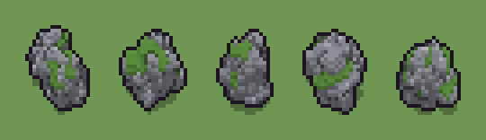

# Masso (`roccia.xml`)

Classe `roccia`, scatola 20 × 20 × 16 voxel; riscrittura procedurale di `universe/models/roccia.xml`.


## Esito

- validatore (`modelErrors`, `checkProgram`, `analyse` a ogni seme): nessun errore, nessun frammento staccato
- varianza su 5 semi (voxel pieni in un seme e vuoti nell'altro, sui pieni in almeno uno; il colore non conta): **media 0.482**, minima 0.405, massima 0.585 (soglia 0.15) → passa
- voxel per seme: 1004, 1006, 1001, 1003, 966; tempo per seme: 9, 8, 9, 9, 9 ms
- avvisi: tocca i bordi laterali della griglia: forse è tagliato

| coppia | 1-2 | 1-3 | 1-4 | 1-5 | 2-3 | 2-4 | 2-5 | 3-4 | 3-5 | 4-5 |
|---|---|---|---|---|---|---|---|---|---|---|
| distanza | 0.567 | 0.522 | 0.481 | 0.585 | 0.445 | 0.422 | 0.405 | 0.498 | 0.407 | 0.492 |



## Traccia di tre semi a confronto

La traccia di `src/mj/trace.ts` (forma `nodi`): per ogni nodo quante volte gira, quante celle scrive e la scatola di ciò che scrive. Le
righe che cambiano fra i semi sono le scelte del programma.

### Seme 1

```text
Traccia, seme 1: griglia 20×20×16, 18 nodi, 1018 passi, finito in 11 ms.
x sinistra→destra, y fondo→davanti, z basso→alto; «.» è la cella vuota; #n è il nodo nell'ordine dell'XML; ×n quante volte ha agito.
Lettere: R=granito, S=granito chiaro, D=crepa, M=muschio, V=dove nasce un lobo (marcatore), k=dove può nascere la scheggia (marcatore), K=la scheggia (marcatore).
Alla fine: R 823, S 94, M 51, D 36.
#2-7 ellipsoid×2, box×1, one×2, prl×1: 137 celle x5-15 y5-15 z0, passi 1-7
#8-12 all×1, one×1: 102 celle x5-15 y5-15 z0-4, passi 8-17
 #13 one R. → RR passi=650: ×650, 650 celle x3-19 y0-17 z0-8, passi 18-667, .→R 650
 #14 one R. → RR passi=300: ×300, 300 celle x2-19 y0-17 z0-8, passi 668-967, .→R 300
 #15 convolution .→R se R in [14,15,16,17,18,19,20,21,22,23,24,25,26]; R→. se R in [1,2,3,4,5,6,7]: ×3, 189 celle x2-19 y0-17 z0-8, passi 968-970, .→R 115, R→. 74
   r1 .→R ×115; r2 R→. ×74
 #16 prl R → S (+1) passi=1: ×1, 140 celle x3-17 y0-15 z0-7, passi 971, R→S 102, R→D 38
   r1 R → S ×108; r2 R → D ×38
#17-18 prl×1, one×1: 51 celle x7-14 y0-15 z3-6, passi 972-1018
Senza effetto (non hanno mai cambiato una cella):
#9 prl . R → K R passi=1
#10 one K → R passi=1: in quel momento nella griglia non c'erano celle "K"
#11 all K → .: in quel momento nella griglia non c'erano celle "K"
```

### Seme 2

```text
Traccia, seme 2: griglia 20×20×16, 18 nodi, 1037 passi, finito in 10 ms.
x sinistra→destra, y fondo→davanti, z basso→alto; «.» è la cella vuota; #n è il nodo nell'ordine dell'XML; ×n quante volte ha agito.
Lettere: R=granito, S=granito chiaro, D=crepa, M=muschio, V=dove nasce un lobo (marcatore), k=dove può nascere la scheggia (marcatore), K=la scheggia (marcatore).
Alla fine: R 820, S 72, M 66, D 48.
#2-3 ellipsoid×1, box×1: 98 celle x5-15 y5-15 z0, passi 1-2
#4-7 one×2, ellipsoid×1, prl×1: 42 celle x7-14 y7-13 z0, passi 3-7
#8-12 all×2, prl×1, one×2: 106 celle x5-15 y5-15 z0-5, passi 8-20
 #13 one R. → RR passi=650: ×650, 650 celle x3-19 y4-18 z0-9, passi 21-670, .→R 650
 #14 one R. → RR passi=300: ×300, 300 celle x2-19 y3-19 z0-9, passi 671-970, .→R 300
 #15 convolution .→R se R in [14,15,16,17,18,19,20,21,22,23,24,25,26]; R→. se R in [1,2,3,4,5,6,7]: ×3, 188 celle x2-19 y3-19 z0-9, passi 971-973, .→R 115, R→. 73
   r1 .→R ×115; r2 R→. ×73
 #16 prl R → S (+1) passi=1: ×1, 128 celle x3-19 y3-18 z0-7, passi 974, R→S 77, R→D 51
   r1 R → S ×83; r2 R → D ×51
#17-18 prl×1, one×1: 66 celle x4-18 y7-15 z2-7, passi 975-1037
```

### Seme 3

```text
Traccia, seme 3: griglia 20×20×16, 18 nodi, 995 passi, finito in 10 ms.
x sinistra→destra, y fondo→davanti, z basso→alto; «.» è la cella vuota; #n è il nodo nell'ordine dell'XML; ×n quante volte ha agito.
Lettere: R=granito, S=granito chiaro, D=crepa, M=muschio, V=dove nasce un lobo (marcatore), k=dove può nascere la scheggia (marcatore), K=la scheggia (marcatore).
Alla fine: R 848, S 88, D 42, M 23.
#2-3 ellipsoid×1, box×1: 98 celle x5-15 y5-15 z0, passi 1-2
#4-7 one×2, ellipsoid×1, prl×1: 41 celle x7-13 y5-13 z0, passi 3-7
#8-12 all×2, prl×1, one×2: 106 celle x5-15 y5-15 z0-5, passi 8-20
 #13 one R. → RR passi=650: ×650, 650 celle x4-15 y1-17 z0-11, passi 21-670, .→R 650
 #14 one R. → RR passi=300: ×300, 300 celle x2-17 y0-18 z0-11, passi 671-970, .→R 300
 #15 convolution .→R se R in [14,15,16,17,18,19,20,21,22,23,24,25,26]; R→. se R in [1,2,3,4,5,6,7]: ×3, 251 celle x2-17 y0-18 z0-11, passi 971-973, .→R 144, R→. 107
   r1 .→R ×144; r2 R→. ×107
 #16 prl R → S (+1) passi=1: ×1, 132 celle x3-15 y1-17 z0-10, passi 974, R→S 90, R→D 42
   r1 R → S ×93; r2 R → D ×42
#17-18 prl×1, one×1: 23 celle x6-11 y9-16 z5-10, passi 975-995
```
