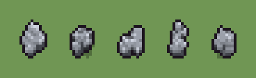

# Sasso (`sasso.xml`)

Classe `sasso`, scatola 10 × 10 × 8 voxel; riscrittura procedurale di `universe/models/sasso.xml`.


## Esito

- validatore (`modelErrors`, `checkProgram`, `analyse` a ogni seme): nessun errore, nessun frammento staccato
- varianza su 5 semi (voxel pieni in un seme e vuoti nell'altro, sui pieni in almeno uno; il colore non conta): **media 0.634**, minima 0.384, massima 0.768 (soglia 0.15) → passa
- voxel per seme: 131, 131, 94, 105, 113; tempo per seme: 2, 2, 4, 2, 1 ms
- avvisi: tocca i bordi laterali della griglia: forse è tagliato; colori mai usati: S

| coppia | 1-2 | 1-3 | 1-4 | 1-5 | 2-3 | 2-4 | 2-5 | 3-4 | 3-5 | 4-5 |
|---|---|---|---|---|---|---|---|---|---|---|
| distanza | 0.722 | 0.611 | 0.534 | 0.768 | 0.736 | 0.612 | 0.384 | 0.579 | 0.722 | 0.671 |



## Traccia di tre semi a confronto

La traccia di `src/mj/trace.ts` (forma `nodi`): per ogni nodo quante volte gira, quante celle scrive e la scatola di ciò che scrive. Le
righe che cambiano fra i semi sono le scelte del programma.

### Seme 1

```text
Traccia, seme 1: griglia 10×10×8, 16 nodi, 88 passi, finito in 2 ms.
x sinistra→destra, y fondo→davanti, z basso→alto; «.» è la cella vuota; #n è il nodo nell'ordine dell'XML; ×n quante volte ha agito.
Lettere: H=pietra lucida, L=pietra chiara, G=pietra grigia, D=pietra d'ombra, S=ombra profonda, V=dove può nascere un lobo (marcatore), c=il centro (marcatore).
Alla fine: G 59, L 35, H 15, D 15, S 7.
#2-3 ellipsoid×1, box×1: 38 celle x2-8 y2-8 z0, passi 1-2
#4-5 one×1, prl×1: 4 celle x2-4 y2-6 z0, passi 3-5
 #6 all V → .: ×1, 32 celle x2-8 y2-8 z0, passi 6, V→. 32
#7-8 one×1, all×1: 3 celle x2-3 y5-7 z0, passi 7-8
 #9 one G. → GG passi=70: ×70, 70 celle x1-6 y0-9 z0-4, passi 9-78, .→G 70
 #10 prl G. → GG passi=2: ×2, 63 celle x0-8 y0-9 z0-4, passi 79-80, .→G 63
 #11 convolution .→G se G in [14,15,16,17,18,19,20,21,22,23,24,25,26]; G→. se G in [1,2,3,4,5,6,7]: ×1, 16 celle x0-8 y1-9 z0-4, passi 81, G→. 11, .→G 5
   r1 .→G ×5; r2 G→. ×11
 #12 all . G → . L: ×1, 50 celle x0-7 y0-9 z0-4, passi 82, G→L 50
 #13 all G G → G D: ×2, 32 celle x1-7 y1-7 z0-2, passi 83-84, G→D 32
 #14 all D. → G.: ×2, 10 celle x1-7 y2-7 z0, passi 85-86, D→G 10
#15-16 prl×2: 22 celle x1-7 y0-8 z0-4, passi 87-88
```

### Seme 2

```text
Traccia, seme 2: griglia 10×10×8, 16 nodi, 87 passi, finito in 1 ms.
x sinistra→destra, y fondo→davanti, z basso→alto; «.» è la cella vuota; #n è il nodo nell'ordine dell'XML; ×n quante volte ha agito.
Lettere: H=pietra lucida, L=pietra chiara, G=pietra grigia, D=pietra d'ombra, S=ombra profonda, V=dove può nascere un lobo (marcatore), c=il centro (marcatore).
Alla fine: G 61, L 30, D 20, H 11, S 9.
#2-3 ellipsoid×1, box×1: 38 celle x2-8 y2-8 z0, passi 1-2
#4-5 one×1, prl×1: 7 celle x4-8 y4-8 z0, passi 3-5
 #6 all V → .: ×1, 29 celle x2-8 y2-8 z0, passi 6, V→. 29
#7-8 one×1, all×1: 6 celle x4-8 y5-8 z0, passi 7-8
 #9 one G. → GG passi=70: ×70, 70 celle x2-9 y3-9 z0-4, passi 9-78, .→G 70
 #10 prl G. → GG passi=2: ×2, 57 celle x3-9 y2-9 z0-4, passi 79-80, .→G 57
 #11 convolution .→G se G in [14,15,16,17,18,19,20,21,22,23,24,25,26]; G→. se G in [1,2,3,4,5,6,7]: ×1, 16 celle x2-9 y2-9 z0-4, passi 81, G→. 8, .→G 8
   r1 .→G ×8; r2 G→. ×8
 #12 all . G → . L: ×1, 41 celle x3-9 y3-9 z1-4, passi 82, G→L 41
 #13 all G G → G D: ×2, 42 celle x3-9 y3-9 z0-2, passi 83-84, G→D 42
 #14 all D. → G.: ×1, 13 celle x3-8 y3-9 z0-2, passi 85, D→G 13
#15-16 prl×2: 20 celle x3-8 y3-8 z0-4, passi 86-87
```

### Seme 3

```text
Traccia, seme 3: griglia 10×10×8, 16 nodi, 86 passi, finito in 1 ms.
x sinistra→destra, y fondo→davanti, z basso→alto; «.» è la cella vuota; #n è il nodo nell'ordine dell'XML; ×n quante volte ha agito.
Lettere: H=pietra lucida, L=pietra chiara, G=pietra grigia, D=pietra d'ombra, V=dove può nascere un lobo (marcatore), c=il centro (marcatore).
Alla fine: G 42, L 35, H 13, D 4.
#2-3 ellipsoid×1, box×1: 38 celle x2-8 y2-8 z0, passi 1-2
#4-5 one×1, prl×1: 6 celle x3-6 y2-8 z0, passi 3-5
 #6 all V → .: ×1, 30 celle x2-8 y2-8 z0, passi 6, V→. 30
#7-8 one×1, all×1: 5 celle x3-6 y2-8 z0, passi 7-8
 #9 one G. → GG passi=70: ×70, 70 celle x0-7 y1-9 z0-2, passi 9-78, .→G 70
 #10 prl G. → GG passi=2: ×2, 40 celle x0-9 y0-9 z0-2, passi 79-80, .→G 40
 #11 convolution .→G se G in [14,15,16,17,18,19,20,21,22,23,24,25,26]; G→. se G in [1,2,3,4,5,6,7]: ×1, 26 celle x0-9 y0-9 z0-2, passi 81, G→. 23, .→G 3
   r1 .→G ×3; r2 G→. ×23
 #12 all . G → . L: ×1, 48 celle x0-7 y2-9 z0-2, passi 82, G→L 48
#13-14 all×2: 12 celle x1-4 y6-9 z0, passi 83-85
 #15 prl . L → . H passi=1: ×1, 13 celle x0-7 y4-9 z0-2, passi 86, L→H 13
Senza effetto (non hanno mai cambiato una cella):
#16 prl D → S passi=1
```
