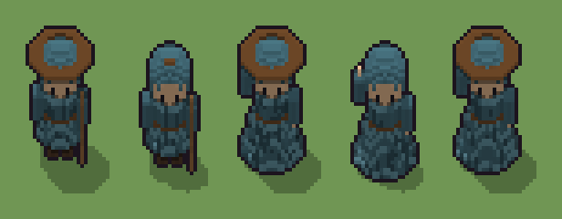

# Viandante (`viandante.xml`)

Classe `persona`, scatola 20 × 15 × 30 voxel; riscrittura procedurale di `universe/models/viandante.xml`.


## Esito

- validatore (`modelErrors`, `checkProgram`, `analyse` a ogni seme): nessun errore, nessun frammento staccato
- varianza su 5 semi (voxel pieni in un seme e vuoti nell'altro, sui pieni in almeno uno; il colore non conta): **media 0.195**, minima 0.000, massima 0.321 (soglia 0.15) → passa
- voxel per seme: 2074, 1957, 2683, 2564, 2684; tempo per seme: 15, 15, 16, 18, 16 ms
- avvisi: tocca i bordi laterali della griglia: forse è tagliato; colori mai usati: K

| coppia | 1-2 | 1-3 | 1-4 | 1-5 | 2-3 | 2-4 | 2-5 | 3-4 | 3-5 | 4-5 |
|---|---|---|---|---|---|---|---|---|---|---|
| distanza | 0.060 | 0.276 | 0.319 | 0.275 | 0.321 | 0.289 | 0.320 | 0.045 | 0.000 | 0.045 |



## Traccia di tre semi a confronto

La traccia di `src/mj/trace.ts` (forma `nodi`): per ogni nodo quante volte gira, quante celle scrive e la scatola di ciò che scrive. Le
righe che cambiano fra i semi sono le scelte del programma.

### Seme 1

```text
Traccia, seme 1: griglia 20×15×30, 59 nodi, 175 passi, finito in 16 ms.
x sinistra→destra, y fondo→davanti, z basso→alto; «.» è la cella vuota; #n è il nodo nell'ordine dell'XML; ×n quante volte ha agito.
Lettere: 0=mescola (marcatore), G=stivali, M=mantello, N=mantello al sole, O=piega del mantello, C=cappuccio, S=viso, E=occhi, A=braccio libero, Q=mano libera, H=braccio col bastone, P=mano, W=bastone, L=cintura, p=il mantello a ruota (marcatore), q=il mantello normale (marcatore), m=dado (marcatore), b=scelta: normale (marcatore), c=la punta del cappuccio, forse (marcatore), d=la bisaccia, forse (marcatore), g=altezze possibili del bastone (marcatore), z=il bastone che sale (marcatore).
Alla fine: M 616, L 375, S 362, C 328, G 162, H 61, A 60, N 42, O 39, W 19, E 8, Q 1, P 1.
#2-59 box×14, prl×3, all×12, cone×4, cylinder×5, one×7, ellipsoid×3: 7230 celle x0-19 y0-14 z0-29, passi 1-175
Senza effetto (non hanno mai cambiato una cella):
#22 all a[AQ] → aa (+4): in quel momento nella griglia non c'erano celle "a", "r", "s"
#24 all r → A: in quel momento nella griglia non c'erano celle "r"
#25 all s → Q: in quel momento nella griglia non c'erano celle "s"
#30 box at 10 12 17 size 8 3 5 . su C
#34 box at 10 11 11 size 2 2 1 K su L
#36 prl c → . passi=1
#37 all c . C → C C * passi=1: le celle cercate c'erano, ma mai disposte come nel pattern
#38 all c . → * C: le celle cercate c'erano, ma mai disposte come nel pattern
#48 all d → .: in quel momento nella griglia non c'erano celle "d"
#54 prl W → . passi=1
```

### Seme 2

```text
Traccia, seme 2: griglia 20×15×30, 59 nodi, 150 passi, finito in 15 ms.
x sinistra→destra, y fondo→davanti, z basso→alto; «.» è la cella vuota; #n è il nodo nell'ordine dell'XML; ×n quante volte ha agito.
Lettere: 0=mescola (marcatore), G=stivali, M=mantello, N=mantello al sole, O=piega del mantello, C=cappuccio, S=viso, E=occhi, A=braccio libero, Q=mano libera, H=braccio col bastone, P=mano, W=bastone, L=cintura, p=il mantello a ruota (marcatore), q=il mantello normale (marcatore), m=dado (marcatore), b=scelta: normale (marcatore), c=la punta del cappuccio, forse (marcatore), d=la bisaccia, forse (marcatore), g=altezze possibili del bastone (marcatore), z=il bastone che sale (marcatore).
Alla fine: M 627, S 362, C 328, L 257, G 162, H 61, A 60, N 41, O 29, W 20, E 8, Q 1, P 1.
#2-59 box×14, prl×3, all×12, cone×4, cylinder×5, one×7, ellipsoid×3: 7204 celle x0-19 y0-14 z0-29, passi 1-150
Senza effetto (non hanno mai cambiato una cella):
#22 all a[AQ] → aa (+4): in quel momento nella griglia non c'erano celle "a", "r", "s"
#24 all r → A: in quel momento nella griglia non c'erano celle "r"
#25 all s → Q: in quel momento nella griglia non c'erano celle "s"
#30 box at 10 12 17 size 8 3 5 . su C
#34 box at 10 11 11 size 2 2 1 K su L
#36 prl c → . passi=1
#37 all c . C → C C * passi=1: le celle cercate c'erano, ma mai disposte come nel pattern
#38 all c . → * C: le celle cercate c'erano, ma mai disposte come nel pattern
#48 all d → .: in quel momento nella griglia non c'erano celle "d"
#54 prl W → . passi=1
```

### Seme 3

```text
Traccia, seme 3: griglia 20×15×30, 59 nodi, 192 passi, finito in 19 ms.
x sinistra→destra, y fondo→davanti, z basso→alto; «.» è la cella vuota; #n è il nodo nell'ordine dell'XML; ×n quante volte ha agito.
Lettere: 0=mescola (marcatore), G=stivali, M=mantello, N=mantello al sole, O=piega del mantello, C=cappuccio, S=viso, E=occhi, A=braccio libero, Q=mano libera, H=braccio col bastone, P=mano, W=bastone, L=cintura, p=il mantello a ruota (marcatore), q=il mantello normale (marcatore), m=dado (marcatore), a=scelta: a ruota (marcatore), c=la punta del cappuccio, forse (marcatore), d=la bisaccia, forse (marcatore), g=altezze possibili del bastone (marcatore), z=il bastone che sale (marcatore), r=il braccio alzato scelto (marcatore), s=la mano alzata scelta (marcatore).
Alla fine: M 1173, L 374, S 362, C 328, G 162, N 91, O 66, H 61, A 54, E 8, Q 2, W 1, P 1.
#2-59 box×14, prl×3, all×14, cone×4, cylinder×5, one×6, ellipsoid×3: 8096 celle x0-19 y0-14 z0-29, passi 1-192
Senza effetto (non hanno mai cambiato una cella):
#15 all [pq] → .: in quel momento nella griglia non c'erano celle "pq"
#30 box at 10 12 17 size 8 3 5 . su C
#34 box at 10 11 11 size 2 2 1 K su L
#36 prl c → . passi=1
#37 all c . C → C C * passi=1: le celle cercate c'erano, ma mai disposte come nel pattern
#38 all c . → * C: le celle cercate c'erano, ma mai disposte come nel pattern
#48 all d → .: in quel momento nella griglia non c'erano celle "d"
#54 prl W → . passi=1
#55 one . W → W W passi=30: le celle cercate c'erano, ma mai disposte come nel pattern
```
