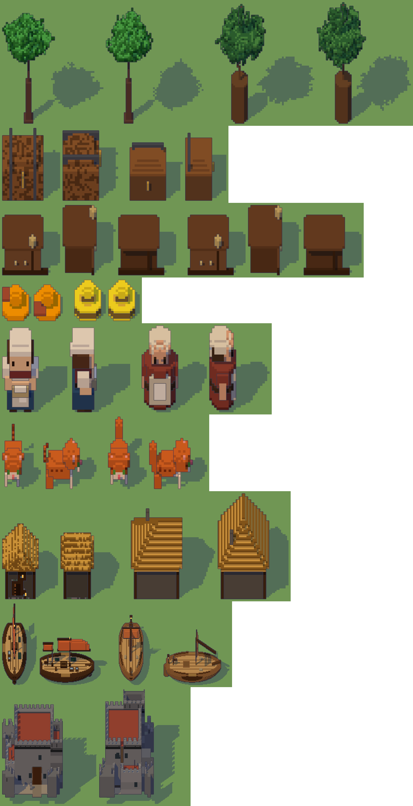

# La prova pagata delle specialità dello Scultore (T473, S7 dello studio T458)

Data: 2026-11-22 · Step 44 · Studio: [`docs/design/scultori-specializzati.md`](../../../docs/design/scultori-specializzati.md) § 6, riga S7 ·
Spesa approvata dall'autore il 21/11: la prova dello studio (3-5 $) con **tetto 6 $ sul registro** di questa cartella.

Le specialità dello Scultore (T468, ADR-0239), i cicli e i nodi dell'Architetto (T469, ADR-0240) e le istruzioni dei mestieri (T470) erano
misurati solo in token (`prompt-tokens.ts -- --scultore --conta`, gratis): **nessun modello li aveva letti**. Questa prova li fa leggere ai
modelli del gioco, sugli stessi concetti, accanto al prompt di prima, e conta ciò che conta per il gioco: i programmi che passano i controlli
del kernel al primo colpo, i voti dell'Artista, i token, il costo; poi guarda i programmi per vedere se le istruzioni nuove sono state seguite.

**Spesa: 4,21 $** sul registro di questa cartella (tetto 6 $): tre giri di 18 richieste (9 concetti × 2 bracci) su Gemini, 4,04 $, e due
prove dei segni della cache su OpenRouter, 0,17 $ (la prima, 0,14 $, contata al massimo: vedi «La cache»).

## In breve

1. **Le specialità non rompono niente e non migliorano in modo misurabile ciò che si conta**: in tre giri «prima» ha fatto 25 modelli su 27 e
   «dopo» 23; al primo colpo 31 programmi su 47 contro 28 (66 % e 60 %: l'errore standard della differenza è di 10 punti); voto finale medio
   6,0 contro 6,3.
   Le differenze stanno nel rumore di tre richieste per concetto. La rocca (Architetto, Grande con la cantina, Argon) cade nei due bracci
   (1 su 3 e 0 su 3) per le stesse ragioni: i piani raggiunti, la porta, le stanze, la cantina.
2. **L'ingresso scende come T468-T470 avevano misurato**: la prima chiamata di un modello porta 6 164 token invece di 7 519 (−18 %); fuori
   dall'Architetto ogni chiamata dello Scultore ne porta 6 778 invece di 8 106 (−16 %), l'Architetto 18 201 invece di 17 064 (+7 %, le guide
   di T469).
3. **Ma sulla via di Google i dollari non scendono.** La cache implicita di Gemini serviva il prompt di prima, uguale per ogni mestiere:
   Flash-Lite ha letto dalla cache il 51 % dell'ingresso «prima» e il 32 % «dopo», e la prima chiamata di un concetto nuovo era servita
   9 volte su 12 «prima» e **0 su 12** «dopo» (un mestiere nuovo non ritrova il nucleo in cache: solo le chiamate seguenti dello stesso
   mestiere leggono 2 000-4 000 token). Il costo d'ingresso di una chiamata (fuori dall'Architetto) è quindi 0,0057 $ contro 0,0054 $; con più
   uscita (+21 % del suo costo fuori dall'Architetto) e più chiamate dove un programma cade, un modello fatto costa 0,050 $ invece di 0,042 $ (tutto: 0,091 contro 0,078). Su Argon
   la cache implicita non ha servito quasi niente in nessuno dei due bracci (5 % e 1 %), su 3.8 Flash il 16-18 %.
4. **Sulla via di OpenRouter i segni della cache di T468 funzionano** (Opus 5.5, `cache_control` alla fine del comune, della sezione e
   degli esempi): lo stesso mestiere legge dalla cache 9 163 token su 9 197 e paga 0,002 $ invece di 0,046 $; un mestiere nuovo legge il
   comune, 5 384 token, e scrive solo la sua sezione con gli esempi (2 087-2 434).
5. **Le istruzioni nuove si vedono dove nominano un meccanismo che il programma scrive**: la casetta con la porta che si apre e si chiude e
   le finestre di vetro (3 su 3 contro 0 su 3), il cortile lastricato con `<convchain>` nelle risposte dell'Architetto (12 su 12 contro 0 su 12),
   la mugnaia con le due braccia staccate che il rig del kernel trova (2 su 3 contro 0 su 3), il baule col coperchio che si alza (1 su 3 contro
   0), i castagni che cambiano col seme (0,60 contro 0,20). **Non si vedono** il ciclo `<markov><sequence>` di T469 (0 risposte su 12 nei due
   bracci: Argon non lo scrive mai) né `close` accanto a `open` (0 su 6).
6. **Un effetto da correggere**: con «Growing like nature» (T470) il Paesaggista stacca la chioma dal tronco. Gli scarti per la chioma che
   galleggia sono 6 su 11 «dopo» contro 2 su 10 «prima», e un castagno «dopo» non è passato.
7. **Il registro delle specialità** (T468) conta ogni chiamata dello Scultore sotto il suo mestiere, con le chiamate vere (`registro` in ogni
   `esito.json`).

```bash
# il giro (i due bracci in parallelo, i concetti uno dopo l'altro nell'ordine dei mestieri) → <giro>/<braccio>/<concetto>/
npx vite-node lab/scripts/scultore-gemini.ts -- --specialita --giro giro1 --tetto 6
# solo alcuni concetti, in un altro giro
npx vite-node lab/scripts/scultore-gemini.ts -- --specialita --giro giro2 --solo castagno,baule,cappello --tetto 6
# senza chiamate: le foto e le misure di nuovo, le tabelle di tutti i giri (tabella.md)
npx vite-node lab/scripts/scultore-gemini.ts -- --specialita --misura --giro giro1
npx vite-node lab/scripts/scultore-gemini.ts -- --specialita --tabella
# i segni della cache su OpenRouter (T468): quattro chiamate di Opus 5.5 che chiedono una parola
npx vite-node lab/scripts/scultore-gemini.ts -- --specialita --cache-opus --tetto 6
# a costo zero, coi modelli locali (lo stesso percorso, nessuna chiamata pagata)
npx vite-node lab/scripts/scultore-gemini.ts -- --specialita --offline --giro offline --out lab/out/specialita
```

Il codice è `lab/scripts/scultore-specialita.ts`; ogni chiamata è in `<giro>/<braccio>/<concetto>/chiamate/` (richiesta, risposta, token,
costo, il sistema una volta per agente), l'esito in `esito.json`, il programma tenuto in `programma.xml`, le foto in `foto.png` (i quattro
lati ai semi 1 e 2; il cappello anche sui due corpi del kernel; la credenza prima e dopo l'azione), i due bracci affiancati in
`<giro>/confronto.png` (a sinistra «prima», a destra «dopo»).

## Il metodo

**Due bracci, una sola differenza: il prompt dello Scultore.**

- **prima**: `prompts/agents/sculptor.md` com'era prima di T468 (`git show 4116e7df^:universe/prompts/agents/sculptor.md`, copiato in
  [`prima/sculptor.md`](prima/sculptor.md)). Senza il segno del nucleo il kernel di oggi lo dà intero, come prima (`hasCore`, il ripiego
  degli universi di prima di T468): a ogni mestiere il prompt generale (16 876 caratteri), all'Architetto la parte dopo `<!-- strutture -->`
  (16 015), a un'azione il prompt generale.
- **dopo**: il seme di oggi (kernel 0.10.17): il nucleo (9 839 caratteri; 5 737 per le azioni) e la sezione del mestiere (1 977-2 960:
  le righe delle sue classi di T468, le istruzioni nuove di T470, `path longest`, `(xyz+)` e le lettere traslucide di T469), all'Architetto
  `architect.md` (20 060: il prompt delle strutture di prima con i cicli, le trame, la cantina e i pezzi di T469).

Tutto il resto è lo stesso: il kernel di oggi (i controlli, l'ordine del sistema, gli esempi scelti da S1 (T467), la richiesta di `describe`,
che T468-T470 non hanno toccato), il mondo e la guida di stile del seme, i modelli del gioco (`DEFAULT_SCULPTORS`: lo Scultore su 3.1
Flash-Lite per le cose semplici, 3.8 Flash per le figure, Argon per ciò che è costruito; l'Artista su 3.5 Flash) col ragionamento del gioco
(`low`), il piano del gioco (due programmi per una cosa semplice e l'Artista sceglie; uno e la revisione sotto 7 per una figura o una cosa
costruita; i due blocchi, le correzioni e la revisione per una struttura che cresce a regole), le temperature. Le chiamate vanno a Google con
la chiave del `.env` della cartella principale (la prova della cache a OpenRouter con la sua), mai stampata né scritta.

**I concetti**, uno per mestiere più l'azione e una seconda figura, con le parole del banco dei token di T458 dove c'erano, chiesti come li chiede il
`ModelDirector`, nell'ordine in cui il direttore li metterebbe in fila (T468, `bySpecialty`):

| concetto | classe | mestiere | modello | che cosa mette alla prova |
|---|---|---|---|---|
| Castagno | `tree` | Paesaggista | Flash-Lite | «Growing like nature» (T470): il seme che sceglie, tronco e chioma, il vento senza `<animation>`, il piede |
| Baule da viaggio | `furniture` | Mobiliere | Flash-Lite | «What the world does with them»: aprire e chiudere col segno nascosto, le facce dove si posa, portare |
| Credenza: «Apri le ante» | azione | le azioni | Flash-Lite | il nucleo delle azioni e la sezione del Mobiliere invece del prompt intero |
| Cappello di paglia (in testa) | `object`, `worn` | Sarto | Flash-Lite | «Every body»: l'aria della zona, i corpi diversi, i due colori |
| Mugnaia | `person` | Figurinista | 3.8 Flash | «How the kernel moves a figure»: gli arti come pezzi, la testa, le mani |
| Gatto rosso | `animal` | Figurinista | 3.8 Flash | le quattro zampe staccate, il muso verso y grande, la coda |
| Casetta del pastore | `building` | Capomastro | Argon | «Building in one box»: la porta che si apre, il basamento, le finestre, il tetto |
| Barca da pesca (Grande) | `vessel` | Carrozziere | Argon | «Building a hull»: lo scafo, la linea di galleggiamento, il ponte, le aree |
| Rocca di confine (Grande, con la cantina) | `structure` | Architetto | Argon | i cicli (`<markov>`), le trame (`<convchain>`), la cantina con `part-cellar` |

**Che cosa si misura.** Ogni chiamata col suo tipo (il primo programma, il piano del primo blocco, il programma intero, una correzione, la
revisione, il giudizio), i token che Gemini dice (d'ingresso, in cache, d'uscita, di ragionamento) e il costo a listino; il verdetto del kernel
su ogni programma (lo `scarta` del registro del Concilio, col motivo); i voti dell'Artista. **Al primo colpo** è un programma che passa i
controlli senza correzioni: per ogni scrittura (`write`) il suo primo programma. Poi ogni programma tenuto gira ai semi 1 e 2 e il banco ne
legge ciò che le istruzioni del suo mestiere chiedono (`measure`): i nodi (cicli `<markov><sequence>`, `convchain`, `map` e la scala
frazionaria, `pieces`, `path`, `convolution`, le simmetrie `(xyz+)`, le animazioni), le azioni, le parti, le aree, le lettere nascoste e
traslucide, gli import; la varietà fra i semi (voxel per voxel per una cosa in una scatola; la pianta, come il kernel la dice allo Scultore,
per una struttura); gli arti che il rig del kernel trova in una figura; la sezione `<worn>` sui due corpi del kernel (B, le sue regole, o C, i
due colori dove non va); la credenza prima e dopo l'azione; la rocca contro il forte dell'autore (la scala di
[`../riferimento/ottima/`](../riferimento/ottima/README.md), v1, un voto su 10 e ogni voce). E il registro dei consumi del kernel: la
specialità di ogni chiamata (T468, `world/usage.json → specialties`).

**Quanto dice.** Una richiesta per concetto e braccio a giro: le differenze di un giro sono aneddoti (Flash-Lite e Argon scrivono a
temperatura 0,7, e lo stesso prompt dà programmi diversi a ogni chiamata). I numeri che reggono sono quelli che non dipendono dal caso
(i token d'ingresso, la cache, il costo dell'ingresso, il registro delle specialità) e quelli che si ripetono nei giri.

## Il risultato

Tre giri (giro1, giro2, giro3), ognuno coi due bracci in parallelo, il 22/11. Le tabelle intere, concetto per concetto e giro per giro, sono
in [`tabella.md`](tabella.md) (`--tabella` le rifà senza chiamate); qui i totali.

| | prima | dopo |
|---|---|---|
| modelli fatti | 25 su 27 | 23 su 27 |
| programmi al primo colpo | 31 su 47 (66 %) | 28 su 47 (60 %) |
| … fuori dall'Architetto | 31 su 44 (70 %) | 28 su 44 (64 %) |
| voto finale medio (i modelli fatti) | 6,0 (22 voti) | 6,3 (20 voti) |
| … fuori dall'Architetto | 5,95 | 6,25 |
| chiamate dello Scultore | 75 | 75 |
| ingresso della prima chiamata di un modello, media | 7 519 token | 6 164 token |
| ingresso a chiamata, fuori dall'Architetto / dell'Architetto | 8 106 / 17 064 token | 6 778 / 18 201 token |
| ingresso servito dalla cache implicita | 24 % | 13 % |
| uscita e ragionamento dello Scultore | 165 620 token | 179 314 token |
| costo (Scultore e Artista, a listino) | 1,947 $ | 2,096 $ |
| a modello fatto / fuori dall'Architetto | 0,078 $ / 0,042 $ | 0,091 $ / 0,050 $ |
| chiamate oltre i 120 s del gioco | 0 su 75 | 0 su 75 |

Mestiere per mestiere (tre giri):

| mestiere | modello | fatti, prima / dopo | al primo colpo | voti finali | ingresso della prima chiamata | costo |
|---|---|---|---|---|---|---|
| Paesaggista (castagno) | Flash-Lite | 3 / 2 | 2 su 6 / 1 su 6 | 6, 6, 3 / 6, 6 | 7 263 / 5 678 | 0,074 / 0,081 $ |
| Mobiliere (baule) | Flash-Lite | 3 / 3 | 5 su 6 / 4 su 6 | 6, 6, 6 / 6, 6, 6 | 7 505 / 5 972 | 0,076 / 0,072 $ |
| le azioni («Apri le ante») | Flash-Lite | 3 / 3 | 3 su 3 / 3 su 3 | — | 7 679 / 4 762 | 0,010 / 0,007 $ |
| Sarto (cappello) | Flash-Lite | 3 / 3 | 2 su 6 / 2 su 6 | 5, 5, 6 / 6, 6, 6 | 6 575 / 5 258 | 0,065 / 0,082 $ |
| Figurinista (mugnaia, gatto) | 3.8 Flash | 6 / 6 | 9 su 12 / 10 su 11 | media 6,3 / 6,5 | 7 552 / 5 941 | 0,231 / 0,187 $ |
| Capomastro (casetta) | Argon | 3 / 3 | 5 su 5 / 4 su 6 | 6, 6, 7 / 6, 7, 7 | 8 351 / 6 920 | 0,236 / 0,340 $ |
| Carrozziere (barca) | Argon | 3 / 3 | 5 su 6 / 4 su 6 | 7, 6, 6 / 6, 6, 6 | 7 597 / 6 228 | 0,326 / 0,377 $ |
| Architetto (rocca) | Argon | 1 / 0 | 0 su 3 / 0 su 3 | 8 / — | 7 598 / 8 775 | 0,929 / 0,950 $ |

**Le istruzioni dei mestieri**, braccio per braccio, contate sui programmi tenuti (per l'Architetto su ogni risposta, anche scartata):

| mestiere | che cosa si conta | prima | dopo |
|---|---|---|---|
| Paesaggista | scarti perché la chioma galleggia o si stacca, su tutti gli scarti | 2 su 10 | 6 su 11 |
| Paesaggista | castagni senza `<animation>` (il vento lo fa il kernel) | 3 su 3 | 2 su 2 |
| Paesaggista | varietà fra i semi 1 e 2 (voxel per voxel: 0 uguali, 1 niente in comune) | 0,20 | 0,60 |
| Mobiliere | bauli con `open` e il coperchio aperto in una lettera nascosta | 0 su 3 | 1 su 3 |
| Mobiliere | … e anche `close` | 0 su 3 | 0 su 3 |
| le azioni | «Apri le ante» al primo colpo | 3 su 3 | 3 su 3 |
| Sarto | cappelli la cui sezione `<worn>` va (via B) sui due corpi del kernel | 3 su 3 | 3 su 3 |
| Figurinista | mugnaie in cui il rig trova 2 gambe, 2 braccia e la testa | 0 su 3 | 2 su 3 |
| Figurinista | gatti in cui il rig trova 4 zampe, la coda e la testa | 3 su 3 | 2 su 3 |
| Capomastro | casette con la porta che si apre e si chiude | 0 su 3 | 3 su 3 |
| Capomastro | casette con le finestre di vetro (una lettera traslucida) | 0 su 3 | 3 su 3 |
| Carrozziere | barche con `furl`, `hoist` e le aree `boarding`, `helm`, `hold` | 3 su 3 | 3 su 3 |
| Architetto | risposte con una trama `<convchain>` | 0 su 12 | 12 su 12 |
| Architetto | risposte con un ciclo `<markov><sequence>` | 0 su 12 | 0 su 12 |
| Architetto | risposte che scavano la cantina con `part-cellar` | 9 su 12 | 9 su 12 |
| Architetto | rocche passate | 1 su 3 (con la cantina) | 0 su 3 |

**Perché il kernel ha scartato i programmi** (un programma può cadere per più motivi): «prima» 5 per la sintassi o un nodo, 12 per pezzi
staccati o sospesi, 5 per i piani, 4 troppo bassi, 2 per le stanze, 1 per la cantina, 1 per la sezione indossata; «dopo» 7, 12, 9, 2, 0, 0, 1.
I piani sono tutti della rocca; gli staccati sono soprattutto del Paesaggista e del Sarto (il cappello che non tocca terra).

Le foto: `<giro>/confronto.png` mette i due bracci affiancati, a sinistra «prima», a destra «dopo» (il fronte e il lato destro al seme 1; dove
un braccio non ha fatto il modello la riga ha solo l'altro); `foto.png` di ogni concetto ha i quattro lati ai semi 1 e 2.



### Che cosa dice, mestiere per mestiere

- **Paesaggista.** La varietà fra i semi c'è (0,60 contro 0,20: «let the seed choose» è seguito), ma la chioma «grown round the ends of the
  branches, then rounded and frayed by a convolution» si stacca dal tronco: il corpo più grande non tocca terra e il kernel lo scarta. «Prima»
  ha un castagno senza chioma (voto 3: «manca completamente la chioma»), «dopo» un castagno non fatto. L'Artista trova i tronchi troppo sottili
  in tutti e due i bracci.
- **Mobiliere.** Il baule «dopo» scrive una volta su tre il coperchio aperto in una lettera nascosta con `open` («Solleva il coperchio»,
  provato nel laboratorio 3D); `close` mai, in nessun braccio: l'esempio della sezione mostra solo `open`.
- **Le azioni.** Stesso risultato coi due prompt (le ante della credenza: 143 voxel cambiati), con il 38 % di ingresso in meno.
- **Sarto.** Nessuna differenza: le sezioni `<worn>` vanno sui due corpi in tutti e due i bracci (le regole di «Worn things» c'erano già); il
  voto è un po' più alto «dopo» (6, 6, 6 contro 5, 5, 6), i cappelli cadono per la stessa ragione (non toccano terra).
- **Figurinista.** La mugnaia «dopo» ha due braccia staccate dal corpo, che il rig trova (2 su 3; «prima» 0 su 3: le braccia toccano il
  busto e il rig ne vede una); al primo colpo 10 su 11 contro 9 su 12.
- **Capomastro.** Il cambiamento più netto: la casetta «dopo» ha sempre la porta con `open` e `close` e le finestre di vetro, «prima» mai. Costa
  di più (8 chiamate contro 5: una volta troppo bassa, una volta un nodo inventato, `<Mark>`) e l'Artista la vota un po' meglio (6, 7, 7 contro 6, 6, 7).
  La porta però è bassa (16 voxel nel giro 1, meno del corpo che deve passarla: la sezione dice 30) e una volta l'Artista non l'ha vista.
- **Carrozziere.** Nessuna differenza misurabile: vele, aree e linea di galleggiamento c'erano già in «Vessels». Una risposta «dopo» ha
  inventato un nodo (`<intersection>`) per «the sheer rises toward the bow and the stern».
- **Architetto.** Le trame entrano (il cortile lastricato con `<convchain>` e `<sample>` in tutte le risposte), il ciclo no; la rocca Grande con
  la cantina passa una volta su sei, e cade per ciò che i controlli del kernel misurano (un piano solo raggiunto, porte di 8 voxel, stanze
  sotto 28, la cantina che non si raggiunge), non per ciò che T469 ha aggiunto. L'unica passata («prima», giro 1) vale 4,7 su 10 contro il forte
  dell'autore (la scala di T371).

## La cache

**Gemini, la cache implicita** (`cachedContentTokenCount` di ogni chiamata dello Scultore):

| modello | braccio | chiamate | ingresso | in cache | prime chiamate di un concetto servite dalla cache |
|---|---|---:|---:|---:|---|
| 3.1 Flash-Lite | prima | 36 | 263 624 | 134 484 (51 %) | 9 su 12 |
| 3.1 Flash-Lite | dopo | 35 | 201 373 | 65 135 (32 %) | 0 su 12 |
| 3.8 Flash | prima | 15 | 133 513 | 22 024 (16 %) | 4 su 6 |
| 3.8 Flash | dopo | 12 | 87 526 | 15 590 (18 %) | 4 su 6 |
| Argon | prima | 24 | 318 299 | 16 641 (5 %) | 3 su 9 |
| Argon | dopo | 28 | 356 499 | 4 866 (1 %) | 1 su 9 |

Con il prompt di prima ogni mestiere cominciava con gli stessi 5-6 mila token, e Flash-Lite li ritrovava in cache (4 076 token a quasi ogni
chiamata, anche alla prima di un concetto nuovo). Con le specialità il comune è il nucleo coi principi, la «Lingua» e la guida di stile (3 733
token di Gemini, `misure-s4.md`) e la prima chiamata di un mestiere nuovo non ne ha mai letto niente; le chiamate seguenti dello stesso mestiere leggono 2 035,
poi 4 073 token. L'ordine del § 2.3 dello studio (il comune prima, la sezione dopo) non basta a Gemini: la sua cache implicita non ha servito il
comune da un mestiere all'altro. Il conto dell'ora della lobby (`hourlyEstimate`) dà ad Argon il 60 % del prefisso dalla cache
(`IMPLICIT_CACHE_SHARE`) e a 3.8 Flash niente (`NO_IMPLICIT_CACHE`): qui Argon ha avuto l'1-5 %, 3.8 Flash il 16-18 %.

**OpenRouter, i segni della cache di T468** (`--cache-opus`, `cache-opus/esito.json`): quattro sistemi dello Scultore come li compone `write`,
mandati a Opus 5.5 con l'adattatore del gioco (`systemParts`: un segno alla fine del comune, della sezione, degli esempi); ognuno chiede una
parola:

| passo | token d'ingresso | letti dalla cache | scritti in cache | costo |
|---|---:|---:|---:|---:|
| A, Capomastro (scritto dalla prova di prima, cinque minuti prima) | 9 197 | 9 163 | 0 | 0,0021 $ |
| B, Capomastro di nuovo | 9 197 | 9 163 | 0 | 0,0021 $ |
| C, Paesaggista (mai chiesto) | 7 501 | 5 384 | 2 087 | 0,0117 $ |
| D, Mobiliere (mai chiesto) | 7 852 | 5 384 | 2 434 | 0,0135 $ |

La prima prova (`cache-opus-prova1/`) ha scritto il sistema del Capomastro intero (9 163 token, 0,046 $): il comune, la sezione e gli esempi
sono tre segni che Anthropic tiene, e il comune (5 384 token di Opus, 3 733 di Gemini) lo legge ogni mestiere. Quella prova aveva due
errori del banco (il kernel sostituisce `onCall` dei modelli al suo avvio, e l'`usage` salvato era sempre quello della prima chiamata): le sue
tre chiamate sono nel registro a 0,138 $, il massimo possibile, perché di B e C non si sa quanto hanno letto.

## Nel browser

Il laboratorio 3D (`npm run dev`, `/lab/3d/`) ha il gruppo «Banco: le specialità dello Scultore, prima e dopo (T473)»: i 48 programmi tenuti
dei tre giri, ognuno alla densità della sua classe nel gioco (`lab/3d/catalog.ts`; `?modello=specialita:giro3/dopo/casetta` lo mette davanti
al viandante). Visti il 22/11 con Claude in Chrome sul server di sviluppo (porta 4734, nel turno `browser`): la casetta «dopo» del giro 3
(muri di pietra a corsi, il tetto di paglia con la gronda, il camino, la finestra col vetro; «Apri la porta» la cambia e il menu offre poi
«Chiudi la porta»), il baule «dopo» del giro 1 («Solleva il coperchio»: il coperchio si alza in piedi dietro, la lettera nascosta che appare), la
rocca «prima» del giro 1 (il mastio con la terrazza, i merli e le feritoie del seme, la scala, le torri), la mugnaia «dopo» del giro 3, la barca
«dopo» del giro 3 (vele a strisce, due alberi, il ponte di assi, il boccaporto, la rete, la lanterna accesa), il castagno «dopo» del giro 3 (la
chioma tonda sul tronco col piede). Nessun errore della pagina.

## Che cosa non è provato

- **Tre richieste per concetto e braccio**: le differenze di passaggio e di voto stanno nel rumore (l'errore standard della differenza al
  primo colpo è di 10 punti); reggono i token, la cache, il registro e ciò che le istruzioni fanno scrivere ogni volta (le porte e i vetri del
  Capomastro, le trame dell'Architetto).
- **Solo la via di Google per la qualità**: le strutture su Opus 5.5 (OpenRouter, dall'1/12) non sono state scolpite; su OpenRouter si è
  provata solo la cache.
- **Gli esempi sono quelli di S1 nei due bracci**, dal seme: il migliore dell'universo (voto ≥ 6) non c'è in un mondo nuovo e qui non è
  provato.
- **La rocca con la cantina** è una richiesta sola: un forte senza cantina, una fattoria o una Enorme direbbero altro (T391: Argon 6 su 8
  fra Grande ed Enorme, senza cantina).
- **Il voto dell'Artista** dà quasi sempre 6 (29 voti finali su 42): distingue poco.

## Proposte per l'autore

1. **Il Paesaggista**: una riga in «Growing like nature» che tenga la chioma attaccata (la chioma cresce dalle punte dei rami e i rami
   restano; ciò che la convoluzione toglie non la stacca dal tronco), e la stessa prova sul solo castagno (Flash-Lite, circa 0,10 $ per sei
   alberi a braccio).
2. **Il Mobiliere**: nell'esempio della sezione `close` accanto a `open` (il menu offre l'azione che cambia il modello ora: senza `close` il
   baule resta aperto).
3. **La cache di Gemini**: il conto dell'ora dà ad Argon il 60 % del prefisso dalla cache e a 3.8 Flash niente; qui Argon 1-5 %, 3.8 Flash
   16-18 %. Una misura su una sessione vera (il registro di un mondo acceso) e poi `IMPLICIT_CACHE_SHARE` e `NO_IMPLICIT_CACHE` corretti. Se il
   comune dei mestieri deve venire dalla cache anche su Google, serve la cache esplicita (ADR-0186) sul nucleo: l'ordine del sistema non basta.
4. **L'Architetto**: il ciclo di T469 non è mai scritto da Argon (0 su 12): o lo si prova su Opus o lo si toglie (circa 400 token a
   chiamata). La rocca Grande con la cantina passa 1 volta su 6: vale una prova a parte (con e senza cantina, Grande ed Enorme).
