# Strutture che si adattano alla taglia: ciò che entra, non l'edificio rimpicciolito (T338, T346)

L'autore (07/11): se l'area è piccola non si forza l'edificio completo del tipo; un forte piccolo è una torre a base larga, una fattoria
di 5 × 5 è una casa normale con una tettoia e la paglia dietro; a un'area più grande si aggiungono campi, staccionata, sentiero, il
fienile; alla più grande il pascolo. La decisione è [ADR-0179](../../../docs/adr/0179-cio-che-entra-nella-taglia.md). Poi (10/11, T346):
la forma che cambia con la taglia va bene, i difetti sono nei dettagli (le porte fra camminamento e torri, i merli irregolari, le
feritoie sparse, i blocchi chiari della staccionata, gli animali che non sono del programma), e la fattoria deve unire l'architettura
di T338 alla varianza dei campi di T339; le parti abitabili diventano sottoblocchi del seme (passo 1 di D48,
[ADR-0182](../../../docs/adr/0182-parti-abitabili-aree-mappe-che-tornano.md)). Si rifà tutto offline, senza modelli (costo in dollari: zero):

```bash
node lab/banco/taglie/parti.mjs                                                     # riscrive universe/models/part-*.xml
node lab/banco/taglie/genera.mjs                                                    # riscrive fattoria.xml e forte.xml
npx vite-node lab/scripts/banco-taglie.ts -- --parti --foto                         # le quattro parti da sole: validatore, misure, parti.png
npx vite-node lab/scripts/banco-taglie.ts -- --semi 2 --foto --json lab/banco/taglie/misure.json
npx vite-node lab/scripts/banco-taglie.ts -- --misura --semi 2                      # le strutture del seme e la risposta offline dello Scultore
npx vite-node lab/scripts/banco-taglie.ts -- --solo scultore-villetta,scultore-rocca --semi 2 --viste   # i programmi scritti come lo Scultore (T354) e il ritorno in testo
```

## In breve

- **Una scala sola**: le strutture che crescono a regole girano a 20 voxel per casella a ogni taglia: Grande 100 × 100 × 80, Enorme
  150 × 150 × 120, Gargantuesca 200 × 200 × 160 (`densityFor`). Le voci già scolpite tengono la loro scatola.
- **Le parti abitabili** hanno misure minime in caselle (`PARTS`): porta 0,55 × 1,5 (11 × 30), piano 1,5 di luce (30), stanza 1,4 di
  lato (28), tettoia 1,5 di luce e 1 di fondo. Dal T346 la scala, la porta, i merli e le feritoie sono **sottoblocchi del seme**
  (`universe/models/part-stair.xml`, `part-door.xml`, `part-battlements.xml`, `part-slits.xml`) che un programma include con
  `<import file="part-…"/>` invece di scriverli; ognuno da solo costruisce la sua scena dall'origine e passa il validatore della libreria.
- **Ciò che entra**: lo stesso programma, a un'area più grande, deve contenere di più (un tipo di parte in più, o un quarto di parti in
  più; `varietyError`).
- **Il piano e il dettaglio**: la fattoria decide il piano su una griglia a un decimo (`map scale="1/10 1/10 1"`, una cella mezza
  casella), due `map` la portano ai voxel e il dettaglio gira a scala piena: un programma le cui `map` tornano alla scatola
  (`mapsBackToBox`) prende la scatola di ogni taglia come uno senza `map`, e tiene `soil`.
- **Le aree**: una lettera della palette porta `area="pasture"` (anche nascosta) e `areasOf` dice l'area di ogni casella del suolo:
  nessun animale è disegnato, il programma marca dove stanno (per il Narratore e lo Scenografo).

## Le parti del seme (`--parti`)

| parte | contratto | da sola |
|---|---|---|
| `part-stair` | chi include marca la striscia `T` (almeno 16 × 10 nell'aria sopra un pavimento, con `symmetry="()"`, dieci voxel di pavimento libero prima: il corpo sale in linea); prende i primi 16 dal lato basso e rende il resto all'aria (T354), sale verso le x grandi 2 per 1, apre il solaio (unione `=`, i pavimenti, di qualunque spessore), riempie sotto, scrive `k` | una casa di 55 × 35 a due piani con la porta: piani raggiunti 1 e 33, porta 11 × 30, 0,19 s |
| `part-door` | chi include scrive il seme `O` di 11 attraverso il muro al piede; sale 30 attraverso l'unione `+` (i muri), architrave e stipiti `N`, assi `o`; le azioni `open`/`close` sono di chi include | un muro di 41 × 2 × 40 con la porta |
| `part-battlements` | sul bordo di ogni cima piatta delle lettere `+`: merli `M` di 5 e vuoti di 3, alti 6, regolari da ogni angolo | una torre di 29 × 29: 16 merli, tutti di 5 |
| `part-slits` | dopo i merli: sotto il centro di ogni merlo di 5 una feritoia `U` di 1 × 6 attraverso l'unione `%` | la stessa torre: 16 feritoie |

I marcatori delle parti sono `#90`-`#91`; la lettera `S` è la scena di prova, che un'inclusione non ha mai (quei nodi non fanno niente
inclusi).

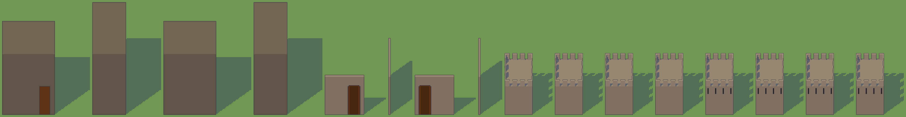

## La fattoria (`fattoria.xml`)

Il piano (A, una cella mezza casella): il seme arretra finché ha otto righe libere dietro e si sposta di lato se ne ha otto; la casa
di 6 × 4 celle con la tettoia di 2 dietro; il cortile (una cella ai lati e dietro, tre davanti) con la strada dalla porta al bordo; dove
restano sei celle di lato, quattro di cortile in più (il posto del fienile); il bordo del cortile ondeggia a caso; la staccionata dove
restano due celle libere (la strada conta), con gli angoli chiusi; il fienile di 3 × 4 dove entra una finestra di cortile di 5 × 6; i
tracciati dalla staccionata al bordo dove restano due celle di campo, almeno tre l'uno dall'altro; gli appezzamenti fra i tracciati,
ognuno del tipo di una cella estratta (grano più spesso, poi pascolo, orto, frutteto); i pascoli con il recinto sul bordo (unito a quello
del cortile) e i cancelli lungo i tracciati; gli alberi del frutteto. Poi (B) ogni cella dieci per dieci, le recinzioni da centro a
centro con un paletto ogni cinque, e (C) il dettaglio di T338: la casa sale a due piani con il solaio e il tetto, `part-stair` e
`part-door`, le finestre, la tettoia con i pali e il fieno, il fienile con l'apertura, paletti, traverse e sbarre dei cancelli, il grano
sulle file seminate, gli ortaggi, gli alberi, il comignolo. Le aree: `house`, `shelter`, `yard`, `barn`, `field`, `orchard`, `pasture`.

| taglia | cosa contiene (seme 1) | parti (tipi) | tempo a seme | aree (caselle) |
|---|---|---|---|---|
| Grande, 5 × 5 caselle | la casa di due piani (60 × 40, stanza 31, porta 11 × 30, scala), il tetto col comignolo, la tettoia dietro con tre balle di paglia, il cortile e la strada | 32-176 (16-22) | 0,27-0,37 s | house 4, shelter 3, yard 18 |
| Enorme, 7,5 × 7,5 | + la staccionata irregolare con la strada come varco, i **campi** tutt'attorno (grano a file, o pascoli e orti secondo il seme), i tracciati davanti | 580-610 (22-23) | 0,33-0,40 s | field 33, yard 23 |
| Gargantuesca, 10 × 10 | + il **fienile** a lato della casa (30 × 40, apertura di 15 × 28), più appezzamenti a incastro con i recinti dei pascoli e i cancelli, gli alberi del frutteto | 420-830 (22-26) | 0,69-0,72 s | barn 1, field 59 o pasture 52 + orchard 6, yard 32-34 |

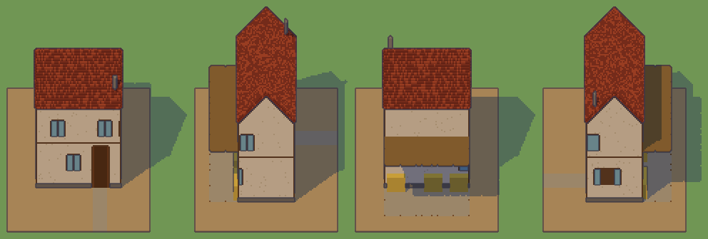
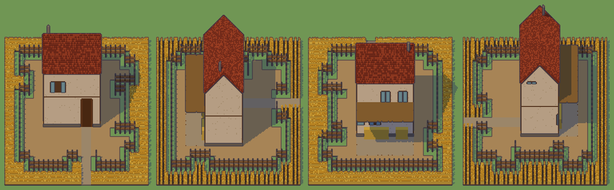
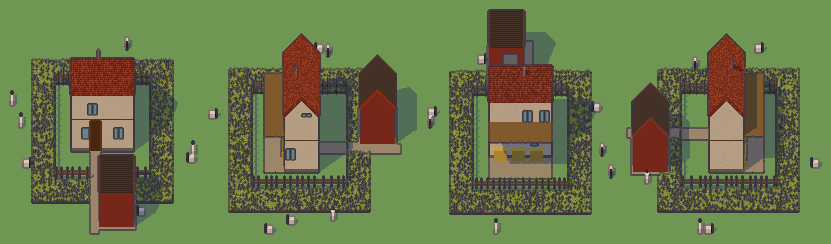

## Il forte (`forte.xml`)

| taglia | cosa contiene (seme 1) | parti (tipi) | tempo a seme | aree (caselle) |
|---|---|---|---|---|
| Grande, 5 × 5 | **una torre a base larga**: il mastio di 51 × 47 con la scarpa, due piani (stanza 33, porta 11 × 30 da `part-door`, scala da `part-stair`), la terrazza con i **merli regolari** (`part-battlements`: 22 di 5, 6 di 3 agli angoli) e **una feritoia sotto ogni merlo** (`part-slits`), l'asta | 58 (13) | 0,15 s | courtyard 16, keep 9 |
| Enorme, 7,5 × 7,5 | + il cortile e la **cinta** di 12 (24 di altezza) con il camminamento fra due merlature e la strada come porta | 122 (14) | 0,27 s | courtyard 22, keep 8 |
| Gargantuesca, 10 × 10 | + le **torri cave** di 21 sugli angoli (60 di altezza, il pavimento al camminamento, il tetto di ardesia) con **una porta dal camminamento in ogni torre**, larga quanto il camminamento fra i merli e alta 30 | 89 (16) | 0,43 s | courtyard 24, keep 4, tower 12 |

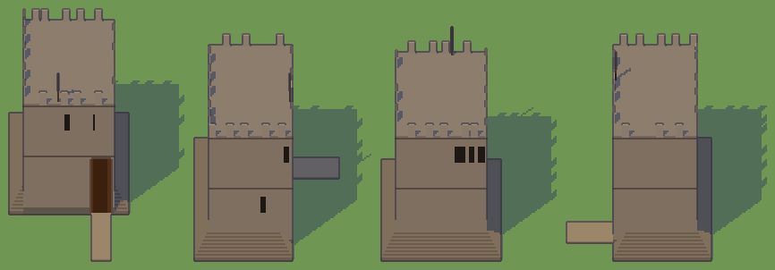
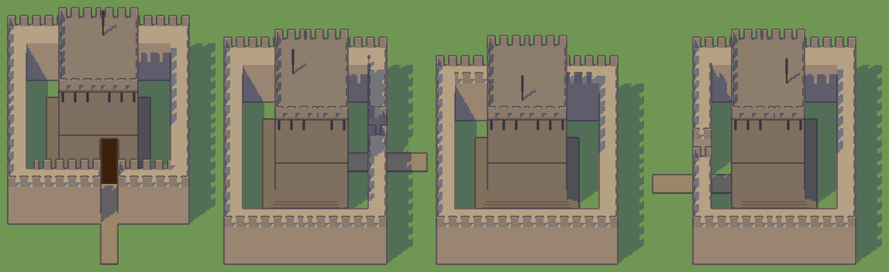
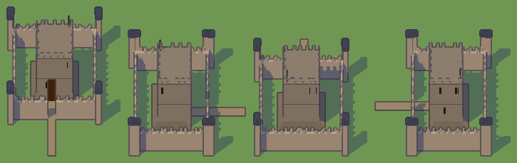

Le foto sono del seme 1, i quattro lati (davanti, destra, dietro, sinistra), a cartone. Le misure intere sono in `misure.json`; i merli
per lunghezza (`merlonRuns`) dicono che quasi tutti sono di 5, i pochi di 3-4 stanno agli angoli e dove due corse si incontrano.

## Come li scrive lo Scultore (T354, ADR-0183)

Due programmi scritti a mano **come lo Scultore li scrive dal prompt senza scheletro** (passo 2 di D48): niente pattern lunghi scritti per
ripetizione, la composizione del concetto sul piano a un quinto (`map scale="1/5 1/5 1"`, una cella un quarto di casella: 20, 30 e 40 celle
di lato alle tre taglie), la `map` che torna alla scatola (`5 5 1`, un blocco di 5 × 5 per lettera), le altezze come colonne a passi, le parti
del seme incluse. La villetta è anche la risposta offline dei modelli locali (`MOCK_STRUCTURE_PROGRAM` in `src/kernel/ai/mockStructure.ts`);
la rocca è `scultore-rocca.xml`. Scrivendoli si è visto ciò che il prompt deve dire: una moneta per tutta la casa è una regola su una cella
sola (la fine della linea per il centro), non `p` su ogni cella del bordo; una crescita «dove il terreno continua» vuole `steps="1"`, se no si
ripete da un lato solo finché c'è terreno; la scala si sale solo in linea, quindi la sua zona lascia dieci voxel liberi prima del primo
gradino (e `part-stair` ora prende i primi 16 di una striscia più lunga); la lettera `S` è la scena delle parti e chi include non la usa.

| programma | taglia | cosa contiene (seme 1) | parti (tipi) | tempo a seme |
|---|---|---|---|---|
| villetta | Grande | il corpo a due piani (interno 45 × 45-50, stanza 36, porta 15 × 30, la scala), il tetto a padiglione col comignolo, l'ala a un piano con la porta di 11 × 30 verso la casa, il portico con i pali e il tetto, il giardino con la siepe dove entra | 44-45 (15) | 0,3 s |
| | Enorme | + gli alberi dove sette celle di prato sono libere oltre la siepe, la siepe intera | 59-65 (17) | 0,5 s |
| | Gargantuesca | + il pozzo dove undici celle sono libere, più alberi | 102-111 (18) | 0,8-1,1 s |
| rocca | Grande | il mastio di 55 a due piani con la terrazza, il parapetto merlato e una feritoia sotto ogni merlo, la cinta di 10 con due merlature, le torri di 25 sugli angoli, il corpo di guardia più alto della cinta col portone, la porta del mastio, la strada; il cortile un passaggio | 92 (15) | 0,2-0,3 s |
| | Enorme | + il cortile di 25 (dove sei celle di terreno continuano) con il pozzo | 106 (16) | 0,4-0,5 s |
| | Gargantuesca | + il cortile di 40 (altre sette celle) e il fossato attorno alla cinta, con la strada che lo attraversa | 119 (17) | 0,9 s |

Entrambi passano `checkProgram` a Grande (4 semi e Enorme) e a Enorme (4 semi e Gargantuesca): due piani raggiunti a piedi (1 e 33), stanza
36, porte 15 × 30 e 11 × 30, una parte nuova a ogni taglia più grande. Con `--viste` il banco stampa ciò che lo Scultore riceve: il ritorno
del primo blocco (le piante grezze di tre semi e della taglia successiva, ≈ 1 000 token a Grande) e le viste del programma intero (pianta,
altezze, fronte, lato, tre tagli, le piante di altri due semi, ≈ 8 000 token; la traccia che le accompagna sta entro 2 500).

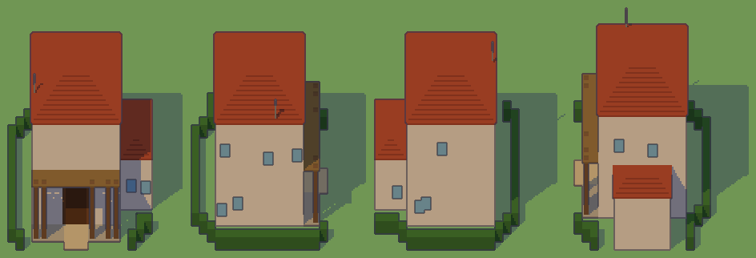
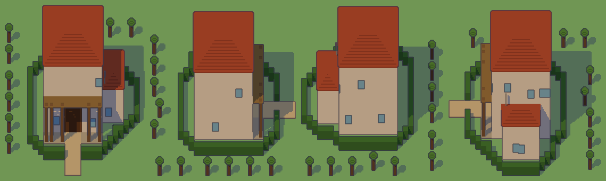
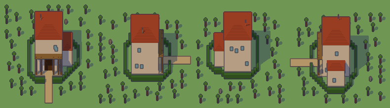
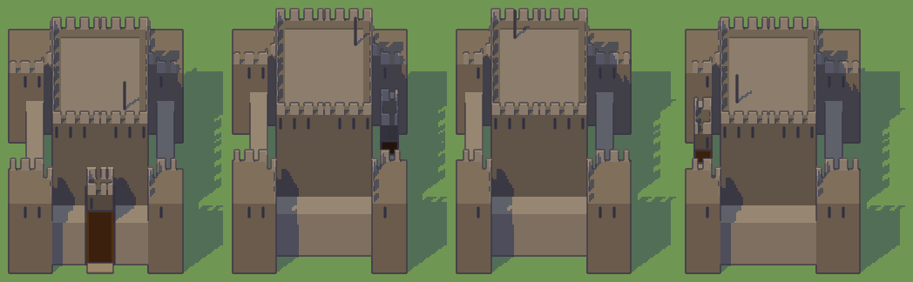
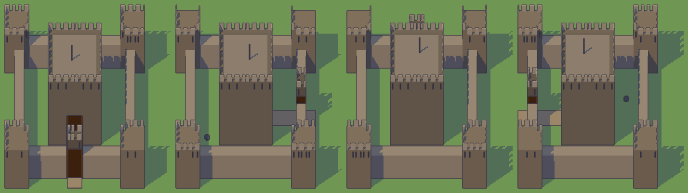
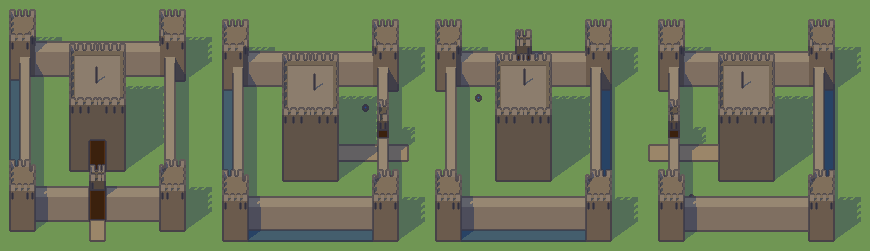

## Il tetto delle gargantuesche (T356, ADR-0185)

L'autore (10/11): a 20 voxel per casella le gargantuesche a 200 voxel sono solo 10 caselle, piccole rispetto alla mappa; va alzato il
tetto, a 20-50 caselle. Dove sta il tetto, misurato sui quattro programmi di qui (con le parti del seme incluse), alti 160, ognuno in un
processo suo (`lab/scripts/misura-tetto.ts`, `misure/tetto.json`): il tempo del programma, il picco di memoria residente prima della mesh e
con la mesh, la mesh come la fa il worker ora (senza le facce sul fondo) e come la faceva prima (col fondo). Si rifà con:

```bash
npx vite-node lab/scripts/misura-tetto.ts -- --solo taglie-fattoria,taglie-forte,scultore-rocca,scultore-villetta --lati 200,400,600,1000 --z 160 --json lab/banco/taglie/misure/tetto.json
npx vite-node lab/scripts/banco-taglie.ts -- --venti --foto --solo fattoria,scultore-villetta --semi 1   # le foto a 20 × 20 caselle
```

| programma | 200 (10 caselle, 6,4 M celle) | 400 (20 caselle, 25,6 M) | 600 (30 caselle, 57,6 M) | 1000 (50 caselle, 160 M) |
|---|---|---|---|---|
| fattoria | 0,89 s · 74 MB · mesh 0,55 M vertici, 26 MB (col fondo 0,68 M, 32) | 1,85 s · 98 MB · **0,93 M, 44 MB** (1,22 M, 57,5) | 3,4 s · 120 MB · 1,71 M, 80 MB (3,09 M, 145) | 8,3 s · 297 MB · 3,81 M, 179 MB (5,66 M, 266) |
| forte | 0,53 s · 68 MB · 0,37 M, 16 MB (0,41 M, 18) | 0,88 s · 116 MB · 0,38 M, 16 MB (0,42 M, 18) | 1,4 s · 206 MB · 0,38 M, 16 MB | 2,6 s · 431 MB · 0,39 M, 17 MB |
| rocca (Scultore) | 0,66 s · 48 MB · 0,37 M, 16 MB (0,43 M, 18) | 1,7 s · 77 MB · 0,39 M, 17 MB (0,46 M, 20) | 3,3 s · 112 MB · 0,40 M, 17 MB | 8,3 s · 244 MB · 0,41 M, 18 MB |
| villetta (Scultore) | 0,71 s · 45 MB · 0,27 M, 13 MB (0,30 M, 14) | 1,7 s · 81 MB · 0,48 M, 22 MB (0,52 M, 24) | 3,4 s · 138 MB · 0,81 M, 38 MB (0,87 M, 41) | 8,8 s · 298 MB · 1,95 M, 92 MB (2,05 M, 97) |

- **Il motore regge anche le 50 caselle** (8-9 s per chi riempie l'area, 2,6 per il forte che non la riempie); a 20 caselle 1,8 s.
- **La mesh era il tetto, in due modi.** Gli array di numeri che crescevano a `push` facevano un picco di otto volte la mesh (541 MB per la
  fattoria a 400, 2,1 GB a 1000): `meshVoxels` ora conta le facce e scrive array tipizzati della misura finale, stessi vertici e stesso ordine
  (il picco della fattoria a 400 è 129 MB con la mesh, la mesh si fa in 420 ms invece di 859). E metà delle facce di una struttura piatta
  erano il fondo (le facce rivolte in basso a z = 0, che nessuno vede da sopra): le forme del gioco le lasciano fuori (`underside: false`):
  −24 % di mesh a 10 caselle, −48 % a 20, −56 % a 50. Un `WorkerRunner` tiene 128 MB per tutte le forme (ADR-0108): la fattoria a 20
  caselle ne prende un terzo, a 30 più della metà, a 50 non entra.
- **I tetti delle celle**: `FORM_LIMITS` da 8 a 32 milioni di celle (la scatola delle 20 caselle è 25,6), `FORM_PIECES` 64, `MJX_LIMITS` 64.
- **Il lotto manca**: un luogo è 18 caselle e una taglia scende alla più grande che entra nel suo lotto (`claimSizes`); `STRUCTURE_SIDE`
  resta 200 finché l'autore non dice come è fatto il lotto di una gargantuesca di 20 caselle (`docs/pipeline/domande/T356.md`).

A 20 × 20 caselle (seme 1) la fattoria ha 1818 parti: la casa, il fienile, la tettoia, 83 caselle di campi e **217 di pascoli** recintati
con i cancelli, 92 di cortile; `checkProgram` passa. La villetta 455 parti (gli alberi e il pozzo nel giardino che cresce fino al bordo).
Nel laboratorio 3D sono la quarta voce di ogni programma del banco («Gargantuesca a 20 × 20, T356»).

**Nel browser** (Chrome headless sulla GPU vera, `lab/scripts/misura-frame.mjs 4421 --modello lab/banco/taglie/fattoria.xml --scatola 400,400,160`,
`misure/frame.json`, RTX 2070): la fattoria a 400 × 400 × 160 arriva dal worker in 2,0-2,4 s (programma e mesh); dentro la fattoria disegnata il
frame sta in 3,2 ms di JS (tick 3,3, disegno 3,1) e 2,9 ms di GPU con 2,96 milioni di triangoli (il luogo pieno senza di lei: 5,2 ms, GPU 4,0,
3,39 milioni); nessun long task. Nel laboratorio 3D (`browser/fattoria-20-laboratorio.jpg`) la costruisce in 2,2 s; nel gioco
(`browser/fattoria-20-nel-gioco.jpg`, messa nella libreria dalla console e indossata da un'entità accanto al viandante) blocca con la sua impronta
e si cammina fra i campi. **Il validatore la rifiuta** com'è: «pezzi staccati: 48 % dei voxel non è attaccato al corpo principale (7 pezzi)», i
recinti dei pascoli e i campi lontani dalla casa; a 10 caselle passa. Una struttura di 20 caselle è un insieme (casa, fienile, campi, recinti), non
un corpo solo: la regola dei pezzi staccati va ripensata per le strutture che crescono a regole quando avranno il lotto.

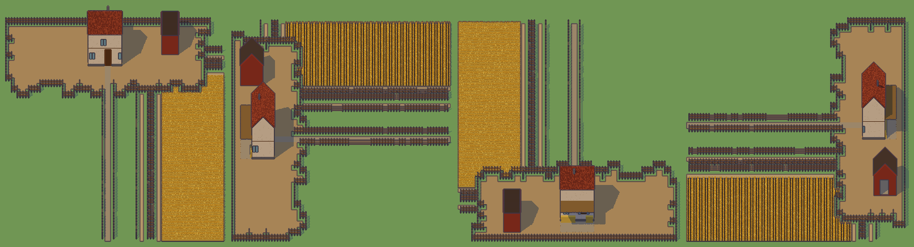
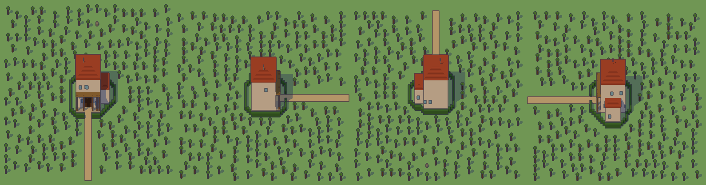

## Costo

Nessuna chiamata ai modelli: i programmi sono scritti a mano (`genera.mjs`, `parti.mjs`; la villetta e la rocca di T354 direttamente). Un giro del forte costa 0,15-0,45 s a seme,
uno della fattoria 0,3-0,7; `checkProgram` a una taglia (quattro semi e uno alla successiva) 1,4-2 s con le parti incluse.

## Ciò che non c'è ancora

- **Lo Scultore su Gemini** con le parti e il prompt senza scheletro: il prompt è fatto (T354, ADR-0183), il giro sul banco è T355.
- **Chi mette persone e animali nelle aree**: le aree sono lette (`formAreas`), nessuno le usa ancora; il Narratore e lo Scenografo (T259)
  le riceveranno in un task loro.
- **Il lotto di una gargantuesca di 20 caselle** (il tetto dei voxel è misurato e pronto, T356, ADR-0185): la domanda all'autore in
  `docs/pipeline/domande/T356.md`; la fattoria di 50 × 50 a 20 voxel per casella non entra in un browser (160 milioni di celle).
- **La varietà degli appezzamenti a 10 × 10**: in 20 celle restano 2-5 celle di campo attorno al cortile, quindi pochi tracciati e due o
  tre tipi di appezzamento per seme; la varianza dei campi di T339 vuole l'area di T356.
- **Le torri del forte** hanno la porta dal camminamento ma il camminamento non ha una scala dal cortile: la cinta si raggiunge dalle
  torri solo sul piano; una scala del camminamento è una parte da aggiungere.
