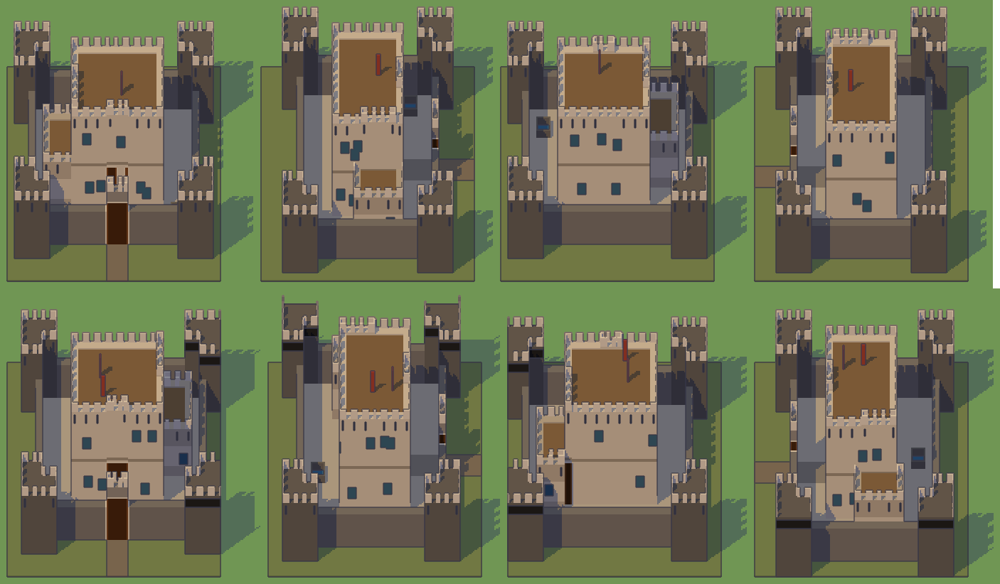
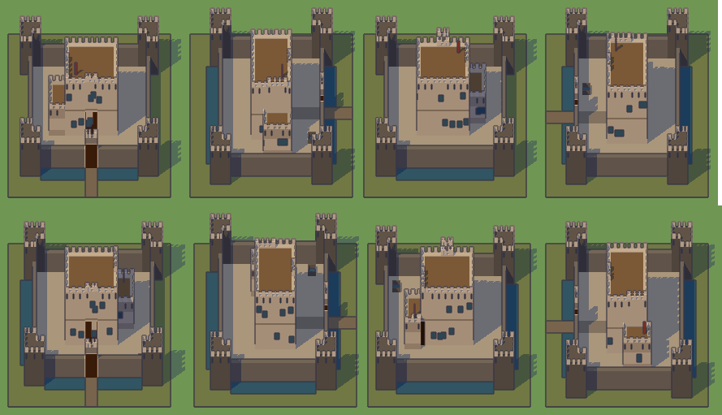
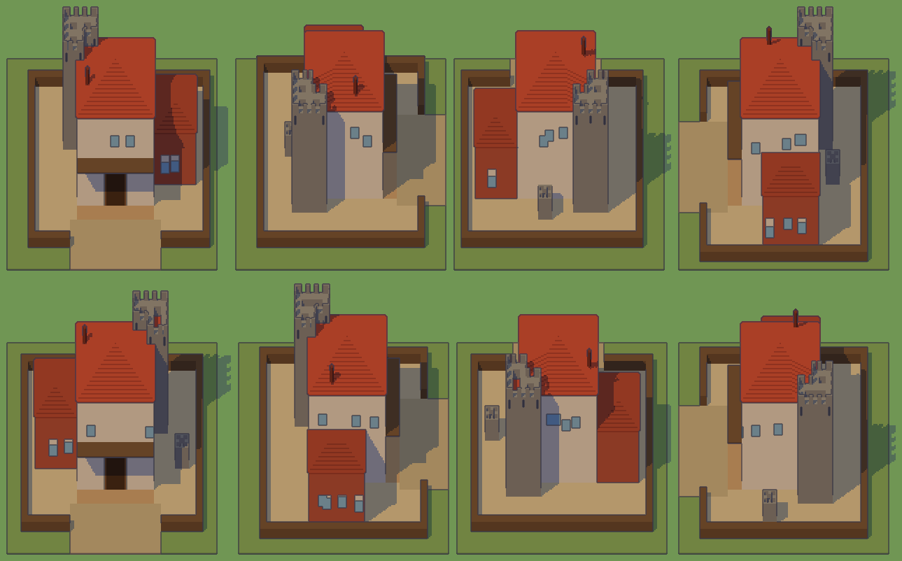
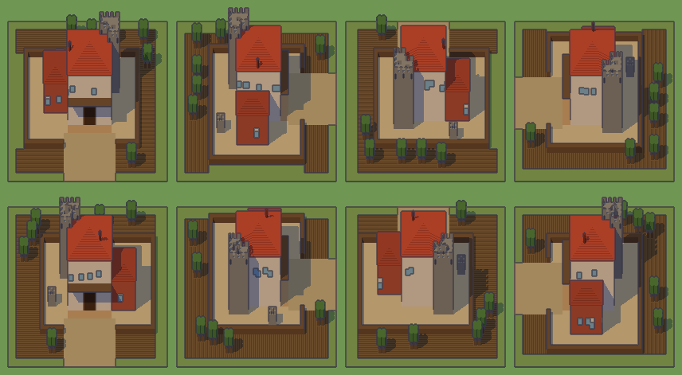
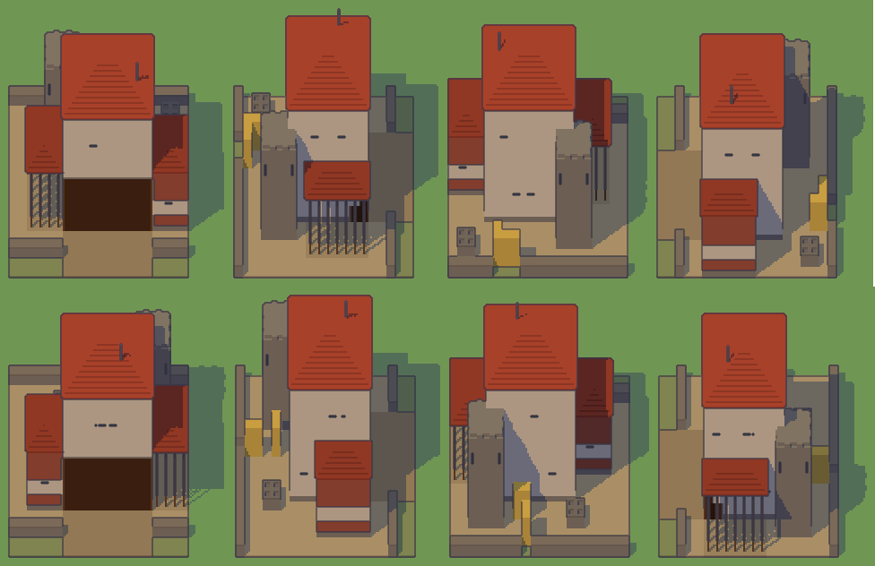

# Lo Scultore vero su Gemini col prompt senza scheletro (T355, passo 3 di D48)

Il prompt delle strutture di T354 ([ADR-0183](../../../../docs/adr/0183-scultore-senza-scheletro-a-blocchi.md)) provato con **lo Scultore del
gioco così com'è**: `sculpt` di `src/kernel/agents/sculptor.ts` (i due blocchi col ritorno in testo, fino a due correzioni, il voto
dell'Artista e la revisione sotto 7), il prompt e le parti del seme dal bundle, la richiesta scritta come la scrive il `ModelDirector`
(«forte: a building one enters, with the door at the front», classe `structure`), il ragionamento del gioco (`ai.thinking = low`).
Forte e fattoria, chiesti a Grande (il gioco usa **3.8 Flash**) e a Enorme (**Argon**, le strutture importanti fino al 1/12); ogni
programma passato gira poi alle tre taglie e a due semi con le misure del banco (`../misure.ts`), `checkProgram` e le foto.

```bash
npx vite-node lab/scripts/scultore-gemini.ts -- --root <cartella col .env> --giro giro2 [--pensiero medium] [--scultore gemini-4-argon] [--taglie large,huge] [--tetto 6]
npx vite-node lab/scripts/scultore-gemini.ts -- --misura --giro giro2      # rimisura e rifotografa i programmi tenuti, senza chiamate
npx vite-node lab/scripts/scultore-gemini.ts -- --concetti                 # concetti contro semi (T337) su tutti i programmi passati e su quelli a mano
```

In ogni cartella di un giro, per ogni richiesta: `chiamate/` (ogni richiesta e ogni risposta, il sistema una volta), `registro.txt` (ciò che il
Concilio ha detto), `esito.json` (modello, voto, chiamate, secondi, dollari a listino, per compito), e se è passato `programma.xml` e le foto
`large.png`, `huge.png`, `gargantuan.png` (una riga per seme, i quattro lati); `giro.log` è l'uscita intera con le misure.

## Il risultato

| giro | richiesta | modello | esito | voto | chiamate | tempo | costo |
|---|---|---|---|---|---|---|---|
| giro1 | forte Grande | 3.8 Flash | ✗ piani, porta | | 4 | 93 s | 0,08 $ |
| | fattoria Grande | 3.8 Flash | ✗ pezzi staccati | | 4 | 99 s | 0,09 $ |
| | forte Enorme | Argon | ✗ varietà Enorme → Gargantuesca | | 4 | 166 s | 0,28 $ |
| | fattoria Enorme | Argon | ✓ | 6 | 6 | 225 s | 0,31 $ |
| giro2 | forte Grande | 3.8 Flash | ✗ | | 4 | 106 s | 0,09 $ |
| | fattoria Grande | 3.8 Flash | ✗ | | 4 | 98 s | 0,09 $ |
| | forte Enorme | Argon | ✓ | **9** | 8 | 273 s | 0,49 $ |
| | fattoria Enorme | Argon | ✓ | 6 | 5 | 164 s | 0,21 $ |
| giro3 | forte Grande | 3.8 Flash | ✗ | | 4 | 92 s | 0,08 $ |
| | fattoria Grande | 3.8 Flash | ✗ | | 4 | 101 s | 0,09 $ |
| | forte Enorme | Argon | ✓ | 7 | 3 | 94 s | 0,09 $ |
| | fattoria Enorme | Argon | ✓ | 6 | 5 | 232 s | 0,33 $ |
| giro5 (Argon a Grande) | forte Grande | Argon | ✗ porta | | 4 | 199 s | 0,31 $ |
| | fattoria Grande | Argon | ✓ | 7 | 5 | 154 s | 0,20 $ |
| giro6 (ragionamento medio) | forte Grande | 3.8 Flash | ✗ | | 4 | 658 s | 0,30 $ |
| | fattoria Grande | 3.8 Flash | ✗ rete dopo 300 s | | 2 | 360 s | 0,03 $ |
| giro4 (ragionamento alto) | forte, fattoria Grande | 3.8 Flash | ✗ rete dopo 300 s | | 2 + 2 | 527-605 s | 0,22 $ |

Il giro3 doveva essere col ragionamento alto, ma il kernel dà a ogni chiamata del Concilio il suo `ai.thinking` (`low`), che vince su quello
dei modelli: è una terza ripetizione della configurazione del gioco (lo script ora lo imposta sul Concilio, giri 4 e 6). **Costo del banco:
3,26 $ a listino** (giri 1-6), 74 chiamate.

- **3.8 Flash a Grande, la configurazione del gioco: 0 su 6.** Ogni richiesta arriva alla quarta chiamata (composizione, programma, due
  correzioni) e cade: 0,08-0,09 $ e 90-110 s per una struttura che resta col modello generico della classe. La composizione del primo blocco è
  quella del concetto (il forte con cinta, torri d'angolo, corpo di guardia, cortile col pozzo e il mastio con la zona della scala; la
  fattoria con la casa, l'ala del fienile, il cortile e la strada): cadono le parti abitabili.
- **Argon: 5 su 6 a Enorme, 1 su 2 a Grande**, 0,09-0,49 $ a struttura (3-8 chiamate, 1,5-4,5 minuti). I forti passati (giro2, giro3) hanno
  mastio a due piani raggiunti dalla scala del seme, cinta merlata con le feritoie, torri sugli angoli, corpo di guardia col portone, e
  crescono con la taglia (a Gargantuesca il cortile più grande e il fossato); l'Artista dà 9 e 7. Dei cinque programmi passati a Enorme,
  tre passano `checkProgram` anche a Grande (i due forti, la fattoria del giro3); la fattoria del giro2 cade sulla stanza (27 contro 28),
  quella del giro1 sulla varietà Grande → Enorme. Il gioco condivide un programma con le altre taglie dello stesso concetto senza riprovarlo (`ModelDirector.shared`, ADR-0160): quelle due fattorie andrebbero a Grande con ciò che i controlli lì rifiutano.
- **La fattoria esce fortificata a ogni giro**: una torre con i merli accanto alla casa (6, 6, 6 e 7 dall'Artista: «sembra un forte»). Le
  parti del seme nella richiesta sono quattro per ogni concetto, e due sono merli e feritoie: Argon le include anche in una fattoria, e la
  revisione dell'Artista non le toglie. A Gargantuesca i campi arati, gli alberi e la staccionata ci sono.
- **Più ragionamento non serve al gioco**: 3.8 Flash col ragionamento medio o alto impiega 280-600 s per la seconda richiesta (22-59 mila
  token di ragionamento) e la rete di Node chiude a 300 s (il gioco ha `ai.timeout` 120 s); l'unico che arriva in fondo (forte, medio) cade
  come gli altri.

### Perché cadono: 33 scarti

| motivo | volte | |
|---|---|---|
| piani (1 o 0 raggiunti) | 14 | la scala del seme non porta su: la striscia `T` non ha i 10 di pianerottolo o il solaio non è nell'unione `=` |
| porta (alta 1-10 invece di 30) | 15 | la porta di `part-door` sale solo attraverso l'unione `+`, e i programmi fanno salire i muri con altre lettere sopra il seme (la fascia delle finestre `U` a z 7-20 nella fattoria del giro1; una porta 15 × 6 si ferma lì). Il ritorno dice «porta 20 × 6 — the leaf the action open takes away», non che cosa l'ha fermata, e tre correzioni su tre non lo trovano |
| pezzi staccati | 3 | alberi e paletti lontani dal corpo |
| varietà fra le taglie | 3 | un quarto di parti in più non c'è (178 → 198) |
| stanza 26-27 invece di 28 | 3 | |
| sintassi | 4 | `+` scritto come uscita, la cifra `1` in un'unione, due colori non validi |

### Concetti e semi (`concetti.json`, `concetti.png`)

A Grande coi quattro semi del mondo, sulla misura di T337 (`lab/banco/concetti.ts`): una riga per programma in `concetti.png` (sei di Gemini,
poi forte, fattoria, rocca e villetta scritti a mano).

| insieme | tra i semi | tra concetti | separazione | vicini |
|---|---|---|---|---|
| Gemini, prompt senza scheletro (forte ×2, fattoria ×4) | 0,14 | 0,38 | **2,62** | 100 % |
| a mano (forte e fattoria di T346, rocca e villetta di T354) | 0,02 | 0,47 | 19,7 | 100 % |
| T337, prompt a zone su Claude (5 concetti) | 0,11 | 0,43 | 3,73 | 100 % |
| T337, scheletro su Gemini (T156, 4 concetti) | 0,33 | 0,37 | 1,13 | 0 % |

Lo scheletro scompare anche su Gemini: un forte e una fattoria sono due edifici (prima ogni seme dava lo stesso edificio a ogni concetto), e i
semi variano più dei programmi a mano (0,14 contro 0,02: il forte e la rocca a mano a Grande sono quasi fermi). Due programmi di Gemini dello
stesso concetto distano 0,25-0,26, quanto basta perché due mondi non abbiano lo stesso forte.







## Confronto con T337-T339

- **T337** (Claude Opus, il metodo a zone su cinque concetti): forma del concetto alla prima richiesta e separazione 3,73, ma misure abitabili non
  rette, 2,5-4,2 $ a modello. Qui, con le parti del seme e i due blocchi, Argon le regge 5 volte su 6 a Enorme a 0,09-0,49 $; 3.8 Flash no.
- **T338-T339, T346** (forte e fattoria scritti a mano): gli stessi contenuti per taglia (la torre a base larga a Grande, cinta e torri dopo; la
  casa con la tettoia, poi i campi e il fienile), merli regolari (quasi tutti di 5), feritoie sotto i merli. I forti di Argon hanno i merli
  del seme (75 di 5 e 51 di 3 a Enorme nel giro2) e crescono con la taglia, ma a Grande sono già un forte intero (mastio, cinta, torri), non la
  torre a base larga; le fattorie di Argon hanno la casa a due piani, il cortile e i campi solo dalla Enorme, e la torre che quelle a mano non hanno.
- **T354** (rocca e villetta scritte come lo Scultore): passano a ogni taglia; ciò che il prompt chiede si può scrivere, e Argon lo scrive.

## La decisione

Il banco **non regge per lo Scultore del gioco com'è configurato**: a Grande, la taglia di gran lunga più frequente, 3.8 Flash non passa mai
e ogni struttura costa quattro chiamate per niente. Il prompt nuovo è già quello del gioco (T354); la domanda all'autore è in
[`docs/pipeline/domande/T355.md`](../../../../docs/pipeline/domande/T355.md), con le opzioni e la raccomandazione.
