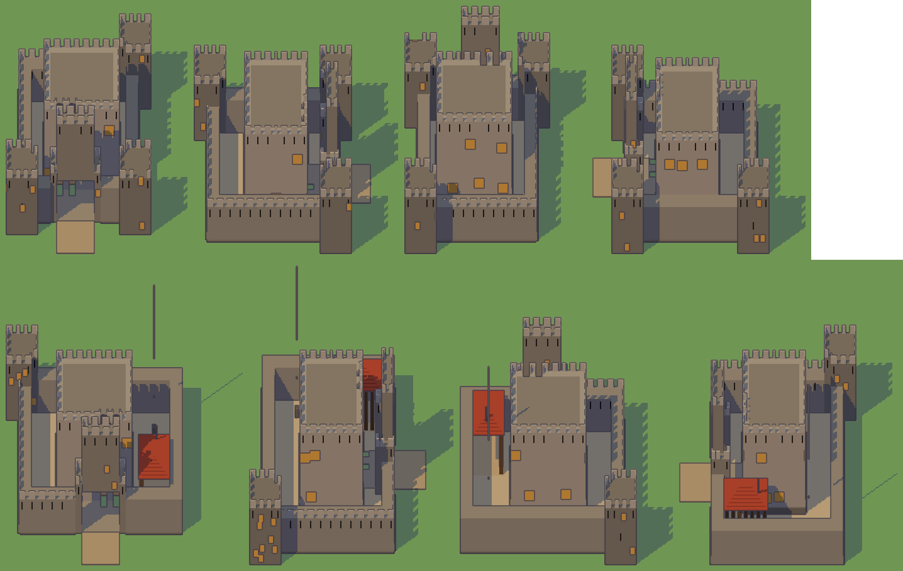
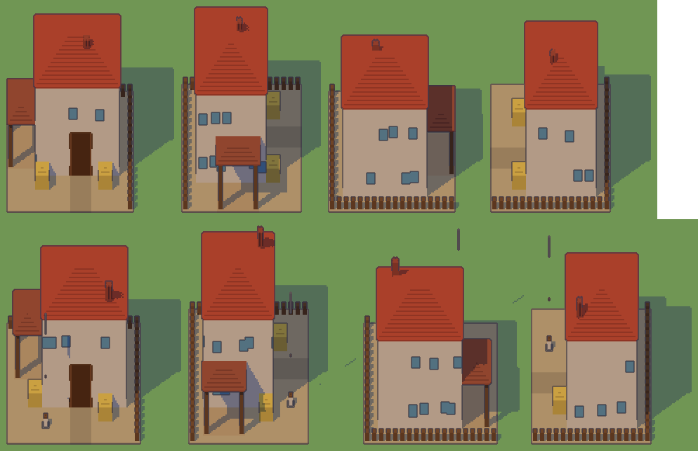
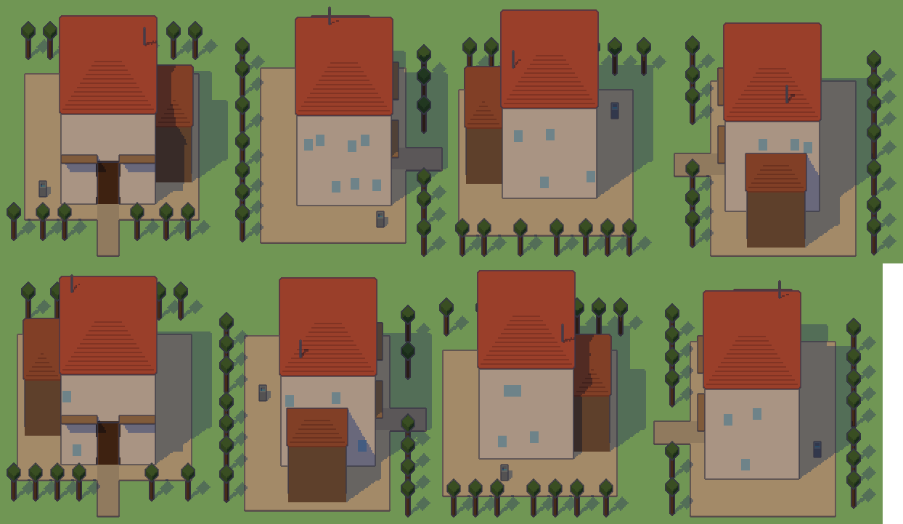
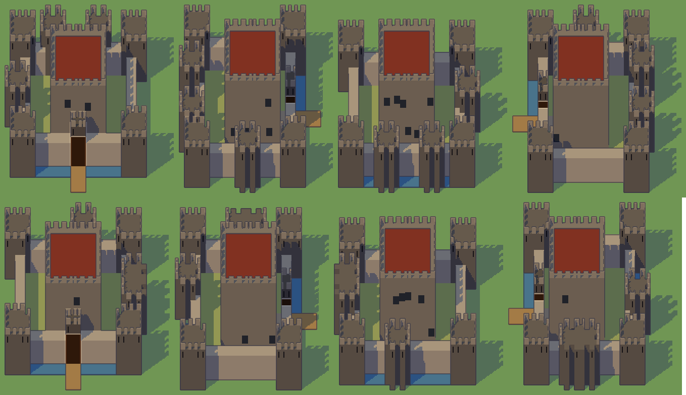
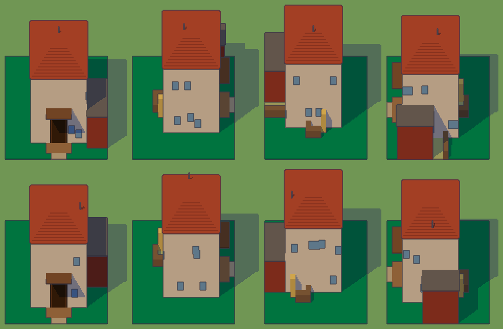
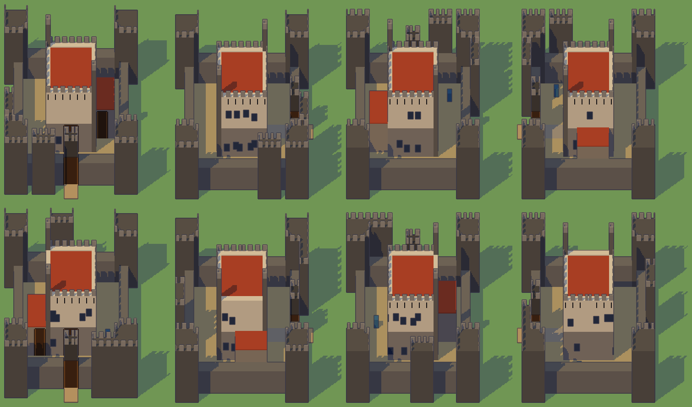
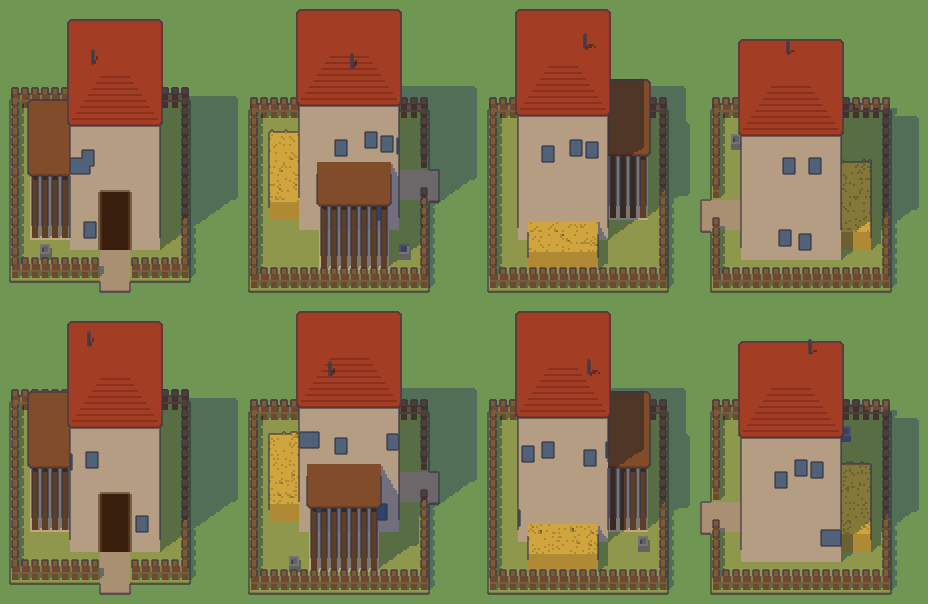

# Quale modello scrive meglio le strutture, a parità di costo per struttura riuscita (T391, per D57)

Lo stesso giro di T355 ([`../gemini/README.md`](../gemini/README.md)): lo Scultore del gioco così com'è (`sculpt` di
`src/kernel/agents/sculptor.ts`, il prompt senza scheletro di ADR-0183, i due blocchi col ritorno in testo, fino a due correzioni, il voto
dell'Artista e la revisione sotto 7, l'Artista sul suo modello del gioco, 3.5 Flash), forte e fattoria chiesti come li chiede il `ModelDirector`,
a Grande e a Enorme, col ragionamento del gioco (`low`); qui lo Scultore è **lo stesso modello a ogni taglia**. Ogni programma passato gira
poi alle tre taglie e a due semi con le misure del banco, `checkProgram` e le foto.

Questo task fa i modelli di Gemini (**Gemini 4 Carbon** e **Gemini 4 Hydrogen**, con la chiave di Google: l'API li offre entrambi, letti il
14/11 con `models.list`) e prepara il giro sull'abbonamento di Claude (Sonnet 5.5, Opus 5.5, Fable 5.1), che ha fatto **T392** il 15/11 (sotto, «Il giro su Claude»). I numeri di 3.8 Flash
e Argon sono quelli di T355, già pagati e non rifatti (solo i giri col ragionamento del gioco: giro1-3 e giro5).

```bash
# Gemini (questo task): tre ripetizioni per modello, 4 richieste a giro → <out>/<modello>/giro<n>/<concetto>-<taglia>/
npx vite-node lab/scripts/scultore-gemini.ts -- --root ../../.. --modelli gemini-4-carbon,gemini-4-hydrogen --ripeti 3 --out lab/banco/taglie/modelli
# senza chiamate: la tabella (tabella.md, con T355 accanto), concetti e semi (concetti.json, concetti.png), le misure
npx vite-node lab/scripts/scultore-gemini.ts -- --tabella --out lab/banco/taglie/modelli
npx vite-node lab/scripts/scultore-gemini.ts -- --concetti --out lab/banco/taglie/modelli
```

**Costo del giro: 5,74 $ a listino** (registro intero di questa cartella, solo Gemini; tetto 10 $), 100 chiamate.

## Il risultato

| Scultore | taglia | riuscite | costo per riuscita | dopo l'1/12 | chiamate (media) | tempo a struttura (media, max) | chiamate oltre 120 s | voti | fattorie con merli | forti con merli |
|---|---|---|---|---|---|---|---|---|---|---|
| 3.8 Flash (T355) | Grande | 0 su 6 | — | — | 4,0 | 98 s, 106 s | 0 su 24 | — | — | — |
| **Argon** (T355) | Enorme | 5 su 6 | 0,34 $ | 0,68 $ | 5,2 | 192 s, 273 s | 0 su 31 | 6, 6, 9, 6, 7 | 3 su 3 | 2 su 2 |
| | Grande | 1 su 2 | 0,51 $ | 1,02 $ | 4,5 | 177 s, 199 s | 0 su 9 | 7 | 1 su 1 | — |
| | **insieme** | **6 su 8** | **0,37 $** | **0,74 $** | 5,0 | 188 s, 273 s | 0 su 40 | | 4 su 4 | 2 su 2 |
| **Carbon** | Enorme | 2 su 6 | 0,67 $ | 1,35 $ | 3,7 | 277 s, 450 s | 2 su 22 | 9, 7 | — | 2 su 2 |
| | Grande | 2 su 6 | 0,83 $ | 1,66 $ | 3,8 | 338 s, 427 s | 3 su 23 | 8, 8 | 0 su 1 | 1 su 1 |
| | **insieme** | **4 su 12** | **0,75 $** | **1,50 $** | 3,8 | 308 s, 450 s | 5 su 45 | | 0 su 1 | 3 su 3 |
| **Hydrogen** | Enorme | 3 su 6 | 0,49 $ | 0,49 $ | 5,2 | 97 s, 129 s | 0 su 31 | 6, 6, 6 | 0 su 3 | — |
| | Grande | 1 su 6 | 1,24 $ | 1,24 $ | 4,0 | 78 s, 99 s | 0 su 24 | 7 | — | 0 su 1 |
| | **insieme** | **4 su 12** | **0,68 $** | **0,68 $** | 4,6 | 88 s, 129 s | 0 su 55 | | 0 su 3 | 0 su 1 |

Il **costo per riuscita** è il costo di tutte le richieste del modello (le riuscite, le fallite, ogni correzione e ogni voto dell'Artista) diviso
per le strutture riuscite. **Dopo l'1/12** Argon e Carbon raddoppiano (`prices.ts`, letto il 14/11); per Hydrogen la pagina non dice un cambio.
Tutte le strutture riuscite lo sono anche col tempo del gioco (nessuna loro chiamata oltre i 120 s di `ai.timeout`). Le fattorie e i forti «con
merli» sono quelli che li **disegnano** (Enorme, seme 1), non quelli che importano le parti del seme: la fattoria di Carbon importa merli e
feritoie e non ne mette nessuno.

Perché cadono (un programma può cadere per più motivi; dai `registro.txt`):

| Scultore | piani | porta | stanza | varietà fra le taglie | colore mancante | pezzi staccati | sintassi | rete (nessuna risposta) | token finiti |
|---|---|---|---|---|---|---|---|---|---|
| 3.8 Flash (T355) | 8 | 5 | 6 | 2 | 0 | 3 | 1 | 0 | 0 |
| Argon (T355) | 6 | 9 | 2 | 1 | 0 | 0 | 1 | 0 | 0 |
| Carbon | 5 | 5 | 4 | 1 | 4 | 1 | 3 | **4** | **1** |
| Hydrogen | **16** | 6 | 3 | **6** | **6** | 0 | 1 | 0 | 0 |

- **Carbon scrive le strutture migliori quando risponde, ma un terzo delle volte non risponde.** I quattro programmi passati sono belli (voti
  8, 8, 9, 7: il forte del giro2 a Enorme ha mastio, cinta merlata, torri d'angolo, corpo di guardia e a Gargantuesca il fossato; la fattoria
  del giro1 a Grande ha casa, tettoia, covoni, recinto, **senza merli**). Ma 4 richieste su 12 cadono perché
  una chiamata di Carbon non ha risposto in 300 s (la rete di Node chiude lì; il gioco aspetta 120 s) e una per i token finiti (33 mila di
  ragionamento con `low`): 5 chiamate su 45 oltre i 120 s. È il più lento (308 s a struttura in media, contro 188 di Argon) e, al prezzo di
  Argon, costa il doppio per riuscita.
- **Hydrogen è veloce e non fortifica le fattorie, ma cade sui piani.** 88 s a struttura, nessuna chiamata oltre i 120 s, ragionamento
  contenuto (5-11 mila token); le tre fattorie Enorme hanno casa, stalla, aia, staccionata, pozzo e **nessun merlo** (due nemmeno le importano),
  ma voti 6, 6, 6. A Grande passa una volta su sei, e il forte passato è una casa col tetto rosso senza merli (voto 7): i piani che la scala non
  raggiunge sono la causa di metà degli scarti (16), poi colori mancanti e la varietà fra le taglie. Al prezzo di oggi costa 0,68 $ per riuscita,
  dopo l'1/12 quanto Argon (0,74 $), con metà delle riuscite.
- **Argon resta il migliore su Gemini**: 6 su 8, 0,37 $ per riuscita oggi e 0,74 $ dopo l'1/12, nessuna chiamata oltre i 120 s; ma le sue
  fattorie disegnano merli 4 volte su 4 (T355).
- **Concetti e semi** (`concetti.json`, `concetti.png`, a Grande coi quattro semi del mondo): la separazione fra concetti è la stessa per i tre
  modelli, 2,57 Carbon, 2,71 Hydrogen, 2,62 Argon (tra i semi 0,16, 0,12, 0,14; a mano 19,7). Il prompt senza scheletro separa i concetti con
  qualunque di questi modelli; ciò che cambia è quanti programmi passano e se la fattoria resta una fattoria.






In ogni cartella `<modello>/giro<n>/<concetto>-<taglia>/`: `chiamate/` (ogni richiesta e risposta, col tempo), `registro.txt`, `esito.json`
(modello, voto, chiamate, secondi, dollari, di cui Gemini e Claude), e se è passato `programma.xml` e le foto a tre taglie; `giro-gemini.log` è
l'uscita intera con le misure; `tabella.md` la tabella come la scrive `--tabella`.

## Il giro sull'abbonamento di Claude (T392): preparato e provato offline

Sonnet 5.5, Opus 5.5 e Fable 5.1 scrivono come Scultore **dalla CLI isolata della coda degli abbonamenti** (ADR-0077, ADR-0106), non dall'API:
`runIsolated` di `tools/abbonamenti/servi.ts` (la stessa esecuzione che serve la coda: cartella vuota, ambiente ridotto, niente strumenti,
MCP, hook né impostazioni, il prompt di sistema dello Scultore al posto di quello della CLI, ogni esecuzione confermata da `IsolationCheck`)
con in più, solo per il banco, il modello (`--model`), lo sforzo (`--effort`, il ragionamento del gioco: `low`) e le immagini della revisione
come un messaggio di eventi (`--input-format stream-json`). La coda del gioco non cambia: non dice modello e non manda immagini. L'Artista
resta su Gemini (il suo modello del gioco, pagato e contato nel tetto). Il costo di Claude si calcola **dai token che la CLI riporta, al
listino API di Anthropic** (`ANTHROPIC_PRICES` in `prices.ts`, letto il 14/11: Sonnet 5.5 2/10 $, Opus 5.5 4/20 $, Fable 5.1 10/50 $ per
milione, le scritture in cache a 1,25 volte l'ingresso, le letture al prezzo della cache), perché in gioco si pagherebbe l'API; accanto, il
costo che dice la CLI stessa (`usdCli`).

Il comando di T392, uno solo (dopo il reset della finestra; i tre modelli uno dopo l'altro, tre ripetizioni ciascuno come Carbon e Hydrogen):

```bash
npx vite-node lab/scripts/scultore-gemini.ts -- --root ../../.. --modelli claude-sonnet-5-5,claude-opus-5-5,claude-fable-5-1 --ripeti 3 --out lab/banco/taglie/modelli
npx vite-node lab/scripts/scultore-gemini.ts -- --tabella --out lab/banco/taglie/modelli && npx vite-node lab/scripts/scultore-gemini.ts -- --concetti --out lab/banco/taglie/modelli
```

- **La finestra**: prima di ogni chiamata (al più una volta al minuto) legge `claude -p /usage`; oltre l'80 % della finestra delle 5 ore le
  chiamate su Claude si fermano e i giri seguenti non partono (`--finestra 80`); le strutture fermate così non contano come tentativi.
- **La settimana**: `/usage` prima e dopo, in console e in `settimana.json` (le letture di ogni giro): quanti punti della settimana ha preso.
- **Un modello che la CLI non raggiunge** (un errore senza un token a ogni richiesta del primo giro) è detto (`irraggiungibile.txt` nel suo
  giro), non conta nella tabella, e il comando prosegue con gli altri.
- **Il tetto**: 10 $ sul registro intero della cartella, contato sulle sole chiamate di Gemini (qui 5,74 $; l'Artista costa circa 0,003 $ a voto).
- **Non provato con la CLI vera** (qui niente chiamate ai modelli di Claude): che `--input-format stream-json` porti l'immagine della revisione.
  Se la prima revisione di T392 cade con un errore della CLI, rilanciare con `--senza-immagini` (la revisione ha allora le viste in testo).

Provato offline con la CLI finta (`lab/scripts/claude-finta.mjs`: dice l'`init` isolato, risponde con la rocca di T354 e l'uso per modello
che dà quella vera; `--irraggiungibile <modello>` per un modello che non risponde), senza nessuna chiamata:

```bash
npx vite-node lab/scripts/scultore-gemini.ts -- --offline --modelli claude-fable-5-1,claude-opus-5-5 --out <cartella temporanea> --cli-cmd "node <assoluto>/lab/scripts/claude-finta.mjs <assoluto>/lab/banco/taglie/scultore-rocca.xml <assoluto>/log.jsonl --irraggiungibile claude-fable-5-1"
```

Il registro della CLI finta mostra a ogni chiamata il modello, `--effort low`, `--tools ""`, le opzioni dell'isolamento e il prompt di
sistema dello Scultore (19,8 mila caratteri); Fable risulta «non raggiungibile» e il comando prosegue con Opus; i test sono in
`tests/banco-claude.test.ts`.

## Il giro su Claude (T392, 15/11)

Lanciato il 15/11 dalle 02:46 alle 04:12 (ora di Roma), all'inizio di una finestra delle 5 ore pulita (3 %), senza altri task (claude e fable
sospesi, generatore spento), col comando di T391 **un modello alla volta**, per avere le letture di ciascuno:

```bash
npx vite-node lab/scripts/scultore-gemini.ts -- --root ../../.. --modelli claude-sonnet-5-5 --ripeti 3 --out lab/banco/taglie/modelli   # poi claude-opus-5-5, claude-fable-5-1
```

Tutti e tre i modelli sono raggiungibili dalla CLI (`claude-fable-5-1` compreso: l'alias `fable` della pipeline è 5.2, qui si è chiesto l'id
del listino); le immagini della revisione con `--input-format stream-json` sono passate senza errori (nessun `--senza-immagini`). Il costo
calcolato coi prezzi di `ANTHROPIC_PRICES` coincide con quello che dice la CLI (`usdCli`). Le uscite intere sono `giro-sonnet.txt`,
`giro-opus.txt` e `giro-fable.txt`; le letture della finestra in `settimana.json`.

**Fable ha fatto due giri su tre**: dopo il secondo la finestra delle 5 ore era all'85 % e il banco ha fermato il terzo (`--finestra 80`),
come chiesto. Ha 8 tentativi, come Argon in T355.

### Il risultato, i sei modelli

| Scultore | riuscite | costo per riuscita (listino) | tempo a struttura (media, max) | chiamate oltre i 120 s del gioco | riuscite con ogni chiamata entro 120 s | voti | fattorie con merli | forti con merli | separazione fra concetti |
|---|---|---|---|---|---|---|---|---|---|
| 3.8 Flash a Grande (T355) | 0 su 6 | — | 98 s, 106 s | 0 su 24 | 0 | — | — | — | — |
| Argon (T355) | 6 su 8 | **0,37 $** (0,74 $ dopo l'1/12) | 188 s, 273 s | 0 su 40 | 6 | 6, 6, 9, 6, 7, 7 | **4 su 4** | 2 su 2 | 2,62 |
| Carbon (T391) | 4 su 12 | 0,75 $ (1,50 $ dopo l'1/12) | 308 s, 450 s | 5 su 45 | 4 | 8, 8, 9, 7 | 0 su 1 | 3 su 3 | 2,57 |
| Hydrogen (T391) | 4 su 12 | 0,68 $ | 88 s, 129 s | 0 su 55 | 4 | 6, 6, 6, 7 | 0 su 3 | 0 su 1 | 2,71 |
| **Sonnet 5.5** | **12 su 12** | 0,92 $ | 662 s, 977 s | **22 su 48** | **0** | 6, 8, 9, 8, 7, 8, 8, 8, 6, 8, 9, 9 | 0 su 6 | 6 su 6 | 4,34 |
| **Opus 5.5** | **11 su 12** | **0,75 $** | 207 s, 341 s | 1 su 49 | 10 | 6, 8, 9, 8, 6, 8, 9, 8, 6, 7, 8 | **0 su 6** | **5 su 5** | **8,50** |
| **Fable 5.1** (2 giri) | 7 su 8 | 2,91 $ | 539 s, 739 s | 17 su 33 | 0 | 6, 8, 8, 6, 8, 8, 8 | 0 su 4 | 3 su 3 | 4,91 |

Per taglia (`tabella.md`): Opus 6 su 6 a Grande (0,52 $) e 5 su 6 a Enorme (1,02 $); Sonnet 6 su 6 a entrambe (0,91 $ e 0,93 $); Fable 4 su
4 a Grande (1,98 $) e 3 su 4 a Enorme (4,16 $). Il costo per riuscita conta ogni richiesta (le riuscite, le fallite, ogni correzione, ogni
voto dell'Artista su Gemini). Gli scarti del kernel lungo la strada: Sonnet colori mancanti (3) e pezzi staccati (2); Opus la varietà fra le
taglie (6, il forte fallito compreso); Fable piani (4), porta (3), stanza (2).

- **Opus 5.5 è il migliore**: 11 su 12, 0,75 $ per riuscita, cioè **quanto Argon dopo l'1/12** (0,74 $) e il doppio di Argon oggi; 3,5 minuti
  a struttura e una sola chiamata su 49 oltre i 120 s. Ragiona poco con `--effort low` (6,5 mila token in uscita a chiamata, risposta
  compresa). **Nessuna fattoria fortificata** (0 su 6: casa col tetto, fienile, recinto) e tutti i forti coi merli; la separazione fra i
  concetti più alta misurata per un modello (8,50, il triplo dei Gemini; a mano 19,7), con l'86 % dei vicini dello stesso concetto. L'unico
  fallito è un forte a Enorme che, corretto due volte, cresceva troppo poco alla Gargantuesca (la varietà).
- **Sonnet 5.5 riesce sempre, ma è lento e caro**: 12 su 12, voti alti, nessuna fattoria fortificata, ma 11 minuti a struttura e **nessuna**
  struttura riuscita con tutte le chiamate entro i 120 s del gioco: con `--effort low` ragiona comunque 25-55 mila token a chiamata, che non
  si vedono nella risposta (9-23 kB) ma si pagano (29 mila token in uscita a chiamata in media). In gioco, col tempo di oggi, cadrebbero quasi
  tutte. Costa per riuscita più di Opus, pur costando la metà per token.
- **Fable 5.1 non vale il prezzo**: 7 su 8, voti come gli altri, 2,91 $ per riuscita (quasi 8 volte Argon oggi), 9 minuti a struttura, metà
  delle chiamate oltre i 120 s; è anche quello che consuma di più l'abbonamento.
- **Le fattorie**: i tre Claude lasciano la fattoria una fattoria (0 su 16), come Hydrogen; Argon la fortifica sempre (4 su 4).






### Quanto ne ha preso l'abbonamento

Letture di `claude -p /usage` prima e dopo ogni modello (`settimana.json`; la settimana di Fable letta a mano):

| | 5 ore | settimana (tutti i modelli) | settimana di Fable | chiamate dello Scultore | tempo |
|---|---|---|---|---|---|
| Sonnet 5.5, 3 giri | 3 → 26 % (**23 punti**) | 33 → 34 % (1) | — | 33 | 40 min |
| Opus 5.5, 3 giri | 26 → 36 % (**10 punti**) | 34 → 35 % (1) | — | 35 | 19 min |
| Fable 5.1, 2 giri | 36 → 85 % (**49 punti**) | 35 → 39 % (4) | 8 → 16 % (8) | 24 | 25 min |
| **insieme** | **82 punti** | **6 punti** | 8 punti | 92 | 84 min |

Le letture comprendono anche l'agente che ha lanciato e seguito il giro (T392, Opus 5.5): durante i giri faceva solo attese brevi e la
lettura dei risultati, stimate in **2-4 punti** della finestra in tutto (non separabili: `/usage` non dice da quale sessione viene il
consumo); la scrittura di questo rapporto, dopo l'ultima lettura, non è nel giro. A listino API il giro su Claude sarebbe costato **39,63 $**
(Sonnet 11,03 $, Opus 8,20 $, Fable 20,40 $); il registro di Gemini della cartella è a **6,00 $** (l'Artista, 0,26 $ in questo giro), sotto
il tetto di 10 $.

### Come cambia D57

A parità di costo per struttura riuscita **e** di tempo del gioco oggi vince ancora **Argon** (0,37 $, 6 su 8, tutto entro 120 s). **Dopo
l'1/12**, quando Argon raddoppia, **Opus 5.5 costa uguale (0,75 $ contro 0,74 $) e riesce di più (11 su 12 contro 6 su 8)**, non fortifica le
fattorie e separa meglio i concetti. Sonnet e Fable no: lenti per il tempo del gioco e più cari per riuscita. Il gioco oggi non chiama nessun
modello di Claude (né da Google né da OpenRouter: `OPENROUTER_MODELS` ha solo Gemini): Opus come Scultore delle strutture vuole un task che
lo porti nella via di OpenRouter (id fisso a elenco, prezzo, lo Scultore delle strutture di quella via; nella via di Google resta Argon). La
domanda all'autore è in [`docs/pipeline/domande/T392.md`](../../../../docs/pipeline/domande/T392.md).

## Il giro di Opus via OpenRouter (T397): preparato e provato offline, non lanciato

D57 è chiusa con l'opzione 1 (16/11): dall'1/12 Opus 5.5 scrive le strutture quando il mondo va su OpenRouter (ADR-0205, kernel 0.7.14). Prima, un
giro breve dello stesso banco **attraverso l'adattatore del gioco** (`OpenRouterAiModels`: senza temperatura, il prompt di sistema in cache con
`cache_control`, `max_tokens` 32 000, il ragionamento `low`, il costo detto da ogni risposta), l'Artista su Gemini come sopra:

```bash
npx vite-node lab/scripts/scultore-gemini.ts -- --root ../../.. --modelli claude-opus-5-5 --via openrouter --tetto 4 --out lab/banco/taglie/modelli/openrouter
npx vite-node lab/scripts/scultore-gemini.ts -- --tabella --out lab/banco/taglie/modelli/openrouter
```

4 strutture (forte e fattoria, Grande ed Enorme), circa 3 $, fermo oltre 4 $ sul registro della cartella (Gemini e OpenRouter insieme); in ogni
`esito.json` le chiamate di OpenRouter con i token letti dalla cache, il costo detto e i secondi. Provato con `--offline` (un OpenRouter finto che
risponde con la villetta): il percorso, il registro e la tabella («claude-opus-5-5 via OpenRouter»). **Non lanciato**: nei `.env` della macchina non
c'è `OPENROUTER_API_KEY` (`docs/pipeline/domande/T397.md`). La soglia: meno di 3 su 4 o oltre 1,50 $ a riuscita, e il passaggio dell'1/12 si toglie.

## Raccomandazione provvisoria per D57 di T391 (solo Gemini; superata da T392, sopra)

Fra i modelli di Gemini **Argon resta lo Scultore delle strutture**, a ogni taglia (l'opzione 1 di T355): riesce 3 volte su 4 contro 1 su 3 di
Carbon e Hydrogen, costa la metà per riuscita oggi e, dopo l'1/12, quanto Hydrogen. **Carbon no**: al prezzo di Argon riesce la metà delle
volte e un terzo delle richieste non riceve risposta entro il tempo del gioco. **Hydrogen** è il candidato da riprovare dopo il task che ripara
il ritorno di piani e porta (T355): è il più veloce, il solo che lascia la fattoria una fattoria, e dopo l'1/12 costa per riuscita quanto Argon;
oggi cade sui piani. La domanda all'autore è in [`docs/pipeline/domande/T391.md`](../../../../docs/pipeline/domande/T391.md).
