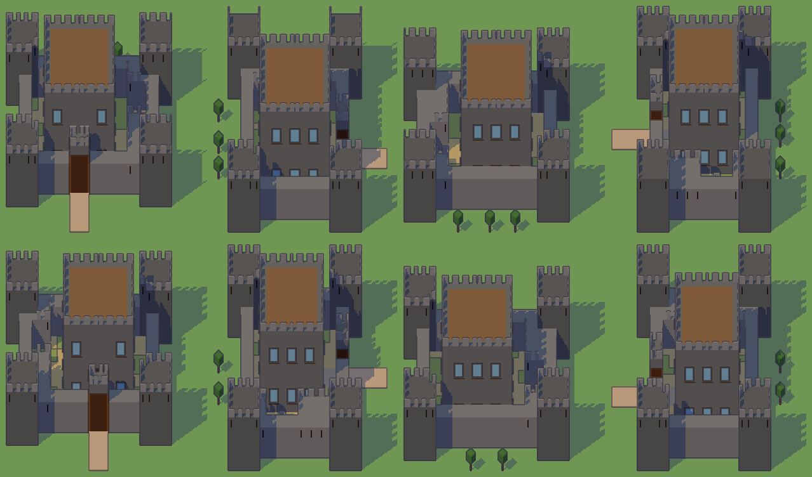
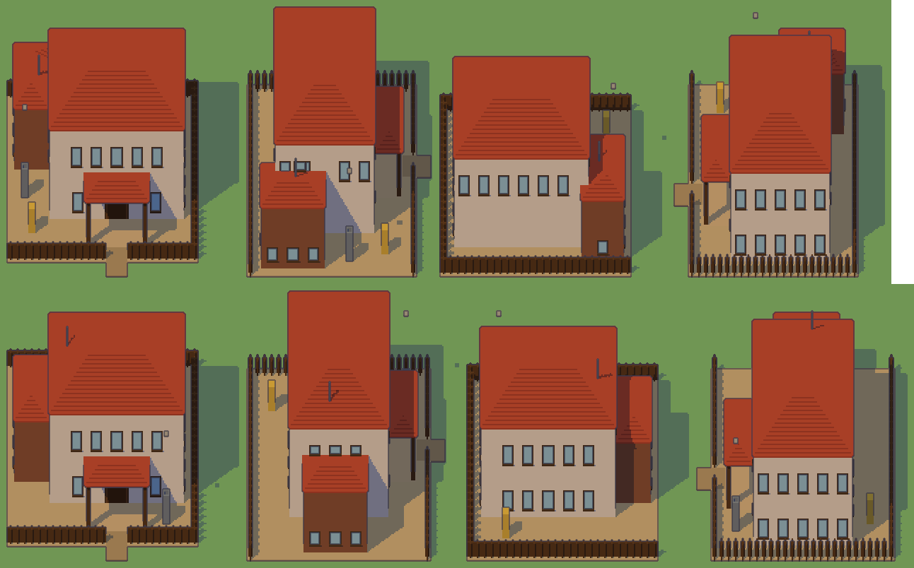
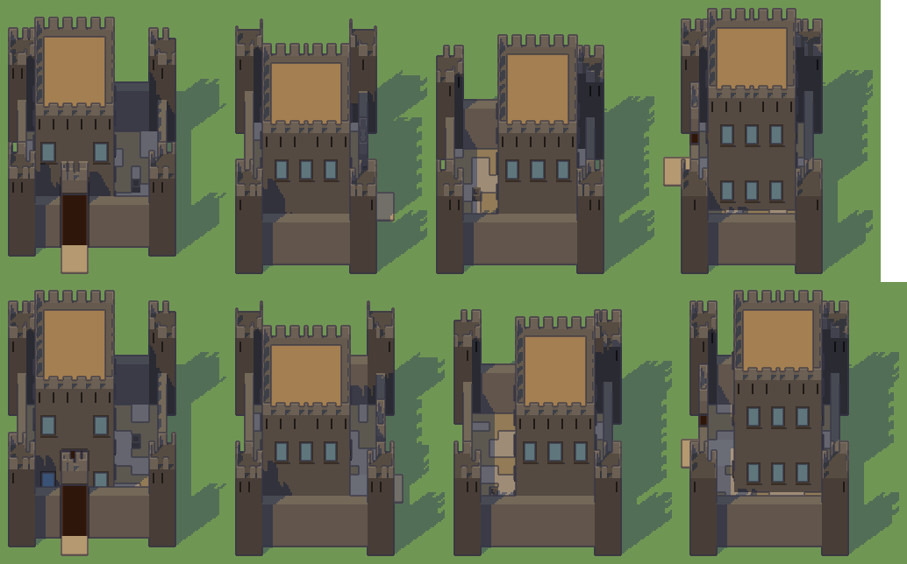

# Gemini 4 Neon: la prova nella pipeline e lo Scultore Architetto (T516)

Data: 27/11/2026 · nasce da T465 (`docs/pipeline/modelli.md` 1.4-1.5, ADR-0237) · guida: `docs/guide/nuovo-modello.md` B.6.

Due domande dell'autore del 26/11: (1) le verifiche per far uscire Neon dalla prova della pipeline non sono mai state chiuse;
(2) come scrive MarkovJunior se lo si mette a fare lo Scultore delle strutture (l'Architetto).

## 1. La prova nella pipeline

### I task che ha fatto

Non cinque ma **sei** (`docs/pipeline/consumi.jsonl` del base, righe `"provider":"neon"`): tutti il 23/11, tutti al primo tentativo, tutti
`fatto` e integrati. L'autore aveva acceso `orchestrabile` per Neon il 22/11 alle 23:29 (`orchestrazione.md`), e l'orchestratore gli ha dato
anche task di kernel, che la prova escludeva (B.6): la settimana di Claude era finita.

| Task | Che cosa | Sforzo | Stima | Previsto (sett.) | Speso: settimana · 5 ore | 5h/sett. | Minuti | Diff | Dopo |
|---|---|---|---|---|---|---|---|---|---|
| T479 | gli strati nel Concilio, API Lua `world.stratum_at` (kernel) | xhigh | 4 % | 10 | **9** · 31 | 3,4 | 43 | 31 file, +1136 −93 | nessun rifacimento |
| T482 | la primitiva degli automi cellulari (kernel, sicurezza V-048) | xhigh | 12 % | 30 | **6** · (finestra rinnovata a metà) | — | 54 | 29 file, +3096 −24 | nessun rifacimento; T484 (Opus) vi ha costruito il vento senza correzioni |
| T475 | il rilievo vero (kernel, regola 10) | xhigh | 12 % | 30 | **13** · 46 | 3,5 | 63 | 29 file, +1703 −149 | **due difetti** trovati da T503 nel browser (Opus): il livello dell'acqua fra rete e passo (→ T504, Opus, `extra`, 76 min) e un capanno sul molo (→ T505) |
| T505 | niente cose solide sui moli (il difetto 2 di T475) | high | 2 % | 5 | **3** · 11 | 3,7 | 43 | 6 file, +303 −15 | nessun rifacimento |
| T506 | integrare T504 (conflitti con T476: ADR, kernel) | high | 2 % | 5 | **2** · 5 | 2,5 | 18 | 18 file, +416 −74 | nessun rifacimento |
| T480 | il fondale (kernel, render, filo `ChunkView.bed`) | high | 6 % | 15 | **9** · 34 | 3,8 | 41 | 25 file, +1014 −87 | la verifica nel browser (T507, Opus) non ha trovato difetti |
| **insieme** | | | **38 %** | **95** | **42** · 127 (senza T482) | **3,5** | 262 | | 1 task su 6 con difetti (T475), riparati da altri due task |

«Previsto» è `stima × moltiplicatoreStima` del piano Google Pro (2,5), cioè ciò che la pipeline toglie dal budget di Neon; «speso» sono le
letture di `/usage` (`Gemini Models`) prima e dopo, nella riga di `consumi.jsonl`. Le 5 ore di T482 non si leggono: la finestra si è
rinnovata durante il task (61 → 93).

Accanto, i task di Opus 5.5 dello stesso giorno e della stessa catena (T459), su `claude`, sforzo `extra`: T478 (48 min, 32 file +1103),
T477 (56 min, 34 file +1164), T484 (78 min, 42 file +2025), T476 (31 min, 26 file +719), T504 (76 min); costo detto dalla CLI 11-27 $ a task.
I diff di Neon sono della stessa misura di quelli di Opus su task simili (T482 è il più grande: lo studio di T459 gli dava cinque famiglie
di automi), più rapidi (41-63 min contro 48-78), e niente del «collega che non sa fermarsi» di T465 si è visto nei rifacimenti: nessun task di
Neon è tornato perché aveva allargato il compito.

### Ciò che i numeri dicono

- **La stima è sbagliata di più di due volte, verso l'alto.** In sei task Neon ha speso 42 punti della settimana di `Gemini Models` contro i
  95 previsti: il rapporto è 0,44. Con `stima` scritta in percento della settimana di Opus su Max 5x, sui piani di oggi un task di Neon costa
  al piano Google Pro **circa quanto costa a Opus**: 42 punti per 38 di stima, cioè un moltiplicatore **1,1** al posto di 2,5. Il 2,5 del
  piano Pro (T305) fa credere alla pipeline che la settimana di Neon basti per sei task di questa misura quando ne regge una quindicina.
- **Il rapporto 5 ore / settimana è 3,5** (31/9, 46/13, 11/3, 34/9, 5/2: da 2,5 a 3,8), il provvisorio di T465 è 3,3: va bene così, al più
  3,5. Con le stime di oggi la pipeline toglie dalla finestra delle 5 ore 2,5 × 3,3 = 8,25 punti per punto di stima, contro i 3,3 veri: un
  task da 12 % «costa» 99 punti delle 5 ore e la pipeline lo lancerebbe solo a finestra quasi vuota, mentre T475 ne ha spesi 46.
- **Il conto condiviso**: la settimana di `Gemini Models` è scesa da 92 a 50 in dieci ore, quasi metà della settimana in sei task; Hydrogen e
  `gemini` spendono lo stesso contatore (`stessoContoDi: gemini`).
- **La qualità**: sei su sei integrati; un difetto vero su sei (T475, il più grande e il più delicato: due difetti di regola 10 trovati solo nel
  browser, che `agy` non ha); gli esiti dicono ciò che non è provato (il browser, Gemini) e ciò che fallisce per conto suo (`site-video` per lo
  spazio su `C:`). Su T465 (una prova sola) il diff era tre volte quello di Opus; nei task veri no.

### Cosa manca per B.6

| Condizione di B.6 | Stato |
|---|---|
| righe di `consumi.jsonl` con `prima`, `dopo`, `sforzo` per correggere `ratioSessioneSettimana` e le stime | **c'è**: 6 righe, 5 con le 5 ore leggibili (sopra) |
| task integrati senza rifacimenti | **c'è, con una riserva**: 6 integrati, nessuno rifatto; T475 ha avuto due task di correzione dopo la verifica nel browser |
| la prova di qualità su un task già fatto da Opus, col criterio scritto | **fatta una volta** (T465 su T423, `modelli.md` 1.5: pari sul risultato, diff tre volte più grande); **manca il criterio scritto** prima della prova, e manca una prova su un task di kernel, che è ciò che Neon ha poi fatto davvero |
| la decisione dell'autore | **manca**: è la domanda di `docs/pipeline/domande/T516.md` |

Il criterio che propongo, da scrivere in B.5 e usare d'ora in avanti per ogni modello in prova: **un task chiuso di Opus, lo stesso
enunciato e lo stesso commit; passa se (a) i test di Opus passano sul suo codice, (b) i suoi passano su quello di Opus, (c) typecheck verde,
(d) il diff non supera due volte quello di Opus in righe, (e) il costo in punti di contatore sta entro il moltiplicatore che la pipeline gli
dà.** T465 ha passato (a), (b), (c) e non (d). La prova che manca è su un task di kernel di Opus della stessa catena (T478 o T477, chiusi il
22/11, con test offline): stima 4 %, cioè circa 4-5 punti della settimana di `Gemini Models` coi numeri sopra.

### La proposta per l'autore

1. **Correggere le stime ora**, senza aspettare la decisione: per il provider `neon` un moltiplicatore suo al posto di quello del piano Pro
   (1,1 misurato; 1,25 per stare larghi) e `ratioSessioneSettimana` 3,5. Nella pipeline il moltiplicatore è del piano, non del provider
   (`scaledEstimate`): serve un campo `moltiplicatoreStima` per provider in `config.json` che vinca su quello del piano (un task piccolo
   di pipeline; Hydrogen andrebbe misurato allo stesso modo: le sue 8 righe dicono 1-2 punti per 1-2 di stima, cioè anche lui sotto 2,5).
2. **Far uscire Neon dalla prova per la programmazione e i task di kernel senza browser**, con la verifica nel browser che l'orchestratore
   delega a Opus (com'è stato per T475 e T480): tetto 1 → 2 entro `limiti.provider.agy` (1, quindi anche quello a 2), `orchestrabile` resta
   come l'autore l'ha messo il 22/11. È ciò che è già successo di fatto, ed è andato bene 5 volte su 6.
3. **Restano fuori**: la sicurezza come compito principale (Neon ha chiuso V-048 dentro T482, ma un task di sola sicurezza non l'ha mai
   fatto), l'architettura (gli studi), MarkovJunior nella pipeline (vedi sotto: come Scultore è un'altra cosa) e tutto ciò che vuole il
   browser.
4. **Prima di salire oltre 2**: la prova di qualità su T478 col criterio scritto sopra.

## 2. Neon come Scultore Architetto

### Come è stato fatto

Lo stesso giro di T355, T391 e T392 ([`README.md`](README.md)): lo Scultore del gioco così com'è oggi (`sculpt`, il prompt dell'Architetto
di T468-T470, i due blocchi col ritorno in testo, fino a due correzioni, il voto dell'Artista su 3.5 Flash e la revisione sotto 7), forte e
fattoria chiesti come li chiede il `ModelDirector`, a Grande e a Enorme, tre ripetizioni: **12 strutture**, come Carbon, Hydrogen, Sonnet e
Opus. Lo Scultore è Gemini 4 Neon **dalla CLI di Antigravity** (`agy` 1.5.18, l'abbonamento Google AI Pro, non l'API), al livello
`gemini-4-neon-low`, il ragionamento del gioco; l'Artista resta su Gemini con la chiave.

```bash
npx vite-node lab/scripts/scultore-gemini.ts -- --root ../../.. --modelli gemini-4-neon --via agy --ripeti 3 --out lab/banco/taglie/modelli
npx vite-node lab/scripts/scultore-gemini.ts -- --tabella --out lab/banco/taglie/modelli   # e --concetti
npx vite-node lab/scripts/banco-ottima.ts -- --cartella lab/banco/taglie/modelli/gemini-4-neon   # la scala dell'ottima
```

`lab/scripts/agy-cli.ts` fa per `agy` ciò che `claude-cli.ts` fa per Claude, con le differenze che la CLI impone:

- **niente isolamento come quello della coda**: `agy` non sa togliere i suoi strumenti né prendere un prompt di sistema (per questo non serve
  la coda degli abbonamenti, `servi.ts`). Per il banco ogni chiamata gira in una cartella vuota nuova sotto quella temporanea, con `--sandbox`,
  senza `--dangerously-skip-permissions`, con l'ambiente ridotto della coda (nessuna chiave, nessun `.env`); il prompt di sistema dello
  Scultore va in testa all'unico messaggio, dopo tre righe che chiedono una risposta di solo testo. Attorno c'è il prompt dell'agente di
  `agy` con i suoi 60 strumenti, circa **15 mila token** a chiamata (misurato con una richiesta di una parola);
- **le foto della revisione come file**: il flusso di `agy` (`--input-format stream-json`, il messaggio `{"event":"user",…}`) prende solo
  blocchi di testo; le foto vanno nella cartella e il messaggio dice di guardarle con `view_file`, che in `--sandbox` non chiede permessi.
  È successo una volta (giro 3, la fattoria a Grande, voto 6): Neon ha aperto la foto ed è passato alla revisione;
- **il costo** è ciò che i token detti da `agy` costerebbero al listino API di Neon (3 $/M in ingresso, 0,15 $/M in cache, 15 $/M in uscita
  col ragionamento, l'annuncio del 18/11: `prices.ts` non lo elenca e il kernel non cambia); accanto, **la sola richiesta dello Scultore
  all'API** (i token del sistema e del prompt contati da `countTokens`, gratis, con la stessa uscita): ciò che il gioco pagherebbe sulla via
  di Google;
- **la quota**: `agy -p /usage` prima, dopo e una volta al minuto durante i giri (`agy-finestra.json`), fermo oltre l'80 % delle 5 ore o il
  30 % della settimana di `Gemini Models`. Nessuna fermata.

Nessuna chiamata ha usato uno strumento oltre la foto, nessuna ha scritto un file, nessuna è stata fermata. Provato prima offline con un `agy`
finto (`lab/scripts/agy-finta.mjs`, la rocca di T354 nel flusso di `agy`, il registro di ciò che riceve).

**Neon c'è anche sull'API di Google**: `models.list` con la chiave del `.env` dà `models/gemini-4-neon` (1 048 576 in ingresso, **65 536 in
uscita**, il doppio di Argon e Carbon, con `thinking`). Non chiamato via API in questo task: il costo sotto è quello dei token di `agy`.

### Il risultato

| Scultore | riuscite | costo per riuscita | tempo a struttura (media, max) | chiamate oltre i 120 s del gioco | voti | fattorie con merli | forti con merli | separazione fra concetti (tra i semi) |
|---|---|---|---|---|---|---|---|---|
| Argon (T355) | 6 su 8 | 0,37 $ oggi, **0,74 $ dall'1/12** | 188 s, 273 s | 0 su 40 | 6, 6, 9, 6, 7, 7 | **4 su 4** | 2 su 2 | 2,62 (0,14) |
| Carbon (T391) | 4 su 12 | 0,75 $ (1,50 $ dall'1/12) | 308 s, 450 s | 5 su 45 | 8, 8, 9, 7 | 0 su 1 | 3 su 3 | 2,57 (0,16) |
| Hydrogen (T391) | 4 su 12 | 0,68 $ | 88 s, 129 s | 0 su 55 | 6, 6, 6, 7 | 0 su 3 | 0 su 1 | 2,71 (0,12) |
| Sonnet 5.5 (T392, CLI) | 12 su 12 | 0,92 $ | 662 s, 977 s | 22 su 48 | 6, 8, 9, 8, 7, 8, 8, 8, 6, 8, 9, 9 | 0 su 6 | 6 su 6 | 4,34 (0,09) |
| Opus 5.5 (T392, CLI) | **11 su 12** | 0,75 $ | 207 s, 341 s | 1 su 49 | 6, 8, 9, 8, 6, 8, 9, 8, 6, 7, 8 | 0 su 6 | 5 su 5 | 8,25 (0,05) |
| Opus 5.5 via OpenRouter (T402, 1 giro) | 4 su 4 | **0,61 $** | 228 s, 368 s | 1 su 17 | 8, 8, 9, 6 | 0 su 2 | 2 su 2 | — |
| Fable 5.1 (T392, 2 giri) | 7 su 8 | 2,91 $ | 539 s, 739 s | 17 su 33 | 6, 8, 8, 6, 8, 8, 8 | 0 su 4 | 3 su 3 | 4,91 (0,09) |
| **Neon** (agy, `-low`) | **10 su 12** | **0,70 $** la richiesta all'API (0,80 $ coi token di `agy`) | 261 s, 363 s | **0 su 49** | 9, 7, 9, 8, 8, 8, 8, 8, 6, 8 | **0 su 6** | **4 su 4** | 40,2 (**0,01**) |

Per taglia (`tabella.md`): Neon **6 su 6 a Grande** (0,68 $ coi token di `agy`) e **4 su 6 a Enorme** (0,97 $); i due falliti sono entrambi il
forte a Enorme (giri 2 e 3). Il costo per riuscita conta tutto: le riuscite, le fallite, ogni correzione e i voti dell'Artista (0,10 $ in
tutto). I numeri degli altri sono quelli dei loro giri, col prompt di allora (prima delle specialità di T468-T470); T473 ha misurato che il
prompt di oggi non cambia in modo misurabile riuscite e voti (`lab/banco/specialita/README.md`), ma il confronto non è a prompt uguale.

Perché cadono (`registro.txt`, un programma può cadere per più motivi): stanza troppo piccola **7** (19-24 voxel di lato contro i 28 che una
stanza vuole, quasi tutte nel forte), piani raggiunti **4** (un piano solo), pezzi staccati 2, porta 1, altro 1. Nessuna risposta mancata,
nessun errore di sintassi, nessuna varietà fra le taglie (lo scarto più frequente di Opus).

- **Il tempo è il migliore misurato sui modelli forti**: 76 s di media a chiamata, **106 s la più lunga**, nessuna delle 49 oltre i 120 s
  di `ai.timeout`. Il ragionamento con `-low` è contenuto (5 mila token a chiamata, 8,8 mila d'uscita col programma): Neon non ha il
  difetto di Carbon (le chiamate che non tornano) né quello di Sonnet e Fable (ragionano troppo per il tempo del gioco).
- **Riesce quasi come Opus** (10 su 12 contro 11 su 12) e più di Argon (6 su 8), **non fortifica le fattorie** (0 su 6: casa col tetto rosso,
  stalla, aia, staccionata, pozzo), mentre Argon le fortifica sempre. Tutti i forti hanno i merli.
- **Il costo**: alla richiesta dello Scultore sulla via di Google, **0,70 $ per riuscita**, contro 0,74 $ di Argon dall'1/12 e 0,61-0,75 $ di
  Opus; oggi Argon costa la metà (0,37 $). Coi token di `agy` (il suo involucro compreso) 0,80 $. Su un giro solo la differenza con Argon
  dall'1/12 è nel rumore: **costano uguale, Neon riesce di più e non fortifica le fattorie.**
- **Il codice MarkovJunior**: programmi lunghi il doppio di quelli di Opus (238 righe e 11 kB contro 124 righe e 7 kB), commentati, con la
  composizione in pianta a 1/5 che torna alla scatola (`map` in 10 su 10), le parti del seme importate (10 su 10), la trama del cortile con
  `<convchain>` (7 su 10, la guida di T469 per l'Architetto) e `<pieces>` per la Gargantuesca (4 su 10). Nessun `<markov>`: come Argon in
  T473, il ciclo di T469 non lo scrive. I commenti li scrive in italiano (il prompt non chiede altro).
- **Il difetto**: i programmi **cambiano pochissimo col seme**. Fra i quattro semi del mondo a Grande la distanza è 0,01 (Opus 0,05, Argon
  0,14, Carbon 0,16); la separazione fra concetti così alta (40,2, a mano 200) viene da lì, non da concetti più diversi (tra concetti 0,43,
  come Fable e Carbon). Nel mondo due forti di Neon in due luoghi sarebbero quasi lo stesso forte; la foto del forte a Enorme del giro 1
  ha le due file dei semi quasi uguali. Per la distanza fra le piante dei semi 1-3 della scala dell'ottima (`varietà`) il quadro è meno
  netto: Neon 0,16-0,53, Opus 0,00-0,16, Argon 0,24-0,27.





### La scala dell'ottima (`lab/banco/riferimento/ottima.ts`, semi 1, 2, 3)

Ogni forte riuscito contro il forte dell'autore v1 (10/10), rimisurati oggi tutti insieme (`banco-ottima.ts -- --cartella …`, la nuova
opzione che prende i forti di una cartella del banco; i numeri di Argon e Carbon sono un poco sotto quelli di `ottima/tabella.md` del 17/11:
il motore e la scala sono cambiati da allora, perciò vale questo confronto, non quello fra le due tabelle).

| Scultore (la tabella intera, voce per voce: [`gemini-4-neon/ottima.md`](gemini-4-neon/ottima.md)) | Grande | Enorme |
|---|---|---|
| **Neon** | **5,4 · 5,5 · 5,3** (media 5,4) | 4,8 (uno: gli altri due caduti) |
| Opus 5.5 (CLI) | 4,9 · 5,2 · 4,9 (5,0) | 5,1 · 5,5 (5,3) |
| Opus 5.5 via OpenRouter | 5,5 | 5,6 |
| Fable 5.1 | 5,7 · 4,9 (5,3) | 5,7 |
| Sonnet 5.5 | 5,4 · 4,9 · 4,7 (5,0) | 6,2 · 6,2 · 5,9 (6,1) |
| Argon (T355) | — | 5,8 · 5,4 (5,6) |
| Carbon | 5,0 | 5,3 · 6,5 (5,9) |
| Hydrogen | 4,6 | — |

A **Grande** i forti di Neon sono i migliori misurati (5,4 contro 5,0 di Opus), con le torri agli angoli in tutti e tre (83-100 %), le mura e la
sagoma; a **Enorme** l'unico riuscito è il più basso (4,8): la scala non vi trova le torri d'angolo (le torri del giro 1 si toccano con le
mura e la scala le conta come mura, mentre la foto le mostra) e il cortile è piccolo (20 % contro il 46 % del riferimento). Come per tutti,
ciò che manca di più al riferimento sono le merlature (6-20 % della cima contro 82 %), il mastio lontano dal portone e i piani in quota.

### Quanto ne ha preso l'abbonamento

| | 5 ore di `Gemini Models` | settimana di `Gemini Models` | chiamate di Neon | tempo |
|---|---|---|---|---|
| giro 1 | 1 → 8 % (7 punti) | 2 → 4 % (2) | 15 | 5 min |
| giri 2 e 3 | 8 → 27 % (19) | 4 → 9 % (5) | 34 | 11 min |
| **insieme** | **26 punti** | **7 punti** | 49 (più 12 voti dell'Artista sull'API) | 16 min |

A confronto, Opus 5.5 sulla CLI di Claude ha preso 10 punti delle 5 ore e 1 della settimana (Max 5x) per lo stesso giro (T392). Sul piano Pro
di Google tre giri del banco costano il 7 % della settimana che spendono anche i task di Neon, Hydrogen e `gemini` nella pipeline. In dollari
il task ha speso **0,10 $** sulla chiave di Google (i voti dell'Artista; `countTokens` è gratis): il registro della cartella è a 8,52 $ con
i 2,42 $ di OpenRouter di T402, sotto il tetto di 10 $.

### La proposta

**Neon è un buon Scultore delle strutture e il migliore per il tempo del gioco**, alla pari di Argon nel costo dall'1/12 e vicino a Opus nelle
riuscite, con un difetto da curare (i semi). Sulla via di Google oggi lo Scultore delle strutture è Argon, che dall'1/12 raddoppia; su
OpenRouter è Opus (ADR-0205), e Neon non è nell'elenco di OpenRouter. Propongo, in quest'ordine:

1. **Un giro via API** (il task che lo porta nel gioco lo deve comunque fare): lo stesso banco con `--modelli gemini-4-neon` sulla chiave
   (la via di oggi per Carbon e Hydrogen, che va già: serve solo il prezzo in `prices.ts`, che il kernel non ha), 12 strutture, circa **7 $** (6,89 $ in questo giro)
   (0,70 $ a riuscita), tetto 10 $ su una cartella nuova. Dice tre cose che `agy` non può dire: il costo vero (senza l'involucro e con la cache
   implicita di Google), il ragionamento dell'API a `low`, lo schema JSON per gli altri compiti.
2. **Se regge (almeno 9 su 12, al più 0,80 $ a riuscita, nessuna chiamata oltre i 120 s)**: un task che metta Neon come Scultore delle
   strutture sulla via di Google al posto di Argon dall'1/12 (`DEFAULT_SCULPTORS.structure`, `prices.ts` con la data, il censimento, la
   stima della lobby, l'ADR; kernel `Z`+1): stesso costo, più riuscite, fattorie non fortificate, nessuna chiamata persa al tempo del gioco.
3. **Il seme**: nel prompt dell'Architetto una riga che chieda ciò che deve cambiare col seme (la profondità del cortile, il posto del
   mastio e delle torri minori), misurata con `--concetti`; vale anche per Opus (0,05).
4. **Nella pipeline** Neon resta escluso dai task MarkovJunior (quelli sono sul motore e sul kernel, non sui programmi): questo banco dice che
   scrive buoni programmi, non che conosce il motore.

Non provati: Neon via API (né il costo vero né lo schema JSON), i livelli `-medium`/`-high` come Scultore, la Gargantuesca chiesta
direttamente, le altre specialità (Mobiliere, Paesaggista…), il prompt di prima (il confronto è col prompt di oggi per Neon e con quello di
allora per gli altri).
